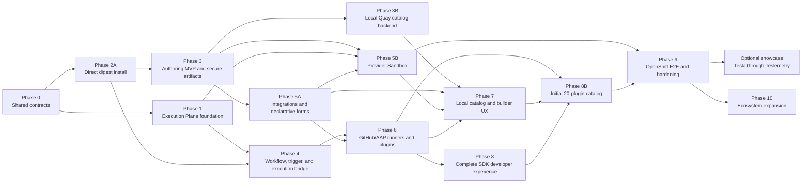

# Proposed Plugin Platform Implementation Plan

- Architecture proposal: [Native Plugin Platform for Syntara](plugin-platform-marketplace.md)
- Branch: `feature/plugin-platform-sdk-marketplace`
- Status: ARCHITECTURE ACCEPTED; PHASE 0 CONTRACT CORE IMPLEMENTED; PHASE 0.4 CROSS-REPOSITORY CONSUMER CHECKS IN PROGRESS; PHASE 1 SHARED CONTAINER ABI/DISPATCHER AND CREDENTIALLESS EP INVOCATION IMPLEMENTED LOCALLY, WITH POOL/POLICY/SECRET-DELIVERY HARDENING IN PROGRESS; PHASE 2A IMMUTABLE INSTALLED-PLUGIN/ACTION, ACTIVE-GENERATION, INTERNAL ENABLE/DISABLE, AND READ-ONLY ACTIVE-REGISTRY API FOUNDATIONS IMPLEMENTED LOCALLY, WITH OCI VERIFICATION, INSTALLATION API, DEPENDENCY-PROTECTED LIFECYCLE CONTROLS, OUTBOX, AND CATALOG HANDOFF ADAPTERS PENDING; PHASE 3 OFFLINE, DETERMINISTIC SDK PLUGIN-ARTIFACT AND CATALOG-INDEX ASSEMBLY PLUS BOUNDED LOCAL-DEVELOPMENT PUBLICATION IMPLEMENTED LOCALLY, WITH SCAFFOLD/CLI, IMAGE RESOLUTION, SIGNING, AND PRODUCTION CATALOG-UPDATE COORDINATION PENDING; PHASE 3B BOUNDED OCI INDEX/PLUGIN-ARTIFACT RETRIEVAL/VERIFICATION, CATALOG SOURCE/PROJECTION PERSISTENCE, CATALOG BROWSING, DOCUMENTATION HYDRATION, AND INTERNAL CATALOG-SELECTED CUSTOM-WORKLOAD INSTALLATION IMPLEMENTED LOCALLY, WITH CONCRETE PRODUCTION TRUST/AUTHORIZATION/IMAGE-ADMISSION ADAPTERS, SCHEDULED RECONCILIATION, AND BROWSER INSTALLATION FLOW PENDING; PHASE 4 STATIC TEMPORAL CONTAINER ACTIVITY, S2S EP CLIENT, SERVER-OWNED INSTALLED-ACTION REQUEST COMPOSITION, PUBLISHED-WORKFLOW ROUTE PINNING INCLUDING THE INSTALLED INTEGRATION-TYPE REVISION, AND IMMUTABLE PLUGIN-DECLARED CONNECTION-TYPE DEFINITIONS IMPLEMENTED LOCALLY, WITH CONNECTION-INSTANCE/POLICY RESOLUTION, CREDENTIAL LEASING, AND NODE EXPOSURE PENDING; LOCAL ON-PREMISES CATALOG IN INITIAL SCOPE; HOSTED MARKETPLACE AND CERTIFICATION DEFERRED
- Last updated: 2026-10-07

> **Important:** This plan does not authorize implementation, commits, pull requests, deployments, credential use, or upstream pushes. Work on a phase starts only after explicit approval. No upstream push occurs without separate explicit approval.

## Purpose

This plan converts the architecture proposal into independently reviewable work packages across Syntara, the Plugin SDK, first-party step types, the runtime Execution Plane, the separately deployed Provider Sandbox Service, and the downstream operator. It keeps contracts ahead of implementations, establishes one immutable digest-verification/install transaction before connecting catalog discovery to it, includes a local Quay-backed on-premises catalog in the initial product, keeps declarative providers as the GitHub/AAP default, verifies the optional executable-provider sandbox independently, tests local OpenShift before hosted OpenShift, and requires automated plus manual evidence at every gate.

The first product scope is an on-premises marketplace: build, sign, document, and publish at least 20 genuine installable Syntara plugins plus a signed catalog index to local Quay; connect that Quay source from the Syntara UI; reconcile, search, browse documentation, inspect, and install a selected plugin through the shared digest-verified transaction; configure, author, execute, update, and audit installed capabilities without rebuilding Syntara; prove one declarative GitHub trigger; and deliver the current built-in sub-workflow business requirement. Hosted/public marketplace operation, certification, partner onboarding, hosted promotion, trust badges, global withdrawal feeds, and publisher-supplied trigger services remain future work.

## First end-to-end demonstration scope

The first end-to-end demonstration proves the install-to-execution path with the smallest practical builder experience. A workflow author selects an installed action and provides a simple structured JSON input that Syntara validates against the action schema. Reusing an existing generic primitive-schema renderer is allowed, but building a new form renderer is not required for this demonstration.

| Included | Deferred |
|---|---|
| Plugin authoring and SDK validation; metadata and workload-image publication; local Quay catalog discovery and documentation; administrator approval/install; static schema validation; and execution of an approved action through the normal runtime route | Dynamic fields, custom UI layouts/widgets, publisher browser code, remote resource pickers, declarative or sandboxed form providers, Provider Sandbox deployment, OAuth and other interactive builder connection flows, and asynchronous form-state behavior |

The action contract still carries input, output, and error schemas, and the workflow stores structured values rather than presentation state. Future UI declarations and provider contracts must extend this stable data boundary rather than change installed action identities, persisted workflow values, artifact verification, or Execution Plane requests.

## Phase 1 implementation increment — shared container invocation

The first implemented Phase 1 increment is deliberately narrow and safe to run without credentials. It proves that an Execution Plane work item can select one action from a multi-action plugin image without using a per-action image, fixed command, or image entrypoint:

1. The SDK owns the versioned in-container `ContainerService` ABI. Its Health call advertises the immutable step revisions supported by the running image; Execute names one selected revision and supplies bounded JSON input plus an optional bounded, non-secret runtime context; Cancel addresses the invocation.
2. EP accepts a `workload_type="container"` work item only after it validates the shared `ContainerWorkloadRequest` contract. It starts the normal isolated, cold-start Kubernetes Job using the pinned image digest, confirms that the image advertises the selected step revision, and uses the SDK client to execute that action. EP forwards the runtime context unchanged after local JSON and size checks.
3. The same image may therefore serve many plugin actions, but the current EP lifecycle remains one cold-start pod per workflow-step attempt. There is no implied image or process reuse across workflow steps in this increment.
4. The legacy script protocol remains a compatibility adapter behind the same Kubernetes transport. The generic protocol is additive; it does not change published script workflow behavior.
5. `credentialLeases` are rejected when non-empty. This is intentional: the Credential Broker redemption and read-only temporary-file mount path must land before any credential-bearing plugin action is accepted. No secret values are passed in the generic work item, command line, environment, logs, or result envelope.

This execution-plane increment does not itself add catalog installation, runner/publisher pool separation, policy snapshots, broker redemption, or dynamic forms. Those remain in their named phases below. Its component and API tests exercise ABI health/action dispatch, safe terminal result/failure mapping, cancellation relay, generic request validation, and compatibility with existing script workloads.

Syntara now also registers one static generic Temporal container activity and an authenticated EP client foundation. The activity validates the same runtime contract, creates a retry-stable work-item identity from Temporal identity, signs a short-lived project-scoped service token with only `work-items:submit`, `work-items:read`, and `work-items:cancel`, then submits and polls the durable EP work item. The installed-action resolver, pure runtime-context builder, and a small application composer provide the credentialless request-composition seam: the composer accepts only a published workflow revision and workflow-step identity plus server-resolved invocation, connection-handle, grant, policy, and timeout state. It reads the durable action binding, re-resolves its immutable action revision, checks that the plugin digest/runtime ABI/image/runner-profile route still matches the stored snapshot, and only then builds the runtime context, policy snapshot, and request hash. The first publish-time action-route binding is now also local: it requires the action to be enabled in the active registry generation while publishing, validates static JSON input against the installed schema, and persists the server-resolved plugin digest, action revision, runtime ABI, image digest, runner-profile revision, and admitting generation against the workflow revision. A later disable cannot silently replace an already-published route. This is deliberately not a canvas/user-configurable node yet: connection and policy resolution records, expression typing, workflow-definition integration, and publication generation preconditions still have to be added before a dynamic workflow can call the composer. Exposing the activity before those records exist would let workflow input select an executable image or policy route and would violate the architecture. The local bridge also accepts only credentialless requests with inline object results; credential lease redemption, temporary secret-file mounts, and object-reference retrieval are separately gated work.

The first Phase 2A persistence increment is also now local. It creates immutable installed-plugin and installed-action rows plus complete generation membership and a singleton active-generation pointer. It verifies the bounded stored input/output/error documents are valid JSON Schemas. An internal resolver returns an image route and the immutable canonical action definition only when a requested immutable action revision is a member of the active generation; a browser or workflow still has no way to supply an image or alter that definition. Its internal enable/disable operation copies the complete snapshot and creates a new active generation rather than mutating an installed definition. It is not exposed publicly until workflow-reference/dependency protection is present. The service accepts a typed **post-verification candidate** only—it does not fetch OCI content, decode unverified manifests, evaluate signatures, expose an install API, or make a workflow node selectable. OCI verification, policy/grant records, source/catalog records, outbox propagation, dependency-protected lifecycle APIs, and the public administrator flow remain separate increments. Database-backed coverage runs locally on Podman through a short UNIX-socket forward with the Testcontainers cleanup sidecar disabled; this is a development-only test setup, not a production setting.

The first Phase 3 artifact increment is also now local in `syntara-plugin-sdk`. A successful pure workspace compilation can be assembled into a metadata-only OCI artifact with a canonical plugin-metadata layer, an exact-byte deterministic gzip/tar bundle for externalized schema and declarative `http.v1` mapping assets, an optional plugin-level UTF-8 Markdown document, and a versioned config asset index. The `http.v1` operation is deliberately narrow: method, origin-less relative path, and bounded field-to-JSON-Pointer-or-literal request/response maps. It has no executable expression, dynamic origin, header, credential, or network capability. The builder fixes archive timestamps, ownership, permissions, ordering, compression metadata, and OCI JSON ordering so identical compiler output produces identical bytes and manifest digest. The author supplies `spec.documentation.path`; the compiler permits only a bounded, contained regular `.md` file without NUL bytes, records its exact SHA-256 digest in the canonical descriptor, and includes the same bytes in the deterministic bundle that a later signing operation binds. The compiler also carries non-secret `IntegrationType` and `CredentialRecipe` definitions and validates their action linkage. It is deliberately offline: it does not build an executable image, resolve a tag, sign, upload, query a registry, create a catalog entry, or contact Syntara. UI, credential values, SBOM, provenance, signature, catalog publication, connection/OAuth exchange, and runtime HTTP execution remain separate source contracts or adapters.

The matching control-plane artifact increment is also local. A pure verifier checks the requested OCI manifest digest; config/layer descriptor media types, sizes, and digests; canonical metadata JSON; asset-index parity and typed schema/map source references; and the inert gzip/tar bundle under strict path, file-kind, ownership, permission, timestamp, count, size, and compression-ratio limits. The installer independently revalidates the intentionally small `http.v1` operation grammar before it binds the server-selected runner image, providing defense in depth against malformed artifact metadata. A narrow OCI client fetches a plugin artifact only by an accepted exact digest, and the verifier inspects its OCI envelope to produce a bounded config/descriptor/bundle fetch plan without decoding blobs. The catalog-documentation hydrator submits that immutable artifact digest to the configured source trust policy before fetching those planned blobs, rechecks the active source snapshot before persistence, verifies that the artifact identity and documentation digest match the accepted catalog entry, renders CommonMark with raw HTML disabled, sanitizes the result to a small HTML/link allowlist, and persists only the rendered HTML plus non-secret evidence. It never persists raw publisher Markdown. The source-qualified documentation API reads only that local rendered record; it has no registry or hydration capability. The separate internal catalog-install service follows the same exact-digest and source-lock sequence, admits the plugin artifact before blobs and each publisher workload image before persistence, and then hands one validated candidate to the immutable registry transaction. It accepts action-only custom-workload plugins with one inherited root workload image. It also accepts action-only platform-runner plugins only when a server-owned resolver binds each versioned driver, such as `http.v1`, to an approved immutable profile; the artifact author, workflow author, and browser cannot name an image. Runner-profile persistence now records a stable driver identity, immutable admitted image/ABI revisions, and the exact selected revision on every installed platform-runner action. The ABI now reserves an optional bounded non-secret runtime context; for `http.v1`, a trusted pure builder now derives and schema-validates only the installed operation and output-schema digest. A second trusted pure composer validates structured workflow input and joins the resolved action, invocation identity, connection handle, policy references, runtime context, and credentialless capability snapshot into one hash-bound `ContainerWorkloadRequest`. The contracts package owns its strict canonical-JSON hash rule; EP independently recomputes it and rejects a modified request before persistence. It cannot contain an endpoint, authorization header, credential, image, or asset reference. Connection/credential resolution and the application adapter that obtains those trusted inputs from a published workflow remain separate work, so no default profile exists and an unconfigured deployment continues to fail closed. Triggers remain rejected. It has no HTTP/browser entry point. A browser component, direct-digest adapter, runner-profile administration/composition, and trigger installation remain separate increments.

The shared runtime now also includes the pure `http.v1` mapper: it validates
the installed operation, safely renders one relative request path, maps an
optional JSON request body, and projects declared response fields. It has no
endpoint, HTTP transport, credential, retry, or logging capability. The later
Syntara-managed runner owns those capabilities and may use this shared mapper
without duplicating operation semantics.

`syntara-step-types` now keeps a small conformance test for its real GitHub
workspace. The test compiles the author-owned YAML, reads the resolved
declarative operation from the compiled descriptor, and runs it through the
shared mapper. It has no copied mapping implementation and no GitHub,
registry, Syntara, or Execution Plane dependency.

## Approval and change control

The following controls apply to every phase:

1. Present the phase design, affected repositories, migrations, security assumptions, test plan, and manual actions.
2. Wait for explicit implementation approval.
3. Implement only the approved phase on local feature branches.
4. Run unit, contract, integration, security, end-to-end, and manual tests appropriate to that phase.
5. Review code structure, maintainability, security, documentation, and test quality before proposing completion.
6. Present diffs and evidence for review.
7. Do not commit, open a pull request, deploy to a hosted environment, or push upstream without explicit approval for that action.

An architecture change that alters an accepted contract returns to architecture review before implementation continues. An implementation detail that does not change an accepted boundary may be resolved within the phase and documented in its evidence.

## Completion handoff: laptop setup and data inspection

End-to-end completion includes an operator/developer handoff, not merely passing automated tests. Before asking the user to run the local acceptance environment, the implementation owners must provide and verify a clean-laptop runbook. It will name the exact supported versions and installation commands for the chosen local stack, rather than asking the user to infer tools from individual repository READMEs.

The runbook must cover:

- required developer tools: Git, the pinned Python/`uv` toolchain, the supported Node/package-manager toolchain, Podman plus its Compose support, the selected local OpenShift distribution, local Quay, and the supported Kubernetes/OpenShift CLI;
- optional but recommended inspection tools: the PostgreSQL `psql` client and DBeaver Community or an equivalent local SQL client;
- a preflight/"doctor" command that checks versions, container runtime access, disk and memory capacity, local OpenShift readiness, registry reachability, required images, certificates, and database connectivity without changing production or hosted resources;
- one documented start/status/stop/reset path for Syntara, Temporal, EP, local Quay, and the selected local OpenShift deployment, including where logs, generated test credentials, and safe teardown information live; and
- a troubleshooting table for the likely local failures: image pull/trust errors, database migrations, certificate trust, unavailable EP targets, registry authentication, and workload NetworkPolicy/CNI enforcement.

The user must be able to inspect the same state through two complementary read-only paths:

| View | Intended user | Required information |
|---|---|---|
| Syntara product UI | Administrator and workflow author | Catalog source and reconciliation state; catalog entry count; plugin identity/version/digest/signer; documentation; installation/generation state; installed actions/triggers; image/runtime binding; policy denial; and execution/audit status. |
| Local database inspection | Developer and operator | Read-only, documented queries or views for catalog sources and entries, verified artifacts, installations and active generations, action/trigger definitions, image bindings, workflow revision references, EP work items, and sanitized terminal results. |

The database path must use a least-privilege read-only local role. It must never reveal OAuth tokens, private keys, plaintext credentials, credential lease contents, encrypted payload ciphertext, or Temporal task tokens. The product UI remains the normal operational interface; the SQL client is a local development and support aid, not a second control plane.

## Recommended architecture baseline

| Area | Recommended decision for review |
|---|---|
| External action execution | Every external plugin action step uses one generic Temporal `Container` activity and one Execution Plane contract. |
| Runtime ownership | Platform-runner steps use platform-owned images; custom-workload steps use publisher-owned images. Both are pinned by digest and use the same workload ABI. |
| ABI authoring | Individual action manifests do not repeat `abi`. Kind A inherits the exact ABI from the admitted runner profile; the SDK infers the single compatible Kind B/provider default and materializes it in canonical output. Any future multi-major selection occurs once at the root workload/provider binding or explicit build request. |
| Workflow model | Native orchestration nodes remain strongly typed. Externally installed actions and declarative triggers use separate immutable revision-pinned generic envelopes. |
| Plugin triggers | Plugins may contribute declarative triggers over Syntara-owned drivers. Install registers a trigger type; workflow publish creates the concrete activation. Publisher listener code is deferred pending a separate Trigger Service design. |
| Sub-workflow requirement | Built-in parent `Execute Sub-workflow` and child `Sub-workflow Trigger` nodes run through Temporal. The child revision is resolved from latest published at call start and then pinned for retry/replay. They are not plugin action workloads. |
| Image routing | The server resolves installed step revision → administrator-admitted runner-profile revision or custom workload → immutable image digest. Workflows and users cannot supply an image route. |
| Publisher image authoring | Author source uses logical image IDs. V1 permits zero or one plugin-level workflow workload inherited by all Kind B targets; sandboxed providers use separate logical image IDs. Every SDK adapter supplies the same explicit image-binding build request, and the signed canonical artifact stores each full `repository@digest` reference once. |
| Image distribution | Registry/repository/tag defaults are previewed, explicit build inputs recorded in the build report, and tags resolved before signing. Mirrors may change the effective pull repository only while preserving the canonical digest. Multiple workflow workload images require separate plugins in v1. |
| Identifier versioning | Version independently negotiated manifests, ABIs, drivers, broker mechanisms, form components, services, APIs, and media formats. Keep integration, credential, provider, step, operation, logical-image, discriminator, and field identities unversioned; immutable installed revisions pin their exact definitions. |
| SDK contracts | JSON Schema 2020-12 plus JSON/OpenAPI are normative for durable artifacts and work-item envelopes. The canonical `ContainerService` protobuf defines only the in-container workload data channel. A later local SDK authoring gRPC adapter is a separate protocol. |
| SDK packaging | One repository publishes `syntara-plugin-contracts`, `syntara-plugin-runtime`, and `syntara-plugin-sdk`. |
| Common plugin code | Runtime, interfaces, schemas, validation, diagnostics, fixtures, and conformance code live in the SDK repository and are imported by concrete implementations. |
| Plugin types | Concrete first-party runners, GitHub/AAP action and declarative trigger definitions, form bindings, examples, tests, and image build inputs live in `syntara-step-types`. Built-in sub-workflow nodes remain in Syntara. |
| Catalog and installation | An administrator connects a local Quay signed-index source from the UI. Catalog selection and direct-digest recovery both call the same immutable digest-verification/install transaction; reconciliation never installs or enables content. |
| Signing | Support local test keys, connected-production keyless identities, and offline organization trust roots. Development identity cannot satisfy production policy. |
| Execution isolation | Platform-runner and publisher-workload executions use separate pools/namespaces from the first release. |
| Dynamic forms | The architecture supports declarative providers plus optional digest-pinned executable providers through a separately deployed Provider Sandbox Service. They are explicitly outside the first end-to-end demonstration. No publisher code is imported into Syntara or the browser; Temporal and runtime EP are not used while editing forms. |
| Provider sandbox | Sandboxed providers use `syntara.provider/v1alpha1`, a distinct service/API audience, namespace, queue, worker pool, capability grant, and short-deadline lifecycle. They receive no ambient identity, direct secret-store access, or unrestricted egress. |
| Authentication | Plugins contribute credential schemas and bounded issuance recipes; Syntara owns allowlisted broker mechanisms, secret storage, approved endpoint revisions, crypto/token exchange, refresh/revocation, and opaque handles. GitHub and AAP support user OAuth and project/service credentials with explicit execution identity. |
| Catalog UX | The initial UI manages local Quay sources, reconciliation state, search/filter/pagination, documentation, versions, and a Backstage-inspired Plugin Inspector for at least 20 plugins. Backstage is a design reference, not a runtime dependency. |
| Trust display | The initial UI displays signer identity, index/plugin digest, source/generation, available evidence, local policy result, requested capabilities, and runtime ownership. Certification labels are deferred. |
| Deployment validation | Test local OpenShift and local Quay first. Use hosted OpenShift only after local acceptance and separate approval. |
| Legacy migration | Preserve existing Temporal activity names and published workflow histories with replay-safe shims. Build new external plugins side by side; do not silently migrate workflows. |

## Repository ownership and planned changes

| Repository | Planned changes | Explicit exclusions |
|---|---|---|
| `syntara-plugin-sdk` | Action/trigger manifest, trigger-driver declaration, credential-recipe, workflow-workload, provider-sandbox, and catalog-index contracts; canonical fixtures; stable diagnostics; minimal workflow/provider runtimes; plugin/runner/provider interfaces; conformance harnesses; deterministic artifact/image and signed catalog-index build/publication; signing, optional SBOM/provenance, public Python API, CLI, and later RPC/LSP support | Syntara catalog/install state, OAuth token storage, workflow orchestration, trigger listeners, runtime/provider scheduling, concrete GitHub/AAP behavior, hosted marketplace or certification services |
| `syntara-execution-plane` | Runtime work API/store, idempotency, placement, workload lifecycle, separate platform/publisher pools, policy snapshots, credentials, egress, cancellation, heartbeat, results, outbox, reconciliation, and observability; plus a separately deployed Provider Sandbox Service reusing generic isolation primitives under distinct APIs, identities, namespaces, queues, pools, grants, and SLAs | Catalog resolution, form semantics, credential storage, step-specific GitHub/AAP logic, workflow semantics, or treating provider calls as runtime work items |
| `syntara` | Local Quay source configuration, credential/CA references, signed-index reconciliation, catalog/documentation projections, catalog search/detail/inspection APIs and UI, immutable direct/catalog digest installation, local policy/trust evaluation, installed action/trigger definition and endpoint persistence, dynamic registries, separate generic external-action and declarative-trigger nodes, trigger drivers/activation/ingress, built-in sub-workflow nodes, Temporal/EP bridge, credential/OAuth broker mechanisms, provider gateway, `FormProviderService`, Provider Sandbox dispatch client, dynamic forms, installed-plugin UI, lifecycle controls, and replay shims | Plugin build logic, publisher trigger-listener programs, concrete workload/provider images, plugin-provided browser or in-process backend code, direct Kubernetes workload management, raw private-key delivery to providers, hosted marketplace or certification services |
| `syntara-step-types` | Concrete HTTP/AAP/script runner images; the initial 20 signed, documented plugins and their action/trigger definitions, forms/provider bindings, credential recipes, tests, and image/catalog publication inputs; a minimal custom-workload example; and one minimal sandboxed-provider reference image | Copied SDK runtime, plugin catalog/install/trigger-activation persistence, built-in sub-workflow nodes, executable trigger listeners, Temporal activities, runtime/provider infrastructure, executable frontend extensions |
| `automation-orchestrator-operator` | Deployment configuration, CRD/operator wiring, secrets/trust configuration, runtime EP and Provider Sandbox Service/pool resources, identities, namespaces, network policies, observability, upgrade/rollback, and local/hosted OpenShift validation | Plugin authoring behavior, credential-broker business rules, hosted marketplace services, or duplicate control-plane policy engines |

Implementation work in each repository will use a local `feature/plugin-platform-sdk-marketplace` branch. Existing PRs are references for selected behavior and tests; no implementation branch is based on a PR head and no PR is cherry-picked wholesale.

## Delivery map



## Phase 0 — Shared contract core

### Objective

Create the smallest candidate contract foundation before any repository implements plugin-platform behavior.

### Planned work

- Start from the merged Plugin SDK PR 6 baseline on current `devel`: preserve the root `plugin.yaml`, explicit ordered targets, plugin-level namespace/version/authorship, canonical step identity/content digest, path-contained discovery, digest-pinned workload validation, plugin metadata layer, and its existing tests. Extend these compiler/discovery services; do not fork or replace them with a second compiler.
- Establish the three Python distributions in `syntara-plugin-sdk` with one-way dependencies: SDK → runtime → contracts.
- Inventory current SDK, Syntara, step-types, and EP models and produce an explicit migration map.
- Define `v1alpha1` JSON Schema/OpenAPI contracts for plugin manifests, separate action and trigger targets, Syntara-owned trigger-driver declarations and event mappings, installed identity, runner/provider image bindings, integration endpoint revisions, credential issuance recipes, dynamic inputs, declarative and sandboxed provider requests/results, signed catalog indexes and entries, catalog source/status safe projections, credential/CA references, policy snapshots, runtime work items, workflow-workload and provider-sandbox requests/results, progress, errors, and cancellation.
- Define and enforce one identifier grammar: `/vNalphaM` or `/vNbetaM` for prerelease schema/ABI groups, `.vN` for stable independently negotiated major contracts, transport-appropriate versions for REST/media types, and no version suffix for stable domain identities or vocabulary inside a versioned containing contract.
- Define the v1 OCI artifact/config/manifest/content-bundle media types, deterministic bundle format, asset-index schema, explicit `DocumentSource<T>` inline/asset union, synthetic inline locations, safe relative-path resolver, canonicalization, identifier, SemVer, digest, compatibility, size, decompression, recursion, and local-reference rules.
- Extend one versioned root-and-target source model shared by YAML, typed Python builders, CLI/LSP/IDE scaffolding, and the canonical compiler. The root `plugin.yaml` owns plugin-wide definitions and an explicit target list; targeted action manifests own step-local schemas, UI, runtime operations, and capabilities; targeted trigger manifests own configuration/output schemas, UI, admitted trigger-driver selection, event mapping, and capabilities. Do not create an independent convenience DSL or directory-scanning discovery path with different semantics.
- Make executable images single-source in author input: define zero or one root logical workflow-workload ID inherited by every Kind B target and separate logical IDs for sandboxed providers. Define one typed image-binding request shared by Python, CLI, RPC, IDE, CI, and hosted adapters; resolve its explicit registry/repository/tag inputs to digests and materialize each full reference once in the canonical signed inventory.
- Keep ABI selection single-source: reject `abi` in individual source action manifests; resolve Kind A through the admitted runner profile; infer the only compatible Kind B/provider ABI from the runtime kind; validate it with conformance evidence; and materialize the exact selected ABI in the canonical descriptor, installed binding, and runtime request. If more than one ABI major becomes compatible, require one explicit root workload/provider or build-request selection and reject target-level overrides.
- Treat the current PoC `spec.images`, target-level full image references, `StepType` manifests, direct entrypoints, and Draft-07 schema as retired inputs. Do not implement a compatibility parser or migration patch in Phase 0. The v1alpha1 logical-image model is the only supported authoring model; fixtures and documentation are replaced rather than translated.
- Define stable diagnostics and reason codes independent of CLI or transport strings.
- Define the provider-neutral runtime failure envelope, including category, safe message, retryability, outcome certainty, sanitized provider metadata, and correlation ID.
- Add valid, invalid, edge, and malicious canonical fixtures.
- Add catalog fixtures covering a valid 20-plugin index, duplicate/colliding identities, invalid documentation, wrong-source entries, lower/replayed/expired generations, broken predecessors, and unsupported plugin contracts.
- Provide workflow-workload and provider-sandbox conformance harnesses every owning repository can run against the same fixtures.
- Freeze the exact Temporal boundary: workflow history contains pinned identifiers and deterministic values; mutable lookup, policy resolution, handle minting, and EP submission occur inside the retry-safe activity.
- Freeze the trigger/control-flow boundary: installation registers inert trigger definitions; publication creates immutable trigger activations; event ingress authenticates, bounds, deduplicates, maps, and starts the pinned workflow; action/runtime EP and form-provider paths cannot be used as trigger listeners.
- Freeze the sub-workflow contract: parent `Execute Sub-workflow`, child `Sub-workflow Trigger`, typed input/output mapping, callable/permission/cycle checks, latest-published resolution once at call start, exact child-revision pinning, synchronous result/error/cancellation behavior, and execution-view linkage.
- Resolve the architecture reviewer concerns for integration metadata transport, attempt-scoped credential leases, policy snapshots, DNS-aware egress, confidential values, typed URL interpolation, Kind B residual credential trust, sandbox-to-broker capabilities, provider publisher trust, and runtime/provider service separation before declaring either ABI frozen.

### Verification

- Unit and property tests for canonicalization and validators.
- Golden tests for diagnostics and deterministic normalized documents.
- Golden source-to-canonical fixtures proving YAML, Python builders, CLI scaffolds, and editor-generated patches compile the same root, explicit targets, derived identities/versions, inherited workload binding, explicit image-resolution request, canonical digest inventory, normalized manifest, and assets.
- ABI materialization tests proving concise source manifests omit ABI, Kind A runner profiles and Kind B/provider defaults resolve deterministically, canonical descriptors and installed/runtime bindings retain the exact value, target-level repetition/override is rejected, and an explicit root/build selection is required only when multiple ABI majors are valid.
- Image-binding property tests covering zero-image Kind A plugins, one shared Kind B workload, separate provider images, unresolved/unknown/duplicate IDs, conflicting compatibility inputs, multiple-workload rejection, tag-to-digest resolution, changed-tag races, hidden-configuration leakage, and build-report completeness.
- Identifier grammar and compatibility tests proving contract selectors require the approved version form, domain identities reject mechanical `.v1` suffixes where prohibited, compatible changes remain within a major contract, and incompatible negotiated contracts require a new major identifier with an explicit coexistence/migration fixture.
- Malicious YAML/JSON, bare-string/unknown document-source kind, archive/link/device entry, path traversal, Unicode/case collision, duplicate/unindexed asset, reference cycle, media-type mismatch, inline/asset canonical-equivalence, regex, markup, oversized input, decompression-ratio, and archive-bomb tests.
- Cross-package dependency test proving the runtime does not import authoring/OCI/server dependencies.
- Consumer smoke tests in Syntara, step-types, runtime EP, and Provider Sandbox Service against the exact fixture version.
- Contract fixtures proving action targets cannot create trigger activations, trigger targets cannot name workload/provider images, and sub-workflow built-ins are not installable plugin targets.
- Owner review from all five repositories plus product security.

### Exit gate

Reviewers accept the candidate contracts, fixtures, resolved questions, compatibility policy, and package boundaries for both workload classes. No control-plane or execution feature is required yet.

### Phase 0 readiness decisions and delivery increments

The Phase 0 implementation-readiness review completed on 2026-10-06. These decisions constrain implementation, but do not themselves authorize code changes, commits, or pushes.

- **Full Phase 0 scope, delivered as smaller increments:** retain every approved Phase 0 contract family and its complete security/negative-test requirements. Review and test the work in four ordered increments instead of one large change.
- **PoC clean break:** `syntara-plugin-sdk` and `syntara-step-types` are unreleased PoCs. Remove or replace their legacy packages, imports, CLI behavior, schemas, fixtures, and documentation as necessary. Do not add a legacy facade, compatibility parser, deprecation window, or migration tooling.
- **Python workspace:** use one `uv` workspace with three independently buildable distributions and a single lockfile: `syntara-plugin-contracts`, `syntara-plugin-runtime`, and `syntara-plugin-sdk`. Dependencies are one-way: SDK → runtime → contracts. The runtime must not import authoring, OCI, CLI, or control-plane dependencies.

| Increment | Scope | Required evidence before the next increment |
|---|---|---|
| 0.1 — Contract spine | Complete locally: three-distribution workspace, JSON Schema 2020-12 bundle, version/identifier grammar, root/action/trigger source contracts, `DocumentSource`, local references, and deterministic bundle digest. | Met: isolated wheels build and positive/negative fixtures pass. |
| 0.2 — Canonical authoring core | Complete locally: explicit root/target compilation, canonicalization, structured diagnostics with YAML locations, logical workload/provider image bindings, ABI materialization, and canonical asset indexing. | Met: YAML/typed and inline/asset output are byte-identical; hostile path/archive/duplicate/Unicode-case/size/recursion tests pass. |
| 0.3 — Runtime and provider contracts | Complete locally: work-item, request/progress/result/failure/cancellation, credential-lease, policy-snapshot, workflow-workload binding, provider request/result, and schema-only conformance harnesses. | Met: runtime imports only contracts; positive/malicious workload/provider fixtures pass; ownership and provider ABI materialize deterministically; no executable workload is started. |
| 0.4 — Catalog/control-plane fixtures and consumers | In progress: the SDK owns signed catalog-index, catalog-source/status, integration/credential recipe, trigger-driver/event mapping, installed-identity contracts, and a self-contained pinned fixture bundle in the contracts distribution. Syntara and EP have fixture-only consumer checks using standard local editable-source dependency patterns; EP's dependency is development-only and does not add catalog behavior to the deployed runtime service. Step-types and Provider Sandbox checks remain pending until their owners establish approved implementation baselines. | Every consumer accepts the exact fixture digest; incompatible/expired/replayed/wrong-source fixtures fail with stable codes; cross-package dependency, compatibility classification, and full conformance checks pass. |

The shared contract pipeline is:

```text
authoring YAML or typed model
        |
        v
contracts validation -> canonical compiler -> immutable fixture bundle
        |                    |                       |
        |                    v                       v
        |              stable diagnostics      SDK/runtime conformance
        v                                            |
valid, invalid, malicious corpus                       v
                                           Syntara / EP / step-types smoke checks
```

## Phase 1 — Execution Plane foundation

### Objective

Generalize the useful durable mechanics from Execution Plane PR 1 into the proposed generic execution service.

The first SDK-owned building block is complete locally: the canonical
`ContainerService` protobuf source, generated Python binding, and generic
multi-action dispatcher. It proves that one image can advertise and dispatch
multiple immutable step revisions while accepting only bounded JSON and mounted
credential-file paths. It deliberately does not change the existing EP
script-specific protocol or make an EP API public. The next approved change is
an EP adapter that consumes this ABI through the generic work-item path.

### Planned work

- Implement authenticated submit, inspect, cancel, heartbeat/progress, and result delivery for the generic work item.
- Implement durable idempotency, claim/fencing, retry, outbox, reconciliation, terminal cleanup, and recovery.
- Implement policy-snapshot validation and fail-closed cache/outage behavior.
- Implement attempt-scoped, just-in-time credential lease materialization without placing plaintext in the durable work record.
- Implement digest-only workload admission and server-owned command/ABI construction.
- Create separate platform-runner and publisher-workload namespaces, service accounts, quotas, admission rules, and placement policies.
- Enforce egress through policy-aware proxy/DNS controls, including redirect, rebinding, raw-IP, and DNS-exfiltration defenses.
- Implement request/result files, sidecar progress channel, SIGTERM/SIGKILL cancellation, output bounds, and cleanup.
- Add correlated metrics, audit records, structured errors, and operator health.

### Verification

- Unit tests for state transitions, request hashes, fencing, retries, cancellation, and cleanup.
- Database and process-restart integration tests.
- Kubernetes/OpenShift workload lifecycle tests with arbitrary UID, read-only filesystem, least-privilege service accounts, and no privilege escalation.
- Security tests for forged submitters, replay, image mutation, policy mismatch, credential replay, cross-environment access, proxy bypass, DNS exfiltration, and secret leakage.
- Resilience tests for API/worker crashes, callback loss, pod loss, stale claims, notification loss, and duplicate delivery.
- Performance baseline for queue, start, and result throughput.

### Exit gate

The EP can execute SDK conformance fixtures for both runtime ownership classes without GitHub/AAP-specific behavior.

## Phase 2A — Direct digest installation

### Objective

Prove the complete immutable installation transaction before catalog automation can call it.

### Current local increment

The active immutable registry now has a safe read-only product API. `GET /plugin_registry` returns the current generation, its safe publication metadata, and a paginated list of installed plugin revisions with their enablement state and action count. `GET /plugin_registry/{namespace}/{name}/versions/{version}` returns the same pinned revision plus its validated action input/output/error schemas and exact admitted image digest. The API neither resolves an OCI reference nor chooses an image, contacts a registry, resolves a secret, or exposes canonical descriptors, verification evidence, credentials, or trust-policy references. Disabled revisions remain visible for diagnosis but remain unavailable to the execution resolver. The endpoint is protected by the new non-secret `plugin_registry:read` permission for administrators, auditors, and users, and its OpenAPI and generated TypeScript contract are synchronized with the runtime export.

### Planned work

- Add immutable plugin, canonical installed-asset, integration-type, integration-endpoint, credential-type/issuance-recipe, action-step, trigger-type, declarative/sandboxed form-provider, runner-profile, provider-image-binding, grant, installation, generation, and audit persistence. Trigger installation stores definitions only; no endpoint, schedule, subscription, poller, or listener is activated in this phase.
- Add a direct digest resolve/verify/install API and administrator review flow.
- Verify the signed plugin artifact manifest and every config/layer descriptor before decoding; stream and verify the exact asset index/content bundle without filesystem extraction; then verify referenced runner, workflow-workload, and provider images before selectable persistence.
- Enforce repository/namespace ownership, identity, signature mode, compatibility, capability, egress, runner profile, custom-workload, and executable-provider policy. Enforce provenance, SBOM, and scan evidence only when the environment's local admission policy requires it.
- Use a staged generation followed by an atomic active-generation pointer flip.
- Derive exact installed action and trigger revisions from canonical IDs. Derive image bindings only for action workloads/providers and do not permit workflow/plugin image overrides; declarative trigger targets cannot name executable images. Store the canonical source repository/digest separately from an environment-effective mirror pull reference, and require digest equality.
- Add enable, disable, revoke, side-by-side version, dependency-report, and protected uninstall foundations for plugin, runner, workload, endpoint, and provider-image revisions.
- Extend the active-registry read API with trigger definitions when trigger installation exists, and with lifecycle/audit/dependency views only after their persistence and authorization models exist.

### Verification

- Unit and database tests for every install state, inline/asset source, bare-string rejection, asset-resolution failure, canonical installed-asset record, compiled local reference, and rollback boundary.
- Concurrency tests for duplicate installs, conflicting sources, generation publication, and notification loss.
- Security tests proving signature verification occurs before decoding any plugin config/layer or writing any candidate definition or asset row.
- Direct digest manual test using local Quay and safe test keys.
- Database inspection with a user-selected PostgreSQL client to verify immutable rows, active generation, and audit evidence.

### Exit gate

A plugin can be installed, inspected, enabled, disabled, revoked, updated side by side, and protected from unsafe removal by digest. This transaction is ready to accept an immutable digest selected by the later local catalog without changing its trust or persistence rules.

## Phase 3 — Authoring MVP and secure artifact production

### Objective

Deliver the minimum friendly authoring-to-artifact workflow and produce plugin and catalog artifacts that the Phase 2A direct-install transaction and Phase 3B catalog can verify.

### Current local Phase 3 increment

Completed locally: the shared Python authoring API now assembles compiler output into an OCI image-manifest artifact with artifact type `application/vnd.syntara.plugin.v1`, a versioned config blob, a canonical plugin-metadata layer, and a deterministic gzip/tar content bundle. The config inventory records normalized asset path, typed source reference, exact source-byte SHA-256, byte size, media type, and canonical parsed-document digest. It also assembles a contract-validated `CatalogIndex` into a deterministic OCI artifact with artifact type `application/vnd.syntara.catalog-index.v1`, a versioned config blob, and one canonical JSON content layer. Tests prove byte-for-byte repeatability, exact archive bytes, fixed archive metadata, OCI layer descriptors, malformed in-memory asset rejection, normalized asset-path rejection, catalog identity uniqueness, and catalog time-window validity. The matching control-plane verifier currently proves plugin descriptor/blob integrity and safely streams the bundle before trust or persistence. The artifact builders remain pure and offline. Separately, the SDK now provides a deliberately bounded catalog-index publisher: it uploads only a pre-built index's two blobs, advances one explicit channel, defaults to HTTPS, permits HTTP only for an explicit loopback local-development target, and follows a registry Bearer challenge only when the token realm has the same origin. It neither signs, builds, nor generically publishes plugin metadata or workload images, and it retains credentials only in memory for that call.

The control plane also now has the first local-catalog staging boundary. Given an already integrity-verified, trust-approved catalog index, it serializes one source's reconciliation, records every accepted, rejected, or stale observation with its generation/digest/time evidence, rejects cross-source pointers, scope violations, replays, conflicts, broken predecessor chains, and expiry, and atomically makes only an accepted immutable version projection active. Exact retries reuse the active projection. This boundary intentionally does not resolve a registry channel, obtain a credential, verify a signature, install a plugin, or execute anything; the following orchestration/API increment owns those concerns.

The compiler now retains external asset provenance separately from resolved schema semantics. Consequently, an inline schema and an external schema with identical parsed JSON have identical action semantics, but their artifacts differ where the external source bytes are intentionally part of the signed content inventory. This preserves both a simple inline authoring experience and independently verifiable external files. The initial Python `syntara-plugin` command is also available for one safe YAML workspace scaffold plus offline `validate` and canonical `inspect`. It delegates directly to the public compiler, refuses to overwrite an existing workspace, and neither resolves images nor performs registry, signing, network, or credential operations.

### Planned work

- Extend the existing path-contained root/target compiler with deterministic source compilation, generated schema/UI/mapping/credential-recipe assets, logical-image binding resolution, canonical digest-inventory materialization, OCI assembly, and inspect operations, including typed inline/asset authoring support, generated synthetic inline locations, the config/asset index, root-manifest layer, normalized content bundle, per-asset source digests, and byte-for-byte reproducibility diagnostics.
- Extend the initial safe `plugin.yaml` plus one targeted-action scaffold and thin `init`/`validate`/`inspect` CLI with typed Python builders and CLI operations for add-step, preview, test, and build. The generic HTTP/custom-workload and credential/provider templates must emit reviewable source and require no hand-written generated JSON, duplicate image inventory, repeated registry paths, or per-target ABI fields. Kind B scaffolds declare one root workload logical ID; target manifests inherit it, and the compiler materializes the inferred default ABI only in canonical output.
- Add one versioned typed build request for logical image bindings and any advanced multi-major ABI selection. Registry/repository/tag values, inferred default ABI, and any SDK-proposed defaults must be displayed in preview and recorded in the build report; machine-global hidden state must not alter canonical output silently. Resolve tags once, detect mutation during build/signing, and emit only immutable `repository@digest` canonical references plus the exact materialized ABI.
- Generate safe UI defaults, bounded mapping/credential-recipe documents, minimum-capability explanations, source-located diagnostics, and local fixtures through the same compiler used by every adapter.
- Add digest resolution for plugin, runner, the single plugin workflow workload, and provider images; optional SBOM/provenance generation; and Cosign signing/verification integration.
- Support local test keys, connected keyless identity policy, and offline organization trust roots.
- Add registry attachment capability detection, standards-compatible fallback, and disconnected verification fixtures for signatures and optional evidence.
- Add deterministic catalog-entry and signed catalog-index generation/publication with source ID, monotonic generation, issue/expiry time, predecessor digest, normalized non-secret metadata, documentation references, and immutable plugin artifact digests.
- Add safe catalog-update behavior for concurrent publisher pipelines: build a candidate index from an exact predecessor, reject lost updates, sign the complete candidate, and publish the mutable channel only after the immutable index artifact succeeds.
- Prove that SDK output installs through the exact Phase 2A direct-digest transaction.

### Verification

- Byte-for-byte deterministic config, root/target manifest, bundle, canonical image inventory, build report, and complete artifact tests across clean workspaces and supported platforms.
- Source-to-canonical golden tests for YAML, Python, scaffolded, inline, and external-asset inputs plus a clean-workspace usability test that builds a simple `plugin.yaml` and explicit target without editing generated output, maintaining duplicate image declarations, repeating a pull reference, or declaring ABI per target.
- Cross-adapter tests proving the same typed image-binding request produces the same canonical inventory and artifact digest through Python and CLI first, then RPC/IDE/hosted adapters as introduced. Negative tests cover missing bindings, unknown logical IDs, multiple Kind B workload IDs, compatibility-input disagreement, mutable/floating tags, digest changes during resolution, and unrecorded SDK defaults.
- Signing tests for valid, unsigned, wrong identity, tampered, expired identity, revoked local trust root, repository-binding, and offline-root cases.
- Catalog generation golden/property tests for deterministic ordering, duplicate identity/version rejection, monotonic generation, predecessor binding, expiry, documentation metadata, concurrent-update conflict, and byte-identical output across SDK adapters.
- Local Quay integration tests including attachment fallback and mirror behavior.
- Manual test proving the SDK-produced digest creates the expected normalized installation records through the direct-install API.

### Exit gate

An unfamiliar developer can scaffold, validate, preview, test, build, sign, document, inspect, and publish a simple plugin without hand-writing generated JSON, maintaining an image inventory, repeating registry paths, or selecting an ABI while the runtime kind has one compatible default. A Kind B author supplies one explicit image mapping for the plugin workload; preview and the build report show the final repository/digest/ABI binding. The SDK can deterministically add the immutable artifact to a signed local catalog index, and the artifact installs from its explicit digest against local Quay without bypassing direct-install policy.

## Phase 3B — Local Quay catalog backend

### Objective

Turn a configured local Quay signed-index source into a safe searchable catalog projection without installing or executing plugin content.

### Current local Phase 3B increment

Completed locally: Syntara now has a bounded, offline verifier for the SDK's catalog-index OCI artifact. It verifies the immutable manifest and blob digests, exact versioned OCI media types, canonical config and content bytes, contract-bundle digest, configured source identity, generation and entry-count bindings, and catalog schema/invariants. A narrow OCI Distribution client can resolve only the configured index repository/channel, bind the returned `Docker-Content-Digest` to the returned bytes, refetch that immutable manifest, and retrieve a size-bounded digest-addressed blob. It follows no redirects, never lists registry repositories, and accepts only backend-resolved authorization material. The database now also persists normalized catalog-source configuration with opaque credential/trust/custom-CA references, immutable accepted/rejected/stale reconciliation observations, and immutable catalog-version/asset snapshots. The source's active pointer can select only one fully accepted snapshot; catalog/source deletion has no relationship to installed-plugin records. A reconciliation staging service accepts an already trusted artifact handoff, atomically persists accepted projections, and preserves observed immutable coordinates plus safe rejection/staleness reasons. It rejects source/repository mismatches, out-of-scope artifacts, expired indexes, replayed or conflicting generations, and broken predecessor chains.

The local reconciliation orchestrator now supplies that trusted handoff through explicit injected boundaries: a backend-owned authorization resolver, configured channel-to-digest OCI resolution, immutable digest refetch, OCI-envelope inspection, digest-specific trust admission before either blob is fetched, bounded blob retrieval, and canonical artifact verification. It snapshots source configuration before network work and the staging transaction rechecks a configuration fingerprint under its source lock. This prevents a result obtained under superseded registry, repository-scope, credential-reference, trust-policy, CA-reference, or mirror settings from becoming active. No permissive authorization or trust evaluator exists; malformed adapter output and unsafe evidence are rejected, and only small non-secret trust evidence is persisted.

The first concrete trust evaluator is also local: `PinnedCosignTrustEvaluator` maps a source-selected opaque policy reference to a deployment-owned pinned Cosign public key, HTTPS registry origin, repository-prefix scope, and canonical plugin-namespace allowlist. It invokes Cosign for an exact digest only, fails closed on unavailable/timeout/denial results, records only policy/key-fingerprint/log-mode evidence, and never uses the host Docker credential store. Transparency-log verification is required unless the administrator policy explicitly permits offline signatures. The first subprocess implementation intentionally supports public, system-trusted registries only; secret-safe private-registry and custom-CA bridging, provenance/SBOM requirements, workload-image admission, and application-factory composition remain pending.

An isolated Podman-compatible local Quay 3.16.2 `local-poc` stack now lives at `tools/local-quay`. It provisions its own generated credentials and volumes outside Git and exposes an unsigned HTTP registry only on `127.0.0.1:8443`. The SDK publisher has published real GitHub plugin metadata artifacts and chained catalog-index updates to that stack; Quay served the immutable digests anonymously. It is developer wiring infrastructure, not a product deployment or an acceptance trust proof. The stack is deliberately not composed with `PinnedCosignTrustEvaluator`, which remains strict and HTTPS-only. The control plane now has a separate, explicit local source profile behind `APP_PLUGIN_PLATFORM_LOCAL_POC_ENABLED=true`. It permits manual catalog-index reconciliation and administrator-requested documentation hydration only when the source uses the fixed loopback Quay origins, anonymous local access reference, unsigned local trust reference, no custom CA, and direct transport. The local adapters recheck those conditions immediately before access and trust admission, save a non-secret warning summary, and use exact artifact digests only. A host-run development API has reconciled generation 4 into an active three-version catalog projection, retaining `syntara/github:0.1.0` and the YAML-source `0.1.1` while adding `0.1.2`, whose platform-runner action declares `http.v1`. It hydrated sanitized GitHub documentation by exact artifact digest and confirmed the active database projection. This profile cannot install a plugin, admit an image, or execute a workload. Production acceptance still requires signed artifacts, HTTPS, and policy-selected trust evaluation.

Administrator source-management APIs are also available locally. They support create, list, get, update, enable, disable, delete, and—when the explicit local-PoC deployment switch is enabled—manual reconciliation with administrator-only RBAC, cursor pagination, RFC 9457 not-found/conflict/configuration responses, and audit events. They return only opaque credential, CA, and trust-policy references. The stable catalog source ID is immutable and must match the `metadata.sourceId` embedded in its catalog artifact; updating a field that affects registry routing or trust clears the active projection pointer, so it is not represented as current until another admitted reconciliation succeeds. The static API contract is defined in the plugin-platform OpenAPI fragment, is checked against the runtime's full and public OpenAPI exports, and generates `PluginPlatformAPI` in the shared TypeScript contracts package. The concrete production adapters resolve only Syntara-managed `OCI Registry` and `OCI Registry CA Bundle` credentials referenced as `credentials/<UUID>`. Both are bound to the source origin. The first creates a request-local Basic or Bearer pull header; the second creates a certificate-validating TLS context used by every OCI request. Neither secret reaches the browser or persistence layer, and TLS verification cannot be disabled. Private-registry/custom-CA Cosign bridging, provenance/SBOM policy, workload-image admission, scheduled reconciliation, and production registry token exchange remain pending.

Read-only catalog browsing is also available locally. `GET /catalog/plugins` returns only version rows whose reconciliation is the active accepted snapshot of an enabled source; it uses the standard cursor/filter contract. Detail and exact-version routes expose only digest-pinned, typed fields. They return a stable source identity so an exact version published by more than one source cannot be selected accidentally: callers must select a source when the identity is ambiguous. `GET /catalog/plugins/{namespace}/{name}/versions/{version}/documentation` follows the same source-selection rule and returns only pre-rendered, sanitized HTML from the local catalog asset. The browse service performs no registry, credential, hydration, installation, or workload operation. `POST /catalog/plugins/{namespace}/{name}/versions/{version}/documentation/hydrate?source_id=...` is administrator-only and exists only while the explicit local-PoC profile is enabled; it accepts no registry URL, digest, token, or trust input from the browser. It resolves the selected catalog row, reads the plugin artifact only by its accepted digest, records the local unsigned exception, verifies artifact/catalog identity and documentation digest parity, sanitizes Markdown, and persists the result. Trusted production hydration remains separately composed with its source-policy adapter.

`POST /catalog/plugins/{namespace}/{name}/versions/{version}/install?source_id=...` is now the separate administrator command path. It requires `plugin_registry:install`, resolves the selected local catalog version before any registry work, and accepts no repository, artifact digest, workload image, credential, trust policy, or command from the browser. A deployment must explicitly provide its registry-authorization, plugin-artifact-trust, workload-image-admission, and—when an artifact selects a platform runner—runner-profile-resolver adapters through the server-owned installation-service factory. Without every required adapter, the command returns a safe `503 PLUGIN_INSTALLATION_UNAVAILABLE`; it never substitutes an anonymous resolver or permissive evaluator. When configured, the existing internal installer retains its exact-digest fetch, trust-before-blobs, image-admission, source-lock/recheck, and immutable registry-generation behavior. The current install subset supports action-only custom-workload plugins with one inherited root workload image and action-only platform-runner plugins whose every versioned driver resolves to an approved immutable profile revision. The revision rows and installed-action pin are now persisted, but trusted runner-image admission, a default profile, and deployment composition remain pending. Triggers remain rejected. The active-registry read API exposes the result only after installation and never reaches a registry.

### Planned work

- Extend the existing bounded list/detail/version/documentation browsing projection with richer capability/compatibility/install-state filters and source/provenance inspection. Keep catalog visibility separate from installation eligibility.
- Add production source test/manual-reconciliation operations after the concrete authorization and trust adapters are composed into the application; the existing local-PoC reconciliation route remains isolated to its explicit loopback/unsigned development profile. Keep create, list, get, update, enable, disable, and delete as non-secret administrator configuration operations.
- Resolve only the configured catalog-index repository and channel through OCI Distribution `manifests/{channel}`; never call `/v2/_catalog` or scan arbitrary container images to infer plugins. Pin the returned digest, refetch `manifests/{digest}`, retrieve signature evidence through OCI referrers or the configured equivalent, then verify descriptors, media type, bounds, signature, identity, source/repository binding, generation, expiry, and predecessor before decoding or staging entries. The request/response examples and ownership boundaries are normative in the architecture's [registry discovery protocol](plugin-platform-marketplace.md#registry-discovery-request-and-response-protocol).
- Reject replayed/lower generations, broken predecessor chains, conflicting plugin identity/version/digest tuples, namespace collisions, out-of-scope repositories, unsupported contracts, and unsafe documentation/assets.
- Resolve and verify only the bounded plugin metadata, icons, canonical inspection data, and documentation needed for catalog browsing. Do not pull or start workflow/provider images during reconciliation or browsing.
- Publish a complete immutable catalog projection atomically and keep the prior accepted generation readable until the new projection validates. Preserve bounded reconciliation failures for administrator inspection.
- Add the browser Plugin Inspector after the documentation route, plus publisher, capability, compatibility, local-verification, installed-state, and available-update filtering.
- Add a secret-safe private-registry/custom-CA bridge for Cosign, then wire the administrator command's server-owned factory to the existing Syntara registry-credential and TLS adapters, pinned-key signature/provenance policy, and workload-image-admission adapters. Keep the endpoint unavailable rather than adding a permissive local fallback. Add direct-digest installation separately for recovery and development.
- Add scheduled reconciliation with jitter/backoff plus explicit manual reconciliation, distributed ownership/locking, audit, metrics, freshness health, and safe source deletion semantics that never uninstall content.

### Verification

- Unit/property tests for source validation, channel-to-digest resolution, high-water/predecessor rules, conflict detection, bounded normalization, documentation sanitization, source-qualified documentation reads, search/filter/pagination, and install-state projection.
- Database/concurrency tests for duplicate/manual/scheduled reconciliation, atomic generation publication, crash recovery, stale workers, source changes/removal, and notification loss.
- Security tests for credential/CA non-disclosure, SSRF and redirect controls, TLS policy, decompression/size/recursion limits, verify-before-parse, signature/identity/repository confusion, replay/rollback/expiry, malicious markup/icons, and cross-environment access.
- Local Quay integration tests for private authentication, custom CA, referrers/fallback, mirror digest equivalence, catalog update, withdrawal/deprecation metadata, and disconnected operation.
- API tests proving catalog installation and direct-digest installation converge on the same resolve/install service and audit reason codes.

### Exit gate

Syntara can connect to a local Quay source through backend APIs, reconcile a signed catalog index into a complete searchable projection, expose safe digest-pinned inspection data, serve verified documentation after asset hydration, and pass a selected immutable digest to the existing installation transaction. Reconciliation alone never creates selectable workflow definitions or runs plugin code.

## Phase 4 — Workflow, trigger, and execution bridge

### Objective

Connect immutable installed actions to Temporal and EP, connect declarative trigger definitions to Syntara-owned trigger drivers, and deliver the built-in sub-workflow call flow while preserving existing workflow histories.

### Planned work

- Add separate generic external-action and declarative-trigger node envelopes with immutable installed revision references and reject cross-use.
- Resolve and pin plugin, action/trigger, integration type, credential type, provider schema, runner profile, image, trigger driver, connection/endpoint, and grant revisions at workflow publication as applicable. The first local binding persists the action/plugin/runtime/image/runner-profile snapshot, optional installed integration-type revision, optional server-validated project connection identity, and admitting registry generation. Installed plugin revisions also preserve immutable non-secret integration and credential-type definitions, and actions can reference their integration-type revision. The first project connection record now pins only project, installed integration-type revision, declared endpoint kind, and enabled state; it deliberately accepts no endpoint configuration or credential reference. Endpoint approval, configuration, policy/credential resolution, trigger, runtime connection resolution, and full workflow-publication integration remain pending.
- Add `TriggerTypeRegistry`, driver admission, and publish-time trigger activation persistence. Installation makes a trigger type selectable; only publication creates a webhook endpoint, schedule, subscription, or bounded poller for an exact workflow revision.
- Implement generic trigger ingress that authenticates, bounds, rate-limits, deduplicates, maps, audits, and starts the exact published workflow revision. No publisher code runs in the Syntara API/worker, Temporal worker, runtime EP, or Provider Sandbox for this path.
- Implement built-in parent `Execute Sub-workflow` and child `Sub-workflow Trigger` nodes. Validate typed input/output maps, callable status, permissions, and call cycles; resolve latest published once at call start; pin the exact child revision; wait synchronously; return typed results; and link child execution details under the parent.
- Implement one generic Temporal `Container` activity and retry-safe invocation identity.
- Perform mutable authorization, policy resolution, credential lease minting, and EP submission inside the activity boundary.
- Implement durable submit/result/cancel outboxes and reconciliation between Syntara and EP.
- Normalize runner failures into the shared envelope, create only sanitized Temporal errors, and scrub again before failed-node or workflow-history persistence.
- Keep existing HTTP, script, AAP, and other external activity names as replay-safe shims.
- Keep built-in manual/webhook/schedule triggers, branching, approvals, loops, waits, sub-workflow nodes, and other orchestration primitives strongly typed and native. Plugin triggers select Syntara-owned drivers through the generic trigger envelope; they do not add Temporal activities or listener code.
- Hide legacy external nodes from new workflow selection only after equivalent plugins pass parity gates; do not rewrite existing workflows.

### Verification

- Temporal replay tests from representative retained histories.
- Unit tests for publish pinning and server-owned route resolution.
- Trigger tests for install-without-activation, publish/republish/deactivate, immutable activation pinning, authentication, schema mapping, payload/rate limits, deduplication, side-by-side trigger updates, disable/revoke, and dependency-protected uninstall.
- Sub-workflow tests for typed mappings, callable and permission denial, latest-published call-start resolution, exact-revision retry/replay, cycle rejection, result/error/cancellation propagation, reference-versus-embed behavior, deletion protection, and parent/child execution visibility.
- Bridge tests for duplicate submission, lost response, Temporal retry, expired credential lease, cancellation, timeout, and late/quarantined result.
- Security tests rejecting workflow-supplied routes, images, policy IDs, grants, and cross-environment references.
- Manual workflow tests that prove old and new revisions run side by side.

### Exit gate

An SDK fixture external action executes through one generic Temporal activity and EP route; a declarative trigger starts only its pinned published workflow through a Syntara-owned driver; a parent workflow invokes a pinned child through the built-in sub-workflow pair; and legacy histories remain replayable.

## Phase 5A — Integrations and declarative dynamic forms

### Objective

Make installed action and trigger nodes configurable through generic declarative design-time forms without executing workflows or publisher code.

### Planned work

- Add dynamic integration types, administrator-approved immutable endpoint revisions, credential definitions, bounded issuance recipes, and exact revision references.
- Implement allowlisted Credential Broker mechanisms including `oauth2-authorization-code.v1`, `static-bearer.v1`, and `jwt-token-exchange.v1`; plugins supply schemas and recipes, not executable broker code or arbitrary absolute endpoints.
- Implement GitHub.com, GitHub Enterprise Cloud/data-residency, GitHub Enterprise Server, and AAP user OAuth with endpoint-owned origins, exact redirects, state/nonce/PKCE where supported, scope ceilings, refresh, revoke, and reconnect.
- Implement project/service credential instances and explicit design-time versus runtime identity selection.
- Add `FormProviderRegistry` and `FormProviderService` with separate declarative-interpreter and sandbox-dispatch ports; implement only the declarative path in Phase 5A.
- Implement trusted generic HTTP and AAP provider/normalizer operations for options and bounded schema fragments.
- Add dependency clearing, debounce/cancellation, cursor pagination, cache partitioning, rate limits, response limits, audit, and redaction.
- Revalidate literal selections and dynamic schemas at publish time and runtime; expressions remain typed but cannot be falsely validated as literals.
- Keep publisher code out of Syntara and the browser. GitHub and AAP remain declarative unless a reviewed operation is proven impossible within the bounded contract.

### Verification

- OAuth/broker-mechanism, credential-recipe, endpoint registration, redirect, SSRF, token/private-key secrecy, scope, refresh, signing/token-exchange, and revocation tests.
- Authorization tests for environment, project, connection, owner, and execution identity boundaries.
- Dynamic form tests for dependencies, stale data, cache isolation, pagination, cancellation, malformed/oversized responses, schema drift, and secret-reference conversion.
- Tests proving declarative form editing schedules neither Temporal, runtime EP, nor Provider Sandbox work.
- Manual GitHub and AAP connection tests after the user explicitly supplies or configures test credentials.

### Exit gate

GitHub and AAP resources can be selected declaratively through dynamic forms with OAuth, GitHub App, and service identities across approved cloud/enterprise endpoints, and publish/runtime revalidation fails closed.

## Phase 5B — Provider Sandbox

### Objective

Add the optional v1 executable-provider escape hatch without importing publisher code into Syntara, exposing long-lived root secrets, invoking Temporal, or treating authoring as workflow execution.

### Planned work

- Implement the `syntara.provider/v1alpha1` request/result ABI, stable error envelope, deadlines, cancellation, health, and conformance harness defined in Phase 0.
- Build a separately deployed Provider Sandbox Service with its own authenticated API audience, service identity, namespace, short-deadline queue, worker pool, quotas, and observability. Reuse generic isolation code from the Execution Plane repository without reusing the runtime work-item API, queue, grants, retries, or result store.
- Extend installation to verify and pin provider image digests, signatures, provenance, SBOMs, scans, ABI compatibility, trust-tier eligibility, operation classes, limits, and executable-authoring capability requests.
- Extend `FormProviderService` to dispatch only the exact installed provider revision/image after caller, connection, environment, and grant authorization.
- Run provider containers with arbitrary non-root UID, read-only root filesystem, no service-account token, no Kubernetes/Syntara/database/secret-store access, dropped capabilities, seccomp/SELinux, bounded processes/CPU/memory/time/output, per-environment/revision isolation, and terminal cleanup.
- Deny direct network egress. Route external operations through the policy-aware provider gateway using invocation-scoped capabilities bound to the endpoint revision, provider operation, caller/environment, connection, data fields, deadline, and one-time nonce.
- Keep refresh tokens, client secrets, private keys, and other root credentials in the Credential Broker. Expose only approved broker operations or short-lived downstream capabilities; do not mount raw long-lived key material in provider containers.
- Validate and normalize returned `options`/`schema` envelopes in Syntara before caching or returning them. Sanitize diagnostics and audit every dispatch, gateway/broker operation, denial, cancellation, crash, and result.
- Implement one minimal sandboxed-provider fixture in `syntara-step-types`; GitHub and AAP acceptance must not depend on it.

### Verification

- ABI/conformance tests for requests, options/schema results, stable errors, deadlines, cancellation, bounds, and forward-compatible negotiation.
- Image admission tests for mutable/mismatched digests, signature/provenance/SBOM/scan failures, unsupported ABI, disallowed trust tier, and revoked revisions.
- Isolation tests for service-account, Kubernetes API, Syntara API, database, secret-store, filesystem, process, namespace, and cross-environment/provider escape attempts.
- Egress tests for direct sockets, proxy bypass, DNS exfiltration, rebinding, redirects, raw IPs, destination/path widening, capability replay, and calls after revocation or deadline.
- Credential tests proving private keys, refresh tokens, client secrets, and raw long-lived tokens never enter provider requests, files, environment, logs, results, caches, or audit payloads.
- Resilience tests for cold start, warm worker reuse, crash, timeout, malformed/oversized output, cancellation, dispatcher/service restart, queue saturation, and cleanup.
- End-to-end form resolution and publish revalidation through the reference provider without a Temporal run or runtime EP work item.

### Exit gate

A signed reference provider installs by immutable digest, resolves and revalidates a bounded form field through the separate Provider Sandbox Service, passes isolation and credential/egress tests, and is denied when any requested capability is absent or revoked. GitHub/AAP declarative behavior remains unchanged.

## Phase 6 — First-party runners and foundation plugins

### Objective

Implement the first concrete plugin-platform slice in `syntara-step-types` while importing every common contract/runtime facility from the SDK.

### Planned work

- Build independently versioned HTTP, AAP, and script platform-runner images.
- Build a GitHub plugin beginning with the `Create issue` action, dynamic repositories/labels/assignees/milestones, and a declarative `Pull request opened` trigger over the Syntara-owned `webhook.v1` driver.
- Build an AAP plugin beginning with `Launch job template` and `Launch workflow job template`, including organizations, templates, inventories, credentials, prompt-on-launch fields, surveys, polling, cancellation, and failure mapping.
- Add a minimal custom-workload plugin with at least two targeted steps sharing one root logical workload ID, solely to prove inherited routing, the publisher-image ABI, and security gates without repeated image paths.
- Add the minimal sandboxed-provider reference image from Phase 5B solely to prove the provider ABI, SDK packaging, and authoring isolation gates; do not make GitHub or AAP depend on it.
- Port selected semantics and tests from step-types PRs 2, 3, 6, and 7 without retaining duplicated runtime, gRPC transport, mutable tags, permissive TLS, environment-proxy trust, or personal registry references.
- Port PR 745's provider-error distinctions and redaction test cases into the shared runner conformance suite rather than copying its TFE-specific error implementation.
- Build multi-architecture images with arbitrary-UID/read-only compatibility, SBOMs, provenance, signatures, and immutable digest publication.
- Publish plugin artifacts and signed catalog entries/indexes through the SDK.

### Verification

- Unit tests for mappings, pagination, response bounds, AAP launch/poll/cancel, error normalization, and redaction.
- Shared contract, workflow-workload ABI, and provider-sandbox ABI conformance tests, including dispatch of both custom-workload targets through the same pinned plugin image with distinct qualified step identities.
- Image security tests for arbitrary UID, read-only root filesystem, capability drops, process cleanup, no embedded secrets, and multi-architecture metadata.
- Mocked GitHub/AAP integration tests plus approved live service tests.
- End-to-end execution through Syntara → Temporal → EP → runner → GitHub/AAP.
- End-to-end GitHub webhook activation through authenticated/deduplicated ingress → exact published workflow revision, proving no runtime EP work item is created for the trigger itself.
- Negative tests for forbidden method/path, redirect, scope, TLS, credential, egress, and result behavior.

### Exit gate

Signed GitHub and AAP plugins install and run through platform-owned runners, the GitHub declarative trigger starts its pinned workflow through a Syntara-owned driver, the custom-workload example's targets inherit and execute through one pinned publisher image, and the reference provider passes the separate executable-authoring policy without becoming a GitHub/AAP dependency.

## Phase 7 — Local catalog, installed-plugin, and builder UX

### Objective

Deliver a generic, accessible connect-Quay-to-discover-to-install-to-workflow experience without plugin-provided browser code.

### Planned work

- Add administrator UI to create, test, edit, reconcile, disable, and remove a local Quay catalog source using registry-credential and custom-CA references without redisplaying secret values.
- Add an available-plugin catalog with bounded search, filters, pagination, publisher, compatibility, verification/source freshness, installed/update state, action/trigger count, and runtime ownership details. Design and test it with the required 20-plugin set, not only GitHub/AAP.
- Render sanitized plugin documentation, versions, actions/triggers, integrations/credential types, requested capabilities, and reconciliation errors before installation.
- Add catalog-to-install and explicit-digest recovery review for identity, index/plugin/runner/workload/provider digests, available or policy-required provenance/SBOM evidence, capabilities, egress, credentials, resources, workload class, sandbox policy, data exposed to publisher code, and residual publisher trust.
- Add an installed-plugin library with search, filters, signer/verification status, compatibility, lifecycle/update state, step count, and runtime ownership details.
- Add lifecycle actions for install, enable, disable, update, revoke visibility, dependency-aware uninstall, and side-by-side versions.
- Add a Backstage-inspired Plugin Inspector for catalog and installed revisions with Overview, Documentation, Contents, Verification, Provenance, Dependencies, Reconciliation, and Raw JSON/YAML tabs.
- Permit optional artifact resolution only after digest/signature verification; keep inspection read-only and permission-filtered.
- Add the generic input-type-to-PatternFly-component registry, declarative/sandboxed provider states, connection/connect/reconnect UX, executable-provider disclosure and failure states, and schema validation.
- Add generic external action and trigger nodes to the canvas with pinned version and locked execution/activation-route visibility.
- Add built-in sub-workflow authoring UX: parent child-workflow selection and input/output mapping, child callable/trigger contract, dependency visibility, cycle and permission feedback, and clear distinction between reference/call and design-time embed.
- Preserve keyboard flow and focus; announce asynchronous changes; cover responsive layouts and accessibility.

### Verification

- Component tests for every built-in input type and declarative/sandboxed dynamic state.
- Permission, secret non-redisplay, redaction, documentation sanitization, deep-link, stale/revoked, source-error, and signature-failure tests for catalog source UI and Plugin Inspector.
- UI integration tests for source add/test/reconcile/edit/disable/remove, 20-plugin search/filter/pagination, documentation, catalog-to-install review, installed library, direct-digest recovery, forms, update, disable, and uninstall.
- Playwright end-to-end tests for add/test/reconcile local Quay → discover/search/read docs/inspect → catalog digest resolve/review/install → connect → author action/trigger → publish/activate → trigger/run → publish/reconcile/inspect/install update, plus parent-to-child sub-workflow configuration and execution inspection.
- Axe and keyboard-only testing plus user-led manual review.

### Exit gate

An administrator can connect local Quay from the UI, discover every valid plugin in the required 20-plugin catalog, search and filter it, browse documentation, inspect verification/capabilities, and install a selected immutable version through the shared transaction. A workflow author can then configure, publish, run, update, and audit GitHub/AAP through generic UI contracts; the direct-digest recovery path remains available.

## Phase 8 — Complete SDK developer experience

### Objective

Turn the proven contract and artifact core into a stable community authoring product without duplicating business rules across interfaces.

### Planned work

- Finalize the public `DeveloperKit` Python API and serializable request/result/event models.
- Keep the CLI thin with stable JSON/JSONL output, diagnostics, exit codes, cancellation, and non-interactive CI behavior.
- Harden the Phase 3 YAML/Python authoring path, generated-output boundary, templates, previews, and diagnostics for community stability and backward-compatible evolution.
- Add idempotent, comment-preserving reviewable patch operations for adding or upgrading steps, integrations, credential patterns, dynamic fields/providers, tests, documentation, and icons.
- Complete versioned templates and typed helpers for actions, declarative triggers, remote jobs, advanced JSON Schema/PatternFly UI, mappings, credential recipes, custom workloads, and declarative/sandboxed providers.
- Add optional local gRPC transport with capability negotiation, local authentication, workspace confinement, deadlines, and streaming operations.
- Add an LSP adapter for diagnostics, completion, hover, links, and code actions.
- Build a separate Syntara VS Code extension that consumes LSP/RPC or the CLI machine contract; do not embed a second compiler/validator.
- Complete inspection, local conformance, deterministic build, explicit sign/publish, and local catalog publication workflows for metadata-only plugins, workflow workloads, runners, and sandboxed providers.
- Add a local provider harness that invokes the same provider ABI, bounds, fixtures, broker/gateway fakes, and diagnostics as the cluster service without pretending to reproduce Kubernetes isolation.
- Document safe embedding in Python services, other developer tools, CI, IDEs, and a future hosted service.

### Verification

- Cross-adapter golden tests proving Python API, CLI, gRPC, and LSP return identical diagnostics and deterministic artifacts.
- Local service tests for authentication, path traversal, concurrency, cancellation, crashes, output limits, redaction, and disabled network mutations.
- CLI usability and documentation tests from a clean environment.
- Golden and property tests proving scaffold/patch idempotence, comment/unrelated-edit preservation, inline/external/Python authoring parity, UI/mapping/credential generation, minimum-capability explanation, and byte-identical canonical output.
- VS Code extension integration and manual developer-experience testing, including action/trigger/provider manifest diagnostics, provider ABI diagnostics, local provider harness launch, and clear explanation that trigger activation occurs only after workflow publication.
- Unfamiliar-developer usability sessions measuring time to first valid build, task completion, diagnostic recovery, and whether a simple plugin can be completed without editing generated JSON or understanding OCI internals.
- Packaging/install tests for each Python distribution and supported platform.

### Exit gate

A plugin developer can scaffold, author, validate, preview, test, build, sign, document, and publish the same plugin and local catalog entry through YAML, Python, CLI, and VS Code without transport-specific behavior, duplicated SDK rules, hand-written generated JSON, a running Syntara/OpenShift environment, or knowledge of OCI layer mechanics.

## Phase 8B — Initial 20-plugin catalog

### Objective

Populate the first on-premises marketplace with at least 20 genuine, signed, documented, installable plugins before platform acceptance.

### Planned work

- Freeze the evidence-ranked plugins 3–20 after GitHub/AAP establish the reusable authentication, runner, dynamic-form, polling, webhook, and remote-job patterns.
- Implement the plugins in shared HTTP, remote-job, webhook, database, cloud, messaging, and custom-workload tranches. Reuse SDK contracts, runners, credential mechanisms, form components/providers, mappings, and test fixtures rather than creating plugin-specific control-plane paths.
- Require every plugin to contain at least one genuine action or declarative trigger, complete metadata and sanitized documentation, versioned input/output/error contracts, credential/integration requirements, capabilities, icons, and applicable examples. Placeholder catalog entries do not count.
- Build, scan where required by local policy, sign, and publish every plugin artifact and referenced executable image to local Quay by immutable digest.
- Generate and sign a catalog index containing all accepted plugin versions; publish the channel only after every referenced artifact and documentation asset is available and verified.
- Provide mocked provider tests for every operation and representative approved live-service tests per reusable tranche. GitHub and AAP retain the deepest dynamic-form, OAuth/service-identity, trigger, action, and end-to-end coverage.
- Record unsupported operations and any architecture exceptions explicitly; a new runner, credential mechanism, executable provider, or workload class returns to architecture review.

### Verification

- SDK validation, documentation/link checks, signature/identity/repository binding, install/enable/disable/update/uninstall lifecycle, and applicable runner/workload conformance for all 20 or more plugins.
- Mock-server contract tests for every plugin plus representative approved live tests using non-production systems and credentials supplied through approved secret mechanisms.
- Catalog integration test proving all entries reconcile, search/filter/paginate, render documentation, open in Plugin Inspector, and resolve to the exact published artifact digest.
- Install smoke test for every plugin and workflow execution smoke test for at least one genuine action/trigger per plugin against a mock or approved non-production provider.
- Dependency, rate-limit, error-normalization, redaction, timeout, retry/idempotency, and egress-policy tests appropriate to each operation family.

### Exit gate

The local Quay acceptance catalog contains at least 20 signed, documented, genuine plugins. Every entry is discoverable and installable, passes lifecycle and mock/provider contract tests, and exposes at least one action or declarative trigger that completes an execution smoke test without requiring plugin-specific Syntara code.

## Phase 9 — OpenShift deployment and end-to-end hardening

### Objective

Prove the complete 20-plugin on-premises catalog and execution platform locally before using the hosted OpenShift environment, then validate production-shaped operations.

### Planned work

- Update the downstream operator for Syntara, runtime EP, Provider Sandbox Service and its pools, trust roots, provider/runtime gateway and proxy/DNS enforcement, local Quay, network policies, service accounts, storage, quotas, and observability.
- Reuse applicable image-pull, pre-pull validation, Kind/Podman, and E2E mechanics from Syntara PR 747 while replacing mutable tags and `node_type` image maps with immutable installed bindings.
- Add install, upgrade, rollback, backup/restore, credential rotation, trust-root rotation, revocation, and disaster-recovery procedures.
- Run the complete vertical slice and required 20-plugin catalog first on local OpenShift and local Quay.
- Publish and validate the clean-laptop setup/doctor/start/status/stop/troubleshooting runbook defined in [Completion handoff: laptop setup and data inspection](#completion-handoff-laptop-setup-and-data-inspection). Record the exact supported tool versions and installation instructions only after validating them from a fresh local environment.
- Deliver the administrator-facing catalog/installed-plugin/execution inspection screens and the separate least-privilege local database inspection query pack. Make catalog counts, installed plugin revisions, registered action/trigger definitions, image bindings, and sanitized EP execution state traceable between the UI and database without exposing secrets.
- Request separate approval and credentials before testing the same release candidate on hosted OpenShift.
- Validate disconnected/mirrored operation and attachment fallback.

### Verification

- Operator reconciliation, upgrade, rollback, and recovery tests.
- Local OpenShift manual acceptance covering Quay source configuration/test/reconciliation, 20-plugin discovery/search/documentation/inspection, catalog and direct-digest installation, OAuth/GitHub App/service credentials, declarative and sandboxed dynamic forms, declarative trigger activation/start, parent/child sub-workflow invocation, runtime action execution, catalog/update reconciliation, provider/workload/trigger revocation, and inspection.
- Clean-laptop acceptance: follow the published runbook from a fresh user environment, run the doctor command, bring up and tear down the local stack, and record version/tooling evidence plus any manual corrections required.
- Data-inspection acceptance: verify that catalog-entry counts, installed revisions, registered actions/triggers, image bindings, and a selected EP execution agree across the Syntara UI and the supplied read-only SQL queries; prove that restricted database views and UI/API responses do not disclose secret or encrypted payload material.
- Load tests for source reconciliation, 20-plugin and generated larger-fixture search, concurrent declarative/sandboxed form resolution, provider cold/warm starts and saturation, catalog/direct installs, workflow dispatch, and runtime EP throughput.
- Penetration-oriented tests for supply chain, OAuth, SSRF, egress/DNS, credentials, tenancy, runtime workload isolation, and provider-sandbox escape/exfiltration.
- Hosted OpenShift smoke and production-shaped E2E tests only after local acceptance and explicit approval.

### Exit gate

The 20-plugin local catalog, GitHub/AAP vertical slice, declarative GitHub trigger, built-in sub-workflow call flow, and independent reference provider pass local and approved hosted OpenShift acceptance, operational recovery, security, accessibility, and performance thresholds. The user also receives and successfully follows a verified laptop-installation/runbook and can inspect catalog, installed-plugin, step, image-binding, and sanitized execution state through both the product UI and least-privilege local database queries.

## Deferred workstream — Hosted marketplace and certification

This workstream is intentionally unplanned until the initial platform is accepted. It must reuse the immutable OCI artifact, verification, and direct-install contracts rather than create a parallel plugin format or installation path.

Candidate future capabilities include:

- partner onboarding and submission;
- hosted aggregation, ranking, curation, and public discovery over the proven local catalog contract;
- certification pipelines and signed certification attestations;
- marketplace countersigning and protected promotion;
- Certified, Validated, and Community labels derived from verified evidence;
- hosted promotion/mirroring channels and cross-customer synchronization over the initial signed catalog-index format;
- publisher namespace governance and transfer; and
- withdrawal and global revocation feeds.

Before scheduling this work, produce a separate architecture proposal covering service ownership, tenancy, partner authorization, certification policy, KMS/HSM operations, legal and support obligations, disconnected synchronization, and incident response.

## Optional showcase — Tesla through Teslemetry

### Objective

After the core goals pass Phase 9, create a memorable team demonstration that proves a plugin author can use the public SDK and installation contracts without changing Syntara core. This showcase is not part of platform acceptance or the required initial 20-plugin catalog.

### Reference and architecture

Use the local [n8n Teslemetry integration](../../../typescript-teslemetry/packages/n8n-nodes-teslemetry/) as behavior and test reference. Do not load its n8n/TypeScript package into Syntara. Model the initial plugin as a platform-runner plugin using declarative HTTP operations, a Teslemetry integration, dynamic vehicle/site providers, and the ordinary signed direct-digest installation lifecycle. Treat SSE triggers as a later addition that requires an admitted platform-owned streaming trigger profile.

Before implementation, verify the current official Teslemetry/Tesla authentication model, API behavior, subscription requirements, licensing, branding, and terms. The current reference uses an access token and may include it in request query parameters; Syntara must redact entire query strings from runner, proxy, diagnostic, exception, metric, and audit output.

### Planned demonstration scope

- Build, sign, and install a Teslemetry plugin from an explicit immutable digest.
- Configure a user-owned Teslemetry connection through the generic integration UI.
- Dynamically list authorized vehicles while masking VINs and sensitive location data.
- Read vehicle status such as online state, battery/charging state, and climate summary.
- Build a workflow that reads the vehicle, requests explicit human approval, then performs one allowlisted visual or comfort/charging action.
- Initially allow only flash lights, start/stop climate, and start/stop charging, subject to API and vehicle support.
- Show audit correlation from workflow through the HTTP runner to the redacted provider result.
- Publish an updated plugin revision and demonstrate side-by-side update/pinning.

The first live-car release excludes unlock, remote start, trunk/frunk, windows/sunroof, Homelink, navigation, software updates, security-system changes, energy-site mutation, and any vehicle-motion or autonomous-driving control. Adding an excluded action requires its own threat model, capability, policy, UI warning, test plan, and explicit approval.

### Live vehicle safety gate

- Prove every operation against a simulator or mock server before using a real vehicle.
- Require a user-owned credential; do not permit service-account or shared-team credentials for live commands.
- Permit live commands only from an interactive manual run. Disable schedules, webhooks, SSE triggers, retries that could duplicate side effects, and unattended execution for the initial demo.
- Require an explicit confirmation that names the vehicle and action immediately before dispatch.
- Revalidate that the selected vehicle is parked/stationary and that the command remains allowlisted. Fail closed when state is unavailable or stale.
- Require the vehicle owner to be nearby, verify safe surroundings, and ensure the vehicle is unoccupied where appropriate.
- Use idempotency where the provider supports it and normalize provider responses in which HTTP success still carries `result: false`.
- Apply short deadlines, bounded retries only for safe reads, cancellation, per-user rate limits, and a command cooldown.
- Keep tokens, VINs, precise location, raw URLs, and complete provider payloads out of logs, screenshots, fixtures, and shared demo material.

### Verification

- Contract and mapping tests for each operation and dynamic provider.
- Mock-server tests for authorization, token redaction, query-string stripping, timeouts, rate limits, provider `result: false`, stale vehicle state, and unsupported vehicles.
- Safety tests proving excluded commands cannot be installed or dispatched, live commands cannot run unattended, and workflow/user input cannot construct arbitrary provider paths.
- UI tests for masked vehicle choices, capability review, real-world-side-effect warnings, approval, confirmation, and stale-state failures.
- Simulator end-to-end test through install, connect, dynamic form, workflow, runner, result, audit, and update.
- A user-led real-vehicle test only after simulator acceptance and separate explicit approval. Begin with read-only status, then perform at most one approved observable action in a controlled setting.

### Exit gate

The demo operates through public SDK and plugin-platform contracts, requires no Syntara core exception, produces no sensitive output, and cannot issue a live command outside the explicit safety gate.

## Phase 10 — Ecosystem expansion beyond the initial catalog

### Objective

Expand beyond the initial 20 only after reusable catalog, runner, authentication, form, lifecycle, and operational patterns are proven.

### Planned work

- Rank additional plugins using internal demand, n8n/template evidence, shared credentials, runner reuse, enterprise relevance, effort, and OpenShift fit.
- Group additions into the reusable HTTP, remote-job, webhook, database, cloud, messaging, and custom-workload tranches established by Phase 8B.
- Review architecture exceptions before allowing a new runner or executable workload.
- Apply the same contract, trust, test, publication, documentation, and manual acceptance gates to every tranche.

### Exit gate

Each tranche demonstrates user value and platform reuse without weakening v1 security or introducing step-specific control-plane execution paths.

## Cross-repository test strategy

| Test layer | Primary purpose | Required location |
|---|---|---|
| Unit | Pure model, mapping, state-machine, and error behavior | Every changed repository |
| Schema/property | Contract bounds, canonicalization, invalid and malicious input | SDK; consumed by all repositories |
| Contract/conformance | Same fixture produces the same normalized workflow/provider behavior | SDK, Syntara, step-types, runtime EP, Provider Sandbox Service |
| Integration | Database, registry, Temporal, runtime EP, provider sandbox, credential broker/gateway, OAuth/provider, and Kubernetes boundaries | Owning repository with controlled dependencies |
| Replay | Existing Temporal histories remain deterministic | Syntara |
| Trigger lifecycle/security | Install versus publish activation, authentication, mapping, bounds, deduplication, revision pinning, disable/revoke, and dependency protection | SDK fixtures and Syntara control plane/UI |
| Sub-workflow | Typed parent/child contracts, callable/permission/cycle checks, call-start revision pinning, retry/replay, result/error/cancellation, and execution visibility | Syntara backend/frontend |
| Image security | Arbitrary UID, read-only filesystem, least privilege, secrets, SBOM/provenance/signature, and workload-class admission | step-types, runtime EP, Provider Sandbox Service, and operator deployment tests |
| Image and ABI binding | Logical-ID resolution, one-workload inheritance, inferred default ABI materialization, future root/build multi-major selection, target-override rejection, canonical reference uniqueness, digest race detection, mirror equivalence, and adapter parity | SDK, Syntara installation, step-types fixtures, and operator mirror tests |
| Catalog | Signed-index generation, source reconciliation, rollback/expiry, search/docs/inspection, catalog-to-install handoff, and 20-plugin acceptance | SDK, Syntara backend/frontend, step-types, and local Quay |
| UI/accessibility | Quay source management, catalog search/docs/inspection, generic rendering, installed-plugin lifecycle, forms, keyboard, axe | Syntara frontend |
| End to end | Publish 20+ plugins and signed index, connect/reconcile/search/inspect/install, declarative/sandboxed authoring, trigger activation/start, action execution, sub-workflow call, audit, revocation, catalog update, and side-by-side install | Cross-repository local OpenShift environment |
| Manual | UX, external service behavior, operator workflow, and production-shaped validation | Per-phase evidence with user feedback |

Test failures block the phase gate. A skipped security, replay, accessibility, or contract test requires a documented owner, reason, risk, and follow-up approval.

## Manual inputs requested only when needed

The implementation should request these inputs at their relevant phase, not in advance:

- Local Quay endpoint, catalog repository/channel, safe plugin namespaces, registry credential, trust policy, and optional custom CA reference, if the existing local configuration is insufficient.
- GitHub OAuth App or GitHub App test configuration and a disposable test repository.
- AAP OAuth client or service token plus a non-production controller, organization, inventory, and job/workflow templates.
- User feedback from Quay source setup, catalog discovery/search/documentation, Plugin Inspector, installed-plugin library, workflow-builder, OAuth, dynamic-form, and VS Code manual tests.
- Hosted OpenShift access only after local OpenShift acceptance passes and hosted testing is explicitly approved.

Credentials must be entered through the product or approved secret mechanism. They must not be pasted into source files, command history, test fixtures, chat summaries, or logs.

## Review locations

- Architecture and rationale: [Native Plugin Platform for Syntara](plugin-platform-marketplace.md)
- Full phased plan: this document
- Architecture diagrams: [diagrams](diagrams/)
- Per-phase implementation evidence: to be created only after that phase is approved and begins

## Current stopping point

Architecture is accepted and implementation is underway on the approved local-PoC increments. The current evidence covers deterministic SDK artifacts, local Quay publication/reconciliation, sanitized documentation hydration, immutable catalog/registry foundations, immutable installed integration/credential-type definitions, their publish-time workflow-route snapshots, the generic Temporal-to-EP client seam, and a platform-runner driver-to-profile installation seam. Connection instances, production credential delivery, executable runner images, workflow dispatch, and browser UI remain intentionally unstarted. No commit, pull request, deployment to a shared environment, credential use, or upstream push is authorized without separate user approval.

## GSTACK REVIEW REPORT

**Target:** Phase 0 of this implementation plan, checked against the current `syntara-plugin-sdk` PR 6 baseline and its tests on 2026-10-06.

| Review | Trigger | Why | Runs | Status | Findings |
|---|---|---|---|---|---|
| Scope and architecture | Phase 0 replaces an unreleased SDK PoC with three public distributions and shared contracts | Package boundaries and contracts must be stable before Syntara, EP, or first-party plugins depend on them | Static repository, plan, and PR 6 baseline review | Ready | Split the full scope into increments 0.1–0.4; retain PR 6 explicit target discovery; use a `uv` workspace and one-way dependencies. |
| Package migration | The repository currently has a root `syntara-step-sdk` package and nested `syntara-sdk` package | Dual package metadata and legacy imports would make a partial split confusing | `pyproject.toml`, `sdk-python/pyproject.toml`, compiler, public API, and fixture review | Resolved | User selected a clean PoC break. Remove legacy package/import/CLI/schema support rather than maintaining compatibility wrappers. |
| Contract design | Current compiler uses Draft-07 and a single `common-definitions.json` document | Phase 0 requires independently distributable JSON Schema 2020-12/OpenAPI contracts and deterministic fixture bundles | Schema/compiler and plan review | Ready | Make the contract bundle the only schema source; do not add a parallel compiler or retain legacy `StepType` schema translation. |
| Tests and security | Phase 0 accepts hostile author input and becomes a shared dependency for five repositories | A malformed path, asset, image, reference, or provider response must fail before later phases reuse it | Existing test inventory and proposed contract corpus review | Ready with environment concern | Add unit, golden, property, malicious-fixture, package-isolation, and consumer conformance tests per increment. Python environment setup did not complete in this review session, so the existing suite was not executed. |
| Performance and distribution | Contracts must be used by CLI, IDE, CI, Syntara, EP, and step types | Repeated parsing or diverging locks would make authoring slow and contract behavior inconsistent | Package/build configuration and official `uv` workspace guidance | Ready | Share one lockfile; cache immutable bundle loading by digest in later adapters; do not add network retrieval to validation or canonicalization. |
| Outside voice | Standard independent review step | A second reviewer can catch missed sequencing or feasibility risks | Not run: this session is already under the Codex harness, so gstack correctly prevented a nested Codex review | Missing coverage | No outside-process review was started; the internal review remains the available evidence. |

### Verified baseline facts

- PR 6 already supplies root `plugin.yaml`, explicit ordered targets, path containment, canonical step identity, and content-digest behavior. Increment 0.2 extends that implementation rather than replacing it.
- The current root package combines `sdk-python/syntara_sdk` and `tools/syntara_tools` in one distribution, while `sdk-python` also declares its own distribution. Increment 0.1 must replace this layout atomically.
- The current root schema is JSON Schema Draft-07 and requires a per-plugin image inventory plus per-step execution images. These are PoC semantics and are intentionally retired by the clean-break decision.
- Existing tests cover root-target discovery, path traversal, symlink escape, content identity, OCI metadata, entrypoint syntax, and digest-pinned image validation. Preserve their security intent while replacing their old vocabulary and fixture format.

### Phase 0 coverage plan

```text
CONTRACT PATHS                                      CONSUMER PATHS
[GAP] [0.1] Workspace builds                         [GAP] SDK imports contracts only
  ├── contracts wheel                               [GAP] Runtime imports contracts only
  ├── runtime wheel                                 [GAP] SDK imports runtime + contracts
  └── SDK wheel                                     [GAP] Syntara consumes pinned fixture

[GAP] [0.2] Source -> canonical bundle              [GAP] EP consumes pinned fixture
  ├── valid action and trigger                      [GAP] step-types consumes pinned fixture
  ├── inline/asset equivalence                      [GAP] Provider Sandbox consumes fixture
  ├── diagnostic golden output
  └── hostile path/archive/reference input

[GAP] [0.3] Runtime/provider ABI                    [GAP] [->E2E later] No workload launch in Phase 0
  ├── platform-runner materialization
  ├── publisher-workload materialization
  ├── cancellation/result/error envelopes
  └── provider options/schema bounds

[GAP] [0.4] Catalog/control contracts
  ├── replay/expiry/source rejection
  ├── credential recipe bounds
  └── trigger target versus action target separation

Legend: [GAP] planned contract coverage | [->E2E later] integration belongs to a later phase
```

### Required Phase 0 test evidence

1. **Unit and property tests:** identifier, SemVer, digest, canonicalization, local-reference, size, recursion, and compatibility classification rules.
2. **Golden tests:** normalized documents and exact structured diagnostics, including source location and reason code.
3. **Security corpus:** malformed YAML/JSON, path traversal, symlink/link/device entries, archive bomb/decompression ratio, duplicate or unindexed assets, Unicode/case collisions, reference cycles, unknown `DocumentSource` kinds, mutable images, and target-level ABI overrides.
4. **Package-isolation tests:** contracts have no SDK/runtime dependency; runtime has no authoring/OCI/CLI/control-plane import; SDK depends only downward.
5. **Conformance tests:** platform-runner, publisher-workload, and provider contracts accept the same pinned fixture bundle wherever they are consumed.
6. **Consumer smoke tests:** Syntara, EP, step-types, and Provider Sandbox owners load the exact fixture-bundle digest. These are contract-only checks, not runtime execution.

### Approval-ready first implementation increment

Start only Increment 0.1 in `syntara-plugin-sdk`:

```text
root uv workspace
    |
    +-- packages/syntara-plugin-contracts
    +-- packages/syntara-plugin-runtime  -> contracts
    +-- packages/syntara-plugin-sdk      -> runtime, contracts
```

Its acceptance criteria are limited to package isolation, JSON Schema 2020-12 bundle loading, root/action/trigger source schemas, deterministic bundle metadata/digest, and positive/negative fixtures. It does not add OCI build/signing, catalog installation, runtime workload dispatch, a provider sandbox, or any Syntara/EP behavior.

**NEXT AUTHORIZATION:**
- Increment 0.4 adds catalog/control-plane contracts and fixture-only consumer smoke checks. It must not begin until explicitly approved.
