# Proposal: Native Plugin Platform for Syntara

- Generated by `/office-hours` on 2026-10-02
- Branch: `feature/plugin-platform-sdk-marketplace`
- Repo: `syntara-orchestration/syntara`
- Status: PROPOSED; OWNER ARCHITECTURE REVIEW REQUIRED; IMPLEMENTATION NOT APPROVED
- Mode: Startup (Intrapreneurship)
- Implementation plan: [Plugin Platform Implementation Plan](plugin-platform-marketplace-implementation-plan.md)

> **Important:** This document records a recommended architecture for review. It does not approve the architecture or authorize implementation, commits, pull requests, deployments, or upstream pushes. Architecture and implementation require separate explicit approval.

## Recommended direction

Build a native plugin platform inside Syntara, not a thin compatibility bridge and not a separate control plane. A plugin is the immutable installation and versioning unit. Installed plugin definitions dynamically contribute steps, integration types, credential types, schemas, and builder metadata without a Syntara rebuild.

### Relationship to Ansible Execution Environments

From an administrator's point of view, a Syntara plugin is closest to an Ansible Execution Environment. It is a versioned unit distributed through a registry, tied to exact runnable content, verified before use, and managed by an administrator.

The packaging is not identical:

```text
Ansible Execution Environment
└── One runnable image contains Ansible, dependencies, and automation content

Syntara plugin
├── A metadata artifact describes steps, forms, connections, and execution requirements
└── When custom code is needed, it references the exact runnable image by digest
```

A Kind A plugin uses a runnable image supplied and maintained by Syntara. A Kind B plugin references a runnable image supplied by the plugin publisher; that workload image is the closest direct equivalent to an Ansible Execution Environment. Keeping the plugin metadata separate lets Syntara inspect forms, permissions, connections, and documentation without downloading or starting the runnable image.

Every externally executable **action step** uses one generic Temporal `Container` activity and one Execution Plane work-item contract. “Kind A” and “Kind B” identify who owns the pinned workload image, not separate execution architectures:

- **Kind A — platform runner:** the plugin is declarative and selects a platform-owned, platform-pinned runner profile such as HTTP, AAP, or script. The plugin author cannot provide or override the image.
- **Kind B — custom workload:** the plugin uses a plugin-owned workload image. Author source names one logical plugin workload; the SDK resolves an explicit build input to an immutable digest and writes the full repository-plus-digest reference once into the signed canonical artifact. The image must satisfy signature, ABI, capability, egress, credential, sandbox, resource, and any locally required supply-chain-evidence policy.

Dynamic step forms are a separate authoring-plane contract with two v1 provider modes. Declarative providers are the preferred path and are interpreted by the trusted Syntara form-resolver service. When bounded declarations are insufficient, an installed plugin may reference an immutable signed provider image that implements `syntara.provider/v1alpha1`; Syntara dispatches it to a dedicated Provider Sandbox Service and never imports publisher code into the API, worker, or browser. Both modes use the selected integration connection to load options or a bounded schema fragment while the workflow is edited, and literal external references are revalidated at publish and execution. Form editing never starts a Temporal workflow or submits a workflow-step work item to the runtime Execution Plane.

Treat the Syntara Plugin SDK as a headless, embeddable developer-tool platform rather than a CLI implementation. One versioned application API owns validation, compilation, conformance, build, signing, publication, and inspection semantics. Python classes, the CLI, an optional local gRPC service, IDE/LSP integration, and CI automation are adapters over that same API and must not reimplement its rules. A hosted authoring service may reuse the API later but is not initial scope.

Legacy external-executor Temporal activities become replay-safe migration shims. Native orchestration activities—control flow, approvals, integration resolution, and other engine-internal work—remain native. Plugins may also contribute declarative trigger definitions, but Syntara owns the long-running trigger mechanism, security checks, activation, and Temporal start. Publisher-supplied always-running trigger programs are deferred until a separate Trigger Service is designed and approved.

### Initial scope and deferred scope

The initial architecture proves secure plugin authoring, local on-premises discovery, installation, workflow authoring, and execution. It does not depend on a hosted marketplace or certification service. An administrator connects a local Quay catalog source from the Syntara UI, reconciles its signed index, browses at least 20 signed and documented plugins, and installs a selected immutable digest through the same verification transaction used by direct-digest installation.

| Initial plugin-platform scope | Deferred scope |
|---|---|
| Metadata-only OCI plugin artifact and immutable executable-image references | Partner submission and onboarding |
| Local Quay source configuration, signed-index reconciliation, catalog search, documentation, and Plugin Inspector | Hosted/public marketplace ranking, recommendations, ratings, and featured content |
| Catalog installation and administrative recovery by immutable OCI digest through one transaction | Cross-customer marketplace accounts, billing, and publisher reputation |
| Publisher or organization signature verification under local environment policy | Marketplace countersigning and certification attestations |
| At least 20 signed, documented, installable plugins published to the acceptance Quay catalog | Certified, Validated, and Community labels backed by a hosted certification service |
| Installed-plugin library and lifecycle management | Hosted promotion channels and global withdrawal feeds |
| Generic Execution Plane route, dynamic forms, integrations, credentials, and provider sandbox | Public multi-registry federation and Internet-scale catalog operation |
| Declarative plugin triggers over Syntara-owned drivers and the built-in sub-workflow pair | Publisher-supplied always-running trigger services |
| Local administrator disable and revocation | Hosted publisher reputation and namespace-transfer workflows |

Signature verification establishes artifact identity and integrity. It does not certify quality, assign a marketplace tier, or imply that Syntara has reviewed publisher code. Provenance, SBOM, and scan evidence may be generated, displayed, or required by local policy without introducing a certification pipeline.

### Plain-language reading guide

#### What are we trying to achieve?

An administrator should be able to add a new workflow capability without changing, rebuilding, or redeploying Syntara. A plugin supplies the information Syntara needs to display, configure, validate, and use one or more related action steps or declarative triggers.

A plugin can describe:

- the action steps or triggers it provides;
- the information each step asks from the user;
- how the form should appear;
- which external system the step connects to;
- which credentials and permissions it needs; and
- which exact runnable program performs the work.

#### How does an action step run?

All external plugin action steps use the same route:

```text
User builds and starts a workflow
                ↓
Syntara decides which installed step version to use
                ↓
Syntara sends one standard "run this step" request
                ↓
The Execution Plane starts the approved runnable program
                ↓
The program calls GitHub, AAP, or another allowed system
                ↓
The result returns to the workflow
```

Syntara does not add a new workflow-engine activity for every plugin. Installing a plugin adds definitions and exact runtime references; it does not add arbitrary code to Syntara's main process.

#### How does an administrator discover and install a plugin?

The administrator connects Syntara to a local Quay catalog from the UI. Syntara stores only a reference to the registry credential, verifies the signed catalog index, and creates a local searchable view of the plugins in that index.

```text
Administrator adds local Quay catalog source
                    ↓
Syntara verifies and reconciles its signed index
                    ↓
Administrator searches at least 20 available plugins
                    ↓
Administrator reads documentation and inspection details
                    ↓
Administrator selects Install
                    ↓
Syntara resolves and verifies the exact plugin digest
                    ↓
Administrator reviews permissions and confirms installation
```

Catalog discovery never installs or runs a plugin. The catalog supplies an immutable digest to the same resolve, verification, capability-review, and installation transaction used by the direct-digest administrative path.

#### Kind A example: create a GitHub issue

The plugin supplies the form fields, the GitHub operation, and the rules for translating user input into a GitHub request. Syntara supplies and maintains the standard HTTP runner that sends the request.

```text
Plugin supplies                         Syntara supplies
├── Issue title and body fields       └── Standard HTTP runner
├── GitHub API path
├── Input-to-request mapping
└── Response-to-result mapping
```

The plugin supplies instructions, not its own runnable program. Use this model when an existing Syntara runner can perform the operation safely.

#### Kind B example: calculate change risk

A custom risk calculation may require libraries or business logic that a standard runner cannot provide. The plugin publisher therefore supplies a packaged runnable program in addition to the plugin definitions.

```text
Plugin publisher supplies               Syntara supplies
├── Input and output definitions       ├── Isolated place to run it
└── Custom risk-calculation program    ├── Approved credentials and network access
                                         ├── Time and resource limits
                                         └── Monitoring, cancellation, and results
```

Use this model only when the step genuinely needs publisher-owned code. Both kinds still use the same standard Syntara-to-Execution-Plane route.

#### How is a trigger different?

An action runs after a workflow has started. A trigger is what starts a workflow. A plugin may describe a new trigger, but it does not place a permanent listener inside Syntara or run a normal one-shot container in the Execution Plane.

For example, a GitHub plugin may contribute `Pull request opened`:

```text
Plugin supplies                         Syntara supplies
├── Event name and form fields         ├── Webhook address
├── Required GitHub connection         ├── Signature and permission checks
├── Incoming event schema              ├── Duplicate-event protection
└── Event-to-workflow-input mapping     └── Starts the pinned workflow in Temporal
```

Installing the plugin makes that trigger type available. Publishing a workflow activates the concrete webhook, schedule, subscription, or poller for that exact workflow revision. Editing the canvas does neither.

#### Current business example: call a sub-workflow

The current sub-workflow requirement uses two built-in nodes with different jobs:

```text
Parent workflow                                  Child workflow

[Previous step]                                  [Sub-workflow Trigger]
       ↓                                                   ↓
[Execute Sub-workflow] ── starts and waits for ──> [Child steps]
       ↓                                                   ↓
[Next parent step] <──── returns child result ───── [Child result]
```

- `Execute Sub-workflow` is a control-flow node in the parent. Reaching it causes Syntara to invoke the child workflow.
- `Sub-workflow Trigger` is the entry node in the child. It receives the parent-supplied inputs and has no incoming edge.
- At the start of the call, Syntara resolves the latest published child revision, checks that it is callable and that the caller is authorized, then pins that exact revision for the run and Temporal replay.
- The parent waits for the child result. The result becomes the output of `Execute Sub-workflow`, so the next parent step can use it.

These are native Temporal orchestration nodes, not Kind A or Kind B plugin actions and not Execution Plane containers. They are the first business example for the broader rule: action code belongs in the Execution Plane; workflow starts and control flow belong in Syntara's control plane and Temporal.

#### How do dynamic forms work?

A form may load information from an external system while a user configures a workflow. This helps the user choose valid values; it does not execute the workflow.

For a GitHub `Create issue` step:

```text
Select a GitHub connection
            ↓
Load repositories visible to that connection
            ↓
Select a repository
            ↓
Load labels and assignees for that repository
```

For ordinary cases, the plugin declares the safe, read-only request and Syntara performs it. When a form needs more complex processing, a small plugin-supplied helper may run in a separate protected service. Plugin code never runs directly inside the Syntara backend or the user's browser.

#### Why does the SDK have one shared core?

The command line, Python API, VS Code extension, CI pipeline, and future local service should all use the same SDK implementation.

```text
                         ┌── Command line
                         ├── Python API
One shared SDK core ─────────├── VS Code extension
                         ├── CI pipeline
                         └── Future local service
```

This prevents one tool from accepting a plugin that another tool rejects, and it gives plugin authors the same messages and build output everywhere.

#### Presentation talking points

- This proposal includes an on-premises plugin catalog backed by local Quay; it does not build the hosted marketplace yet.
- Administrators connect Quay once, then discover, inspect, and install plugins without copying digests by hand.
- The first acceptance catalog contains at least 20 real, signed, documented, installable plugins.
- Installing a new external action or declarative trigger should not require a Syntara release.
- Every external action step uses one execution route.
- The two step kinds differ by who supplies the runnable program.
- Triggers start workflows; action steps run inside workflows.
- Plugins may describe triggers, while Syntara owns and secures the trigger mechanism.
- A sub-workflow call uses a parent control node and a child entry trigger, both managed by Temporal.
- Plugin code never runs directly inside the Syntara backend or browser.
- Dynamic forms configure a workflow; they do not execute it.
- One shared SDK core serves the command line, APIs, IDEs, agents, and CI.
- Signing proves identity and integrity. It does not mean Certified.

#### Decision requested from reviewers

Do reviewers agree that the first goal is a native plugin platform with a local Quay-backed on-premises catalog, at least 20 installable plugins, one digest-verified installation transaction, one Execution Plane route for external actions, Syntara-owned drivers for declarative triggers, and built-in Temporal control flow, while the hosted marketplace and certification service come later?

## Problem Statement

Syntara cannot currently install a plugin and expose its capabilities to workflow authors without rebuilding the product because its extensibility seams are closed at build time. Step names and node models are discriminated unions, activity dispatch is statically registered, integration types are enums, credential types are preseeded, and frontend nodes/forms are compiled local modules. The SDK can package step metadata, but there is no secure plugin installation lifecycle that turns a verified OCI artifact into runtime registrations and canvas entries.

The platform needs an end-to-end path from signed OCI publication through local Quay catalog discovery, documentation inspection, digest-verified installation, local policy admission, dynamic workflow authoring, declarative trigger activation, and isolated Execution Plane action execution. The first proof must cover GitHub and AAP actions and forms, a declarative GitHub trigger, the built-in parent/child sub-workflow flow, and an acceptance catalog containing at least 20 signed, documented, installable plugins.

## Demand Evidence

- The requested initial outcome is operational rather than speculative: local Quay source configuration from the UI, signed catalog reconciliation, discovery and documentation for at least 20 plugins, digest-verified install/update behavior, SDK packaging/signing/publishing, dynamic canvas nodes, OAuth/service credentials, signature rejection, and equivalent n8n nodes are in scope. The hosted/public marketplace and certification service are deferred.
- Existing engineering work already occupies the critical path: Syntara PR 701 explores containerized node execution, Syntara PRs 709 and 724 add Terraform steps and SDK mappings, merged SDK PR 6 establishes the root plugin/explicit-target artifact baseline, and Execution Plane PR 1 provides a standalone execution service. This is an integration and productization problem, not a blank-slate idea.
- The supplied architecture comment confirms that the Execution Plane proof of concept already constructs a work-item payload from a step definition, including its container image. It also identifies the ambiguity in treating only Kind B as a generic-container path.
- The current workaround—adding enums, Pydantic unions, activities, adapters, frontend modules, and seed data for each new capability—does not scale to an installable ecosystem and forces Syntara releases for plugin changes.
- **Still unknown:** there is no supplied end-user usage telemetry or sponsor interview evidence proving which 20 integrations should follow GitHub and AAP. The initial shortlist below is a product hypothesis and must be ranked with internal workflow demand plus n8n usage/template evidence before tranche two.

## Status Quo

- Integration configuration is a closed discriminated union backed by a small `IntegrationType` enum and a static adapter factory.
- Workflow definitions use closed activity/node unions, while the workflow engine has a static Temporal activity registry.
- Current trigger types are built into Syntara and converge on Temporal workflow start. Scheduled triggers already establish the correct lifecycle precedent: configuration while editing, activation when a workflow is published. Adding a new trigger still requires core registrations that the declarative trigger registry should replace at the plugin extension seam.
- Credential types exist as database rows but are populated by platform seed logic rather than a versioned plugin installation API.
- The React builder has a runtime `NodeRegistry`, but registrations originate from build-time local modules discovered through `import.meta.glob`; configuration contracts are similarly closed.
- The current AAP node already proves the UX need with a bespoke connection-aware resource browser and prompt-on-launch form, but that implementation is coupled to one built-in node rather than exposed as an installable, reusable form-provider contract.
- The current SDK validates a root `plugin.yaml`, discovers explicit targeted step manifests safely, derives plugin-qualified step identities and content digests, validates a digest-pinned source image inventory, and emits one OCI plugin metadata layer. It remains an authoring/prototype baseline: plugin-wide integrations/credentials/providers and inert assets, logical source image bindings resolved from explicit build inputs, a canonical digest-pinned image inventory, signing and optional supply-chain evidence, digest-first installation, and production workload/provider ABIs are not yet implemented.
- The Execution Plane proof currently exposes a script-oriented public work-item type. PR 701 adds a compatibility bridge that maps known node types to configured images, but it does not yet establish the final generic, installed-step execution contract.
- n8n proves the desired catalog/install/update UX but loads community package code into its main process. That trust model is unsuitable here; signed metadata and isolated workloads are the boundary.

## Target User & Narrowest Wedge

### Primary user

A Syntara platform administrator who must make trusted automation capabilities available in an OpenShift environment without rebuilding or redeploying Syntara.

### Secondary user

A workflow author who expects installed capabilities to appear in the builder with validated forms, integrations, credentials, documentation, and predictable execution behavior.

### Plugin developer

A Syntara plugin author who needs the same deterministic authoring operations from Python, a terminal or CI job, an IDE, another developer tool, or a hosted service without scraping human CLI output or depending on Syntara control-plane internals.

### How the three users interact

The platform administrator decides which plugins are trusted and available. The workflow author uses those installed capabilities on the canvas. The plugin developer creates and tests the capabilities through the SDK without depending on Syntara internals.

```text
Plugin developer
Builds, signs, and documents Syntara plugins
            ↓
Platform administrator
Connects local Quay and reconciles its catalog
            ↓
Discovers, inspects, and installs selected plugins
            ↓
Workflow author
Connects GitHub and AAP
            ↓
Configures actions using dynamic forms
            ↓
Publishes a GitHub trigger
            ↓
Calls a child workflow
            ↓
Runs the workflow securely
            ↓
Platform administrator installs an update
            ↓
Existing workflows remain on their pinned versions
```

### Narrowest architecture-validation demo

On a local OpenShift-compatible development stack with local Quay:

1. Publish at least 20 signed, documented, installable plugin artifacts plus their referenced runner/workload images and a signed catalog index to local Quay; the set includes GitHub and AAP.
2. From the Syntara UI, add the local Quay endpoint, catalog repository/channel, registry-credential reference, trust policy, and optional custom CA; test the connection without exposing the secret to the browser after submission.
3. Reconcile the source, discover every plugin in the signed index, search and filter the catalog, open plugin documentation, and inspect contents, versions, publisher, exact digests, compatibility, signatures, requested capabilities, dependencies, and reconciliation errors.
4. Select a catalog version and pass its immutable digest to the standard resolve flow. Review signer, digest, requested capabilities, egress, credentials, sandbox, and image ownership before installation.
5. Install without rebuilding Syntara; observe installed-plugin entries, integration/credential forms, and workflow nodes. Prove that direct-digest installation remains available as an administrative recovery path and reaches the same transaction.
6. Configure GitHub OAuth, GitHub App, or service credentials and an AAP OAuth or service-token connection.
7. Configure a GitHub step from dynamically loaded repositories/labels and an AAP step from dynamically loaded organizations/templates/inventories plus prompt-on-launch fields, without executing the workflow.
8. Publish-time revalidate those external selections, then run a GitHub → AAP workflow through the same generic Temporal Container activity and Execution Plane contract.
9. Configure a declarative GitHub `Pull request opened` trigger, prove that draft editing creates no listener, publish it into an immutable activation, and start only the pinned workflow revision through authenticated and deduplicated ingress.
10. Run a parent `Execute Sub-workflow` node into a child `Sub-workflow Trigger`, proving typed input/result flow, permission and callable checks, cycle rejection, call-start child revision pinning, and parent/child execution visibility.
11. Install one minimal sandboxed provider fixture, resolve a dynamic field through its digest-pinned image, and prove that it cannot reach Syntara internals, Kubernetes, credentials, or the network outside its explicit grants.
12. Reject unsigned or replayed catalog indexes and unsigned, locally untrusted, tampered, over-capability, forbidden-egress, unauthorized form-provider, provider-sandbox escape, workflow-supplied image-route, and unauthorized trigger-start attempts.
13. Publish a GitHub update and a new catalog generation, reconcile it, show the available update, install it side-by-side, keep an existing workflow pinned to its prior action/trigger revisions, and opt a new workflow into the new revision.

### What the demo proves

1. **Distribution and discovery:** at least 20 plugins can be built, signed, documented, published to local Quay, reconciled, searched, inspected, and selected for installation.
2. **Administration:** an administrator can configure the local source from the UI and review identity, permissions, image ownership, and network access before installation.
3. **Authoring:** GitHub and AAP actions appear dynamically and load external resources without executing the workflow.
4. **Triggers and control flow:** a GitHub event can start a pinned workflow, and a parent workflow can call a pinned child workflow.
5. **Security:** invalid signatures, excessive permissions, forbidden network access, provider-sandbox escape attempts, and unauthorized starts are rejected.
6. **Updates:** new plugin versions can be installed without silently changing existing workflows.

### Why local validation comes first

Local OpenShift and Quay provide a controlled environment where failures are safer and easier to diagnose. Hosted OpenShift testing begins only after the local acceptance criteria pass and separate access is approved.

### Out of scope for the first demo

- Hosted/public marketplace operation and partner submission
- Ratings, reviews, and recommendations
- Certification and trust labels
- Remote multi-registry federation
- Internet-scale catalog operation

These features do not help prove the basic installation, authoring, trigger, control-flow, execution, security, and update contracts.

### Presentation talking points

- The platform serves administrators, workflow authors, and plugin developers.
- The first demonstration proves both the complete lifecycle and a useful catalog of at least 20 installable plugins.
- GitHub and AAP exercise different integrations while reusing the same platform.
- The GitHub trigger proves control-plane extensibility.
- The sub-workflow example proves built-in Temporal control flow.
- Security failures and safe upgrades are acceptance requirements, not later enhancements.
- Local validation comes before shared hosted infrastructure.

## Constraints

- **OpenShift first:** production acceptance targets OpenShift and Quay; OCI, Kubernetes, and policy contracts must remain portable enough for later vanilla Kubernetes and RHEL certification.
- **Temporal determinism:** activity names and workflow histories cannot be broken. Legacy histories require shims and version/patch boundaries until retention and migration criteria are met.
- **Verify before parse:** untrusted plugin payload bytes must not be decoded into application objects before digest, signature, and identity verification succeeds.
- **Signature is not safety:** signatures establish identity and integrity, while capability grants, least-privilege credentials, egress controls, sandboxing, image policy, and audit enforce runtime safety.
- **No package install hooks:** installation is metadata ingestion and policy evaluation. It never executes plugin-provided code. An approved sandboxed provider image may run only after installation and enablement, for an explicitly authorized provider invocation, outside the Syntara API, worker, frontend, and runtime workflow processes.
- **Air-gap aware:** direct installation, local catalog reconciliation, documentation browsing, and verification must work with mirrored registries, local trust roots, and standards-compatible attachment fallback where OCI referrers support is incomplete.
- **Immutable execution:** workflow revisions reference immutable installed action/trigger revisions, trigger activations, and action image digests; tags are discovery conveniences, never execution identities. A sub-workflow call resolves latest published once at call start and records the exact child revision.
- **Existing branch work:** the design must reconcile open PRs and their diverged bases rather than duplicating large implementations.
- **UI consistency:** installed-plugin management and builder changes use the existing React 19, PatternFly 6, React Flow, accessibility, and responsive conventions.

## Premises

- A **plugin** is the versioned, signed, installable, updatable, disableable, and locally revocable unit. A future hosted service may also withdraw a published digest. An **extension** may group related plugins for discovery but is not the lifecycle boundary.
- Integration type definitions are distinct from integration instances. Credential type definitions are distinct from credential instances and secret values.
- Registry content, local catalog state, and local installed state are separate. Reconciliation makes a verified digest discoverable; only an explicit installation transaction activates definitions for an environment.
- Plugin artifacts are metadata-only OCI artifacts. Executable images remain normal OCI container images referenced by digest in the signed canonical artifact; author source uses logical image IDs rather than registry paths.
- Direct digest installation is the foundational and recovery mechanism. The initial local catalog supplies a selected immutable digest to that same transaction through a signed, mirrorable catalog index.
- Both Kind A and Kind B external actions use one generic Execution Plane route. Their difference is image ownership and the corresponding local admission policy.
- The server resolves the execution route from an installed immutable step revision. “Dynamic” means different installed step revisions may bind to different verified image digests without a Syntara rebuild; it never means choosing or changing an image at workflow execution time. Workflow input, plugin inputs, and end users cannot supply `_container_route`, an image tag, or an image digest.
- Platform-owned runners are ordinary pinned and attested workload images. “Platform owned” does not bypass verification, scanning, resource, or audit policy.
- Sandboxed provider images are a separate authoring-plane workload class. They do not change Kind A/Kind B runtime ownership, do not create Temporal workflow runs, and use a distinct short-deadline queue, ABI, capability grant, service identity, namespace, and worker pool.
- New workflows compile external plugin action steps to the generic activity. Declarative plugin triggers compile to Syntara-owned trigger drivers and immutable activations instead. Existing named activities remain as compatibility shims only while retained histories or published workflow revisions require them.

## Disposition of the Kind A / Kind B Comment

The comment is correct and exposes a material ambiguity in the source analysis. The current text describes Kind A as wrappers around existing activities and introduces the generic Container activity only for Kind B. That would preserve two execution architectures indefinitely and make Kind A look like a permanent privileged bypass.

The source analysis must be amended as follows:

1. Define Kind A and Kind B by **image ownership**, not execution path.
2. Route both kinds through the generic Temporal Container activity and Execution Plane work-item contract.
3. Move the generic EP contract from a late, Kind-B-only step to foundational platform work alongside dynamic registration.
4. State that legacy external-executor activities are temporary, replay-safe shims with an explicit removal condition.
5. State that native orchestration activities are not candidates for deletion merely because plugin actions converge on EP.
6. Prohibit image routing from user/workflow payloads; resolve it from the installed step revision and administrator policy.

This proposal reconciles conflicting ideas from `plugin-packaging-and-marketplace-selfcontained.md`, but does not supersede that analysis until architecture reviewers approve the resulting decisions.

## Kind A and Kind B: Simple Examples

The shortest useful distinction is: **both kinds run a container through the same generic Temporal activity and Execution Plane path; they differ in who supplies and owns the executable image.**

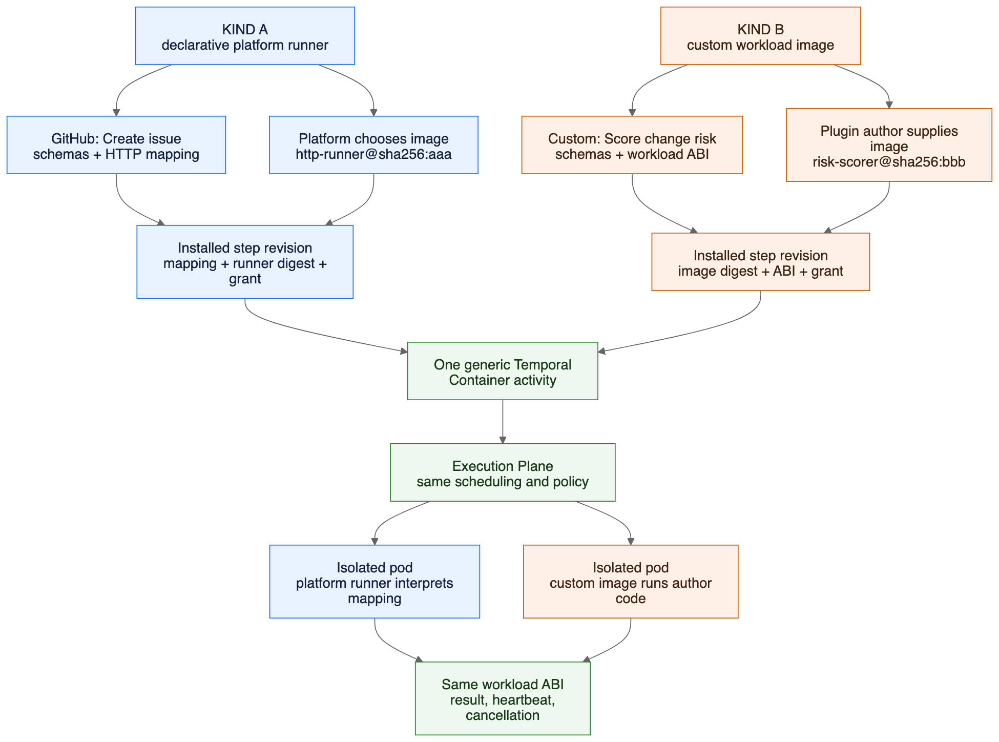

| Question | Kind A — platform runner | Kind B — custom workload |
|---|---|---|
| Who writes the executable runtime? | The Syntara platform team | The plugin author |
| What does the plugin contribute? | Schemas, UI metadata, a declarative operation, and a platform runner driver selector such as `http.v1` | Schemas, UI metadata, and one logical plugin workload binding; the SDK infers the default workload ABI and the signed canonical artifact records both the exact ABI and immutable image digest |
| Who chooses the image digest? | Syntara resolves the profile to a platform-owned pinned image; the plugin cannot override it | The publisher's explicit SDK build input resolves to the digest before signing; individual steps and workflow authors cannot override it |
| Simple example | GitHub `Create issue` expressed as an HTTP request mapping | A proprietary change-risk scorer containing custom code and libraries |
| What is shared? | Signed installation, immutable revisions, capability review, credentials, egress policy, the generic `Container` activity, Execution Plane isolation, and the workload ABI | The same controls and runtime path |

### Who approves the image binding?

“Approved” has two distinct gates. A signature proves publisher identity and integrity; it is not approval by itself.

| Binding | Who supplies it? | Platform admission | Environment activation | How an image changes |
|---|---|---|---|---|
| Kind A platform runner | The Syntara runner team publishes a signed runner image and runner-profile revision | Automated signature, provenance, SBOM, scan, ABI/conformance, and policy checks must pass; a **Platform Security Administrator** promotes the exact runner-profile revision to `APPROVED` | An **Environment Plugin Administrator** installs/enables the plugin revision and approves its effective capabilities; the plugin can select only an already-approved compatible profile | Publish and approve a new runner-profile revision, producing a new derived installed-step revision; existing workflows stay pinned |
| Kind B custom workload | The plugin publisher's signed manifest names the exact plugin-owned image digest | The configured local policy checks signer/namespace, repository scope, ABI/conformance, required supply-chain evidence, and whether that publisher is allowed to supply Kind B images; policy may require Platform Security Administrator review | An **Environment Plugin Administrator** reviews the exact digest and grants, then installs/enables that plugin revision | Publish a new signed plugin revision that references the new digest; it is installed side-by-side and existing workflows stay pinned |
| Sandboxed authoring provider | The plugin publisher's signed manifest names the exact provider image digest | Provider-specific signature, required supply-chain evidence, `syntara.provider/v1alpha1` conformance, repository scope, and sandbox-policy checks must pass; policy may require Platform Security Administrator review | An **Environment Plugin Administrator** separately enables executable authoring and grants the provider's endpoint, broker, and resource capabilities | Publish a new signed plugin revision that references the new provider digest; it is installed side-by-side and existing form bindings remain pinned |

For Kind A, a selector such as `http.v1` names a platform runner family, not a product-specific GitHub or AAP profile and not a mutable image alias. During installation Syntara resolves it only to an already-approved compatible revision—for example `http.v1/revision-17` bound to `http-runner@sha256:abc...`—and stores that exact runner-profile revision and digest in the installed step revision. Updating the default `http.v1` candidate does not rewrite an installed step or a published workflow. Product-specific endpoint, credential, and operation data stays in the immutable connection and plugin revisions.

For Kind B, the image is dynamic only at the **build/install boundary**: the generic platform can ingest a new plugin and bind its steps to the image digest declared in the signed canonical manifest without adding code or rebuilding Syntara. The local catalog may supply that digest but cannot change the transaction. The author manifest uses one logical plugin workload; the final published manifest contains its `repository@sha256:digest` once in the root canonical inventory. An SDK may accept a tag as an explicit developer build input only if it resolves the tag, rewrites it to the digest, and signs the resulting immutable manifest before publication. Installation never follows a tag, and execution never accepts an image override from the browser, workflow, step input, or plugin payload.

A sandboxed authoring provider follows the same immutable publication rule but is neither Kind A nor Kind B: it is design-time code with a separate ABI, capability grant, service identity, queue, worker pool, namespace, and short request lifecycle. Approval of a provider image never approves it as a workflow workload, and approval of a workflow workload never permits design-time invocation.

### Kind A example: GitHub `Create issue`

The plugin author describes the operation, but does not ship code for it:

```yaml
runtime:
  kind: platform-runner
  driver: http.v1
  connection:
    type: syntara.github.connection
    input: connection
  operation:
    method: POST
    path: /repos/{input.repository.owner}/{input.repository.name}/issues
    requestMap:
      kind: asset
      path: mappings/create-issue.request.json
```

At installation, Syntara validates that mapping and records a platform-controlled `http.v1` runner revision bound to `http-runner@sha256:aaaaaaaaaaaaaaaaaaaaaaaaaaaaaaaaaaaaaaaaaaaaaaaaaaaaaaaaaaaaaaaa`. The workflow node selects an authorized `syntara.github.connection` instance; its immutable endpoint revision determines GitHub.com, GitHub Enterprise Cloud with data residency, or a validated GitHub Enterprise Server API origin, TLS policy, OAuth registration, and egress grant. At execution, the generic `Container` activity sends the resolved runner digest, relative operation, effective capability grant, and non-secret input to the Execution Plane. The HTTP runner joins the administrator-approved API origin to the relative path and calls it with the approved credential. The plugin author can add another operation supported by `http.v1` without writing a Temporal activity, defining a host-specific protocol in core, or building an image.

An AAP `Launch job template` step follows the same Kind A pattern when a platform-owned AAP or HTTP runner calls the Automation Controller API. The Execution Environment image that AAP later uses to run Ansible content belongs to AAP's execution domain; it is not the Syntara plugin workload image. If a plugin instead asks Syntara's Execution Plane to run a plugin-supplied Execution Environment directly, that Syntara step is Kind B unless the platform team has deliberately adopted that image as a governed platform runner.

### Kind B example: custom change-risk scorer

Suppose Acme needs proprietary scoring code, an ML model, and native libraries that the declarative runners cannot express. The plugin declares one logical workload at the plugin root, and every custom-workload target inherits it:

```yaml
# plugin.yaml
spec:
  workload:
    image: plugin-workload
  targets:
    - ./steps/score_change/manifest.yaml

# steps/score_change/manifest.yaml
runtime:
  kind: custom-workload
```

The author does not repeat the container ABI in each target. While `custom-workload` has one compatible default, the SDK infers `syntara.container/v1alpha1`, verifies the workload against its conformance contract, and materializes the exact ABI in the signed canonical descriptor. The build request explicitly binds `plugin-workload` to a publish input such as `quay.io/acme/change-risk-scorer:1.2.0`. The SDK resolves the tag and writes `quay.io/acme/change-risk-scorer@sha256:bbbb...` once into the signed canonical root image inventory; compiled step descriptors refer only to `plugin-workload`. Syntara verifies and records that exact digest and ABI during installation. At execution, the same generic `Container` activity resolves the installed revision and sends a server-generated work item to the Execution Plane. The custom image runs in an isolated pod with only the approved credentials, egress, resources, and capabilities. It reports heartbeats, cancellation, structured errors, and results through the same workload ABI as a Kind A runner.

### What the distinction does not mean

- Kind A is **not** a plugin wrapper around an existing named Temporal activity. New external Kind A steps compile to the generic `Container` activity.
- Kind B does **not** dynamically register a new Temporal activity for each plugin image. Temporal sees the same generic activity for every external plugin action step.
- Merely running a container does **not** make a step Kind B. Kind A also runs in a container; the deciding question is whether the pinned image is platform-owned or plugin-owned.
- Existing named external-executor activities may temporarily call the new path as replay-safe migration shims. That compatibility mechanism is not the Kind A architecture.

A practical authoring rule is: **use Kind A when an approved platform runner can express the operation declaratively; use Kind B only when the step genuinely requires plugin-owned executable code or a custom runtime.**

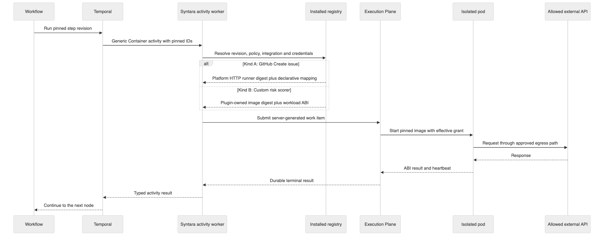

## Trigger and Control-Flow Architecture

Kind A and Kind B classify **action steps only**. They do not classify triggers or control-flow nodes. The platform has three node families with deliberately different execution paths:

| Node family | What it does | Where it runs | Initial extension rule |
|---|---|---|---|
| Action step | Performs work after a workflow has started | Generic Temporal `Container` activity → Execution Plane | Plugin action may use a platform runner or a publisher workload |
| Trigger | Starts a workflow when an event or schedule occurs | Syntara control plane and Temporal | Plugin may contribute a declarative trigger definition over a Syntara-owned driver |
| Control flow | Changes how an already-running workflow proceeds | Temporal workflow code | Built in and strongly typed; not plugin workload code |

This separation is a security and lifecycle boundary. An action container is short-lived and starts only when Temporal schedules it. A webhook endpoint, scheduler, event subscription, or poller may need to exist for months and must continue to enforce workflow publication state, authentication, duplicate-event handling, rate limits, and revision pinning before a workflow starts. That long-running responsibility belongs to Syntara, not to a normal Execution Plane work item.

### Declarative plugin triggers

A plugin may add a trigger type when a Syntara-owned trigger driver can express it. The plugin contributes inert data: configuration and event schemas, UI metadata, an integration requirement, a driver selection, and a bounded event-to-workflow-input mapping. Syntara owns the endpoint or subscription, credentials, validation, deduplication, activation, audit, and Temporal start.

For example, the GitHub plugin could include a target similar to:

```yaml
apiVersion: syntara.io/v1alpha1
kind: TriggerType
metadata:
  name: pull_request_opened
  displayName: Pull request opened
spec:
  integrationType: syntara.github.connection
  configurationSchema:
    kind: asset
    path: schemas/pull-request-opened.configuration.json
  outputSchema:
    kind: asset
    path: schemas/pull-request-opened.output.json
  ui:
    kind: asset
    path: ui/pull-request-opened.json
  trigger:
    driver: webhook.v1
    event: pull_request.opened
    eventMap:
      kind: asset
      path: mappings/pull-request-opened.event.json
```

`webhook.v1` is a versioned platform contract, not a GitHub listener embedded in Syntara core. The installed GitHub integration revision supplies the approved endpoint and authentication family; the trigger definition supplies bounded GitHub event metadata and mapping. The driver rejects an unsupported signature, event, mapping, or capability during installation or publish rather than executing publisher code.

The initial platform may expose drivers such as `manual.v1`, `webhook.v1`, `schedule.v1`, `event-source.v1`, and a bounded `polling.v1`. A new product event does not require a new Temporal activity when one of these drivers can express it. A genuinely new transport or long-running executable listener requires a separately reviewed platform driver. Publisher-supplied always-running trigger images are deferred: if later justified, they require a dedicated Trigger Service with its own API, identity, queue, isolation, credential, egress, upgrade, and availability model. They do not run inside the Syntara API/worker, the one-shot runtime Execution Plane, or the short-lived Provider Sandbox.

### Trigger installation and activation

Installing and publishing have different effects:

```text
Install plugin
    ↓
Register immutable trigger definition
    ↓
Show trigger in the workflow builder
    ↓
User configures workflow (nothing listens yet)
    ↓
Publish workflow revision
    ↓
Validate connection, permissions, mapping, and trigger settings
    ↓
Create immutable trigger activation for that workflow revision
    ↓
Webhook, schedule, subscription, or poller may start the pinned workflow
```

An activation binds the installed trigger revision, published workflow revision, approved connection/endpoint revision, effective capability grant, and driver-owned endpoint/schedule/subscription identity. Republishing creates a new activation and retires the prior one idempotently. Disabling a plugin or workflow prevents new starts; revocation follows the stricter security policy. Updates install side by side, and uninstall is rejected while drafts, published workflows, activations, or retained runs still reference the trigger revision.

The ingress path verifies and normalizes an external event before Temporal starts. It uses a stable event ID for deduplication, applies rate and payload limits, maps only schema-declared fields, and starts the exact published workflow revision named by the activation. A generic built-in trigger activity may record the normalized start payload in workflow history, but it performs no external I/O and no plugin-specific code runs in the Temporal worker.

### Current business requirement: sub-workflow invocation

Sub-workflow invocation is the primary example for the trigger/control-flow boundary. It uses a built-in pair rather than an installed plugin target:

| Node | Location | Responsibility |
|---|---|---|
| `Execute Sub-workflow` | Parent workflow | Select a child workflow, map parent data to child inputs, start it, wait, and expose its result |
| `Sub-workflow Trigger` | Child workflow | Declare the child's callable input contract and provide the entry point for a parent invocation |

The user and data flow is:

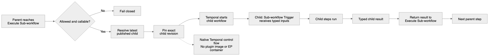

```text
1. A parent run reaches Execute Sub-workflow.
2. Syntara checks that the caller may run the child and that the child is published and callable.
3. Syntara resolves “latest published” once, at call start, and records the exact child revision.
4. Temporal starts the child at its Sub-workflow Trigger with schema-validated mapped inputs.
5. The parent waits while the child runs its own nodes.
6. The child returns a schema-validated result.
7. Execute Sub-workflow exposes that result to the next parent node.
```

The child revision is never re-resolved during that call, retry, or replay. This preserves the business meaning of “latest published” without making an in-flight execution change when the child is republished. The workflow model rejects recursive/cyclic calls, validates input/output mappings at parent publish time, applies permission and callable-policy checks again at start time, propagates cancellation according to a pinned policy, and shows the child run under the parent execution without copying the child nodes into the parent definition.

`Execute Sub-workflow` may have incoming and outgoing edges because it is part of an already-running parent. `Sub-workflow Trigger` has no incoming edge because it is the child's entry point. A design-time **embed** operation, if offered, is different: it copies nodes into the parent and creates no child run or runtime relationship.

These nodes remain native because they manipulate Temporal workflow structure and history. They are not plugin action containers, do not have image ownership, and therefore are neither Kind A nor Kind B. The same principle applies to branching, loops, waits, approvals, and merge behavior.

## Cross-Model Perspective

An independent cold read steelmanned the product as n8n-grade discovery and installation backed by signed OCI metadata and isolated containers. Its strongest point was that the true core is the dynamic **install → registry → canvas → execution** contract, not the package format in isolation.

It challenged the original security premise: a correctly signed plugin can still exfiltrate secrets or abuse network access. That changed this design. Installation and execution now require explicit capabilities, least-privilege credential delivery, egress policy, sandboxing, resource policy, and auditable denials in addition to signature verification.

Its proposed 48-hour prototype remains useful feasibility evidence: FastAPI, SQLModel/PostgreSQL, local Quay, Cosign, and the existing React frontend; two plugin artifacts; one generic container route; browse → install → verify-before-decode → persist → render → execute → pinned upgrade. The proposed initial-scope target goes further by requiring a signed local catalog index, source configuration from the UI, documentation/inspection, and at least 20 genuine installable plugins; ratings and hosted curation remain out of scope.

## Approaches Considered

### Approach A: Native Plugin Platform — recommended

Replace closed plugin-contributed unions/registries with database-backed, versioned runtime definitions and typed domain services inside Syntara. Keep workflow engine internals typed and native, but resolve external action definitions through installed immutable revisions. This creates a coherent API, UI, SDK, and execution lifecycle with one source of truth.

### Approach B: Generic Plugin Bridge — rejected

Add one generic node/activity and store most plugin behavior as opaque payloads. It would prove execution quickly, but it would leave integrations, credentials, validation, builder rendering, compatibility, and lifecycle behavior fragmented. It is useful as a throwaway spike, not the product architecture.

### Approach C: Separate Plugin Control Plane — rejected

Build catalog, install state, and policy as another service. It could become valuable at multi-cluster scale, but it introduces distributed consistency and authorization boundaries before Syntara has a stable internal plugin contract. Extract later only if deployment ownership or scale demands it.

## Recommended Architecture

### 1. Domain boundaries

Keep four boundaries explicit:

1. **Distribution and local discovery:** OCI registry, explicit artifact references, signatures, optional supply-chain evidence, workload images, documentation, and a signed local catalog index. Hosted aggregation/promotion and certification attestations are later services.
2. **Installation control plane:** resolution, verification, schema validation, policy review, transactional persistence, activation, update, disable, uninstall, and audit.
3. **Authoring and trigger control plane:** catalog UI, integration and credential setup, dynamic action/trigger registry, schema-driven forms, trusted design-time provider resolution, publish-time external-reference validation, trigger activation, compatibility information, workflow revision pinning, and built-in sub-workflow orchestration.
4. **Action execution plane:** generic Temporal `Container` dispatch, policy-bound work item, secret delivery, isolated action-workload execution, progress/results, cancellation, and audit. Trigger listeners and control-flow nodes do not use this path.

### 2. Manifest and OCI layout

Publish one metadata-only plugin artifact per plugin version. Store the manifest and its inert referenced assets as content-addressed OCI layers rather than size-limited annotations.

```yaml
apiVersion: syntara.io/v1alpha1
kind: Plugin
metadata:
  namespace: syntara
  name: github
  version: 1.2.0
  authors:
    - name: Syntara Platform
  documentation:
    kind: asset
    path: docs/README.md
  icon:
    kind: asset
    path: icons/github.svg
spec:
  compatibility:
    syntara: ">=0.8 <0.10"
    executionPlane: ">=0.3 <0.4"
  targets:
    - ./steps/create_issue/manifest.yaml
    - ./triggers/pull_request_opened/manifest.yaml
  integrationTypes:
    - id: syntara.github.connection
      inputSchema:
        kind: asset
        path: schemas/integration-github.json
      endpointKinds:
        - github-cloud
        - github-cloud-data-residency
        - github-enterprise-server
      credentialTypes:
        - syntara.github.oauth
        - syntara.github.app
        - syntara.github.service-token
  credentialTypes:
    - id: syntara.github.oauth
      schema:
        kind: asset
        path: schemas/credential-github-oauth.json
      secretFields: [accessToken, refreshToken]
      issuance:
        kind: oauth2-authorization-code.v1
    - id: syntara.github.app
      schema:
        kind: asset
        path: schemas/credential-github-app.json
      secretFields: [privateKey]
      issuance:
        kind: jwt-token-exchange.v1
        recipe:
          kind: asset
          path: credentials/github-app-token-exchange.json
    - id: syntara.github.service-token
      schema:
        kind: asset
        path: schemas/credential-github-service-token.json
      secretFields: [token]
      issuance:
        kind: static-bearer.v1
  formProviders:
    - id: syntara.github.resources
      kind: declarative
      driver: http.v1
      connectionType: syntara.github.connection
      purpose: authoring-read
      operations:
        repositories.list:
          method: GET
          path: /user/repos
          responseMap:
            kind: asset
            path: mappings/github-repositories.options.json
        labels.list:
          method: GET
          path: /repos/{dependency.owner}/{dependency.repo}/labels
          responseMap:
            kind: asset
            path: mappings/github-labels.options.json
      capabilities:
        network: [integration-endpoint]
        credentials:
          - syntara.github.oauth
          - syntara.github.app
          - syntara.github.service-token
```

The root `plugin.yaml` owns the plugin namespace, version, authorship, compatibility, integration and credential types, provider definitions, and an explicit ordered target list. Targets are authoritative; tooling does not scan the tree for undeclared steps. Every step inherits the root namespace and plugin release version, so one plugin revision remains the installation and rollback unit.

Each target is either an action `StepType` or a declarative `TriggerType` source document. Action targets contain step-local schemas, UI, and a runtime operation; trigger targets contain configuration/output schemas, UI, and a Syntara-owned trigger-driver declaration. For example, `steps/create_issue/manifest.yaml` contains an action:

```yaml
apiVersion: syntara.io/v1alpha1
kind: StepType
metadata:
  name: create_issue
  displayName: Create issue
  description: Create an issue in a GitHub repository.
spec:
  integrationType: syntara.github.connection
  inputSchema:
    kind: asset
    path: schemas/create-issue.input.yaml
  outputSchema:
    kind: asset
    path: schemas/create-issue.output.json
  errorSchema:
    kind: asset
    path: schemas/github.error.json
  ui:
    kind: asset
    path: ui/create-issue.json
  runtime:
    kind: platform-runner
    driver: http.v1
    connection:
      type: syntara.github.connection
      input: connection
    operation:
      method: POST
      path: /repos/{input.repository.owner}/{input.repository.name}/issues
      requestMap:
        kind: asset
        path: mappings/create-issue.request.json
      responseMap:
        kind: asset
        path: mappings/create-issue.response.json
  capabilities:
    required:
      network: [integration-endpoint]
      credentials:
        - syntara.github.oauth
        - syntara.github.app
        - syntara.github.service-token
    optional: []
```

`DocumentSource.path` values are normalized logical paths from the plugin source/bundle root, even when the reference appears in a nested target manifest. They are not filesystem paths relative to that target. This keeps authored references stable when a target moves and avoids `..` traversal. JSON Schema `$ref` values inside an asset remain bounded relative references from that asset to another indexed asset.

The plugin-platform contract extends the root and target schemas already established by Plugin SDK PR 6; it does not introduce a second discovery model or replace the existing path-contained compiler.

The target authoring schema intentionally does not require the current source-authored `spec.images` duplication or a registry path on each Kind B target. Author source uses logical image IDs. For v1, a plugin has zero or one plugin-level workflow workload: a Kind A-only plugin declares none, while every Kind B target in a plugin inherits the same `spec.workload.image` logical ID. A sandboxed form provider may declare a different logical provider-image ID because it uses a different ABI, service, trust decision, lifecycle, and isolation boundary. Platform-runner images are never part of the publisher inventory.

The target authoring schema also does not require `runtime.abi`. For a Kind A action, the admitted runner-profile revision owns and pins the container ABI; the plugin cannot select or override it. For a Kind B action or sandboxed provider, the SDK infers the only compatible default ABI from the runtime kind, validates the image through the matching conformance contract, and writes the exact ABI into the canonical signed descriptor. If a future runtime kind supports multiple ABI majors, the author or build request selects one once at the plugin-level workload/provider binding; per-target ABI repetition and overrides remain invalid. Declarative triggers and built-in control-flow nodes have no container ABI.

Image resolution is an explicit SDK application request, regardless of whether it arrives through Python, CLI, RPC, IDE, CI, or a hosted service. For example:

```yaml
# plugin.yaml author source
spec:
  workload:
    image: plugin-workload
  targets:
    - ./steps/score_change/manifest.yaml
```

```yaml
# explicit build input; not hidden SDK global state
images:
  plugin-workload:
    reference: quay.io/acme/change-risk-scorer:1.2.0
```

The SDK may propose a repository and tag from configured registry, repository prefix, plugin namespace/name, and plugin version, but it must display the resolved mapping and treat it as a recorded build input. A tag is permitted only at this build boundary. Before signing, the SDK resolves it to a digest and emits a canonical inventory such as:

```yaml
# generated canonical metadata; authors do not maintain this
spec:
  images:
    - id: plugin-workload
      purpose: workflow-workload
      reference: quay.io/acme/change-risk-scorer@sha256:bbbbbbbbbbbbbbbbbbbbbbbbbbbbbbbbbbbbbbbbbbbbbbbbbbbbbbbbbbbbbbbb
  workload:
    image: plugin-workload
  targets:
    - id: acme.change-risk.score_change
      runtime:
        kind: custom-workload
        image: plugin-workload
        abi: syntara.container/v1alpha1
```

The full pull reference therefore appears once in the canonical signed plugin metadata, while steps refer to its logical ID. The build report records the requested tag, resolved repository and digest, resolver identity, and resolution time. Rebinding a logical ID to a different repository or digest creates different canonical bytes and a new artifact digest; it cannot silently republish the same plugin revision.

This v1 cardinality is deliberate: one plugin revision is one executable and trust-review unit, and a shared image can route internally by the qualified step identity supplied by the workload ABI. A publisher that requires independently versioned or isolated workload images creates separate plugins in v1. Multiple workflow-workload images in one plugin are deferred until a demonstrated use case justifies the policy, lifecycle, and user-interface complexity.

| Plugin content | Publisher executable image in v1 | Where the author names it | Where the complete pull reference appears |
|---|---:|---|---|
| Kind A platform-runner steps | 0 | Nowhere; each target selects a platform driver such as `http.v1` | In the separately governed platform runner-profile revision, not the plugin's publisher inventory |
| One or more Kind B custom-workload steps | 1 per plugin | Once as `spec.workload.image: <logical-id>` in `plugin.yaml` | Once in the signed canonical root image inventory; every compiled Kind B target points to the logical ID |
| Declarative trigger types | 0 | A `TriggerType` target selects a Syntara-owned trigger driver such as `webhook.v1` | No publisher image; the installed trigger revision binds to a platform driver and workflow publication creates its activation |
| Declarative form providers | 0 | Nowhere; declarations are interpreted by Syntara | No publisher image |
| Sandboxed form providers | Separate from the workflow workload | Once per provider binding as a logical provider-image ID | Once per distinct provider image in the signed canonical root inventory |
| Plugin metadata and assets | 1 metadata-only OCI artifact | The root and explicit target source documents | The signed plugin artifact; it is not an executable step image |

Consequently, not every plugin target has its own implementation image. Declarative triggers have no publisher runtime image, and control-plane form behavior does not reuse the workflow workload image. Kind A actions share an independently versioned platform runner; Kind B actions in one v1 plugin share one publisher workload; executable form providers are separately admitted sandbox services.

During migration, the upstream source-authored `spec.images` field and target-level full image references remain compatibility inputs only. The compiler normalizes them into the logical model, rejects disagreement, and offers an explicit migration patch; new scaffolds emit the plugin-level logical binding. Kind A installation separately resolves a driver selector to an approved immutable runner-profile binding.

Registry mirroring does not rewrite signed canonical metadata. An environment records both the canonical source reference and an effective mirror pull reference, requires the mirrored content to have the same digest, and dispatches only the verified digest. Workflow authors and administrators cannot substitute an arbitrary image; changing publisher code requires a new signed plugin revision or fork.

#### OCI content bundle and safe asset resolution

A v1 plugin is one OCI artifact. The signed OCI manifest digest covers the config descriptor, one root plugin-manifest layer, and one deterministic content-bundle layer. Installers identify blobs by media type rather than layer order. This follows the [OCI artifact guidance](https://github.com/opencontainers/image-spec/blob/main/manifest.md#guidelines-for-artifact-usage), in which the artifact manifest binds config and layer descriptors by media type, digest, and size.

| OCI object | Required media type | Purpose |
|---|---|---|
| Artifact manifest `artifactType` | `application/vnd.syntara.plugin.v1` | Identifies a Syntara metadata-only plugin artifact |
| Config blob | `application/vnd.syntara.plugin.config.v1+json` | Declares layout version and the exact asset index |
| Plugin-manifest layer | `application/vnd.syntara.plugin.manifest.v1+yaml` | Contains the canonical plugin metadata envelope: the validated root plus ordered compiled descriptors for every explicit target |
| Content-bundle layer | `application/vnd.syntara.plugin.content.v1.tar+gzip` | Contains schemas, UI declarations, mappings, credential recipes, documentation, and icons |

The following tree is a logical `inspect` view of a fully externalized canonical artifact produced by the SDK; it is not the required source layout and plugin authors do not have to create these JSON files by hand. Inline documents from either the root or a targeted action/trigger remain in the canonical metadata layer and therefore do not appear in the content bundle.

```text
plugin.manifest.yaml                  # generated root + compiled-target metadata layer
content/                              # generated content-bundle layer
  schemas/
    credential-github-app.json
    credential-github-oauth.json
    credential-github-service-token.json
    pull-request-opened.configuration.json
    pull-request-opened.output.json
  credentials/
    github-app-token-exchange.json
  mappings/
    create-issue.request.json
    create-issue.response.json
    pull-request-opened.event.json
  ui/
    create-issue.json
    pull-request-opened.json
  docs/
    README.md
  icons/
    github.svg
```

Structured fields that permit either embedded content or a bundled file use an explicit tagged `DocumentSource<T>` union. Bare strings are invalid for these fields, so the installer never guesses whether a value is a path or content.

| `kind` | Required field | Meaning |
|---|---|---|
| `inline` | `value` | The typed JSON/YAML value is embedded in its root or targeted source manifest and canonicalized into the metadata layer |
| `asset` | `path` | The value is loaded from exactly one indexed content-bundle asset and must match the field's expected media type |

A small one-off input schema can be inline:

```yaml
inputSchema:
  kind: inline
  value:
    type: object
    additionalProperties: false
    required: [title]
    properties:
      title:
        type: string
        minLength: 1
        maxLength: 256
```

A shared or larger schema uses an asset reference:

```yaml
inputSchema:
  kind: asset
  path: schemas/create-issue.input.yaml
```

For hand-authored JSON Schema documents, plugin authors should use `.yaml` as
the default because it is easier to read, review, and maintain. `.json`
remains supported for generated schemas and schemas copied directly from an
external API specification. The extension determines the stored source media
type; both forms are parsed, schema-validated, and canonicalized to the same
semantic contract.

`inline` is allowed only for structured schema, UI, mapping, and credential-recipe fields whose contract explicitly declares `DocumentSource<T>`. Documentation, icons, and other binary/text resources are asset-only. Runtime endpoint paths such as `operation.path: /repos/{owner}/{repo}/issues`, OCI image references, IDs, and ordinary string inputs are not document sources and remain strings. Inline and asset forms pass through the same type-specific validator, canonicalizer, size limits, local-reference rules, and installed-content hashing. The compiler assigns inline content an immutable synthetic location based on the derived qualified identity and field JSON Pointer, such as `manifest:///steps/syntara.github.create_issue/inputSchema`, so both forms resolve to an installed-asset ID after installation.

The SDK generates the config blob and deterministic bundle. The config contains one entry for every regular file in the bundle, keyed by its normalized path, with its media type, byte size, and SHA-256 digest of the exact uncompressed file bytes. Every bundle entry must appear exactly once in that index, and every indexed asset must be referenced by a typed field in the plugin manifest. Unknown, duplicate, hidden, or unreferenced content is rejected.

The current local SDK increment implements this layout for external JSON/YAML schema documents, the bounded declarative `http.v1` operation maps, non-secret `IntegrationType` and `CredentialRecipe` documents, and one optional plugin-level Markdown document. An `http.v1` action declares a method, an origin-less relative path template, and optional request/response maps. A map is only a bounded output-field mapping to an RFC 6901 JSON Pointer or a JSON literal; it is not code and cannot invoke a service, select an origin, or add a header. Map documents can be inline or use a YAML/JSON asset, and receive the same canonicalization, size limits, asset inventory, and typed-source validation as schemas. An author declares `spec.documentation.path`; the compiler accepts only a bounded, contained regular UTF-8 `.md` file without NUL bytes, binds its exact SHA-256 digest into the canonical descriptor, and includes those exact bytes in the same deterministic bundle and config inventory. A platform-runner action also declares a versioned driver such as `http.v1`; it never declares a runner image or ABI. The matching control-plane verifier checks OCI descriptor/content integrity, schema/map/credential-schema asset media types, and their explicit typed references before the installation service revalidates the small `http.v1` operation grammar. When documentation is declared, it returns it only after proving the descriptor path and digest bind it to the verified bundle. The narrow registry client can fetch only a preselected plugin manifest by its immutable digest, and the verifier can inspect that envelope to return its three bounded blob descriptors before content is retrieved. The documentation hydrator obtains source-scoped pull access, admits the artifact digest through the source policy **before** it fetches the blobs, verifies catalog/artifact identity and documentation-digest parity, renders CommonMark with raw HTML disabled, and sanitizes to an explicit HTML/HTTPS-link allowlist. It persists only that rendered HTML and bounded non-secret verification evidence; raw publisher Markdown is not stored. `GET /catalog/plugins/{namespace}/{name}/versions/{version}/documentation` reads only that already-admitted local HTML record, requires `source_id` when publishers conflict, and has no registry, credential, or hydration capability. A separate internal catalog-install service follows the same exact-digest fetch and source-lock discipline, additionally admitting every publisher workload image before it writes the immutable installed-plugin generation. Its current safe subset supports action-only custom-workload plugins with one inherited root workload image and action-only platform-runner plugins only after a server-owned resolver binds each declared driver to an approved immutable profile revision. The resolver materializes that revision's ABI and image into the installed action and persists its exact revision identity; no artifact, browser, or workflow can override them. The same installation transaction now persists immutable, non-secret integration and credential-type definitions and makes an action reference the installed integration-type revision. It stores schema, secret-field **names**, and issuance metadata only; no credential value, token, private key, OAuth exchange, or remote call occurs in this increment. Trusted runner-image admission, a default profile, connection-instance/credential resolution, runtime request construction, and application composition remain pending, so an unconfigured deployment continues to fail closed. Triggers remain rejected. `POST /catalog/plugins/{namespace}/{name}/versions/{version}/install?source_id=...` is an administrator-only command seam over that service: the browser supplies only the catalog identity and selected source, while the deployment supplies registry authorization, artifact trust, workload-image admission, and runner-profile resolution through one server-owned factory. If any required trusted adapter is absent, it fails closed with `503 PLUGIN_INSTALLATION_UNAVAILABLE`; there is no anonymous or permissive default. `GET /plugin_registry` and its exact-version detail route are the separate database-only inspection surface after installation: they expose current generation metadata, safe plugin identity/digest/enablement state, and validated action contracts, but never create an install path or reach a registry. A browser inspector UI remains a later increment. Icons, UI declarations, credential values, OAuth, and live runner execution will join the same bundle or platform boundary only through their own typed contracts; they do not bypass the compiler or introduce a second package format.

The current shared-runtime implementation now includes a pure `http.v1` mapper.
It revalidates the installed operation, substitutes only checked string values
into `{input.field}` path segments, builds an optional JSON request body, and
projects declared fields from an already parsed JSON response. Author-written
templates cannot contain percent escapes; runtime values cannot contain a
separator, pre-encoded value, query/fragment character, or dot segment. The
mapper has no endpoint, HTTP client, credential, retry, logging, or image
selection capability. Those remain the Syntara-managed runner and connection
boundaries described above.

Manifest asset references such as `{kind: asset, path: schemas/credential-github-app.json}` obey these rules:

- Paths are non-empty, UTF-8, Unicode-NFC, case-sensitive, relative POSIX paths. Absolute paths, backslashes, drive prefixes, control characters, empty segments, `.`/`..` segments, and normalization or case-fold collisions are invalid.
- The archive contains only normalized directories and regular files. Symlinks, hard links, devices, FIFOs, sockets, sparse entries, whiteouts, setuid/setgid bits, and executable files are forbidden.
- The SDK produces sorted entries with normalized ownership, permissions, and timestamps plus deterministic gzip metadata, so identical source produces the same bundle and artifact digest.
- Versioned limits apply to compressed and expanded bundle size, asset count, individual asset size, path length, JSON/YAML nesting, schema depth, and decompression ratio. The installer streams and bounds verification; it never extracts the archive onto a host or container filesystem.
- A reference must resolve to one indexed asset with the expected media type. JSON Schema `$ref` may target only bundled schema assets through bounded local references. Remote references, cycles, cross-plugin paths, and media-type mismatches fail installation.
- Bundle content is inert. It cannot contain executable browser/backend modules, install hooks, migration scripts, native libraries, or code loaded into Syntara. Executable workflow/provider images remain separate digest-pinned OCI images.

Installation first verifies the signed OCI artifact manifest digest. It then verifies each descriptor digest and size, parses the bounded config and root manifest, validates every `DocumentSource<T>` discriminator, streams the bundle, verifies the asset index against the archive, and validates every asset reference. Valid inline and asset-backed JSON/YAML documents are canonicalized and stored with their original plugin digest, logical location, media type, source digest where applicable, and canonical content digest. Local references are compiled to immutable installed-asset IDs; derived records such as credential types store the validated canonical schema and broker recipe, not an unresolved filename.

Runtime services never pull the plugin artifact, open a repository path, or extract the bundle. The builder reads installed schema/UI assets from the immutable registry generation. `FormProviderService`, trigger activation/ingress, the Credential Broker, workflow publication, and the generic action activity resolve installed revision IDs and canonical content hashes. An update creates new plugin, asset, credential, provider, action, and trigger revisions side by side; it never changes content behind an existing path.

For the GitHub App example, `schemas/credential-github-app.json` becomes the validated credential-instance shape and secret-field metadata, while `credentials/github-app-token-exchange.json` becomes a validated broker plan selecting `jwt-token-exchange.v1`. Credential values such as the private key are created later through the credential service and stored in the secret store; they are never present in the plugin artifact or installed asset rows. OAuth access/refresh-token fields are broker-managed outputs and are never rendered as author-entered form fields.

Kind A operations use a versioned, allowlisted declarative language interpreted by the selected platform runner. For `http.v1`, the platform runner owns HTTP mechanics, supported methods/headers/status handling, retry policy, mapping, and pagination/polling primitives; it does not hard-code one profile for every external product or endpoint. The installed integration type defines the allowed endpoint kinds and credential-type families. An administrator creates an immutable endpoint revision containing the validated API/web origins, TLS trust, OAuth application registration, and exact egress policy, and a workflow selects an authorized connection instance backed by that revision. An operation may select a method, relative path template, bounded JSON request/response maps, and one driver-supported pagination or polling strategy. Syntara Mapping v1 permits JSON Pointer, literal values, context-typed interpolation, field rename/select/default, and bounded array projection; it forbids loops, arbitrary code, network access, filesystem access, dynamic origins, dynamic headers outside the driver and integration allowlists, and unbounded recursion. Path interpolation percent-encodes one segment by default; query values use a separate encoding context, and ambiguous encoded separators, dot segments, fragments, or origin-changing forms are rejected before policy comparison. All mappings are statically validated at install time. A new GitHub operation or approved GitHub Enterprise endpoint can therefore be installed or configured without changing Syntara or the runner; only a genuinely new transport, authentication, signing, pagination, or streaming primitive requires a new platform mechanism.

Form-provider operations use the same safe mapping primitives but are a distinct authoring-plane capability. Declarative providers are read-only, separately grantable, and interpreted by the trusted Syntara form-provider service. Sandboxed providers implement the separate provider ABI described below and run only in the Provider Sandbox Service. A field binds to one provider operation through immutable installed metadata; the browser never supplies an operation, method, path, origin, auth mechanism, provider image, credential ID, or raw credential.

A plugin may contribute a sandboxed provider only when the declarative provider language cannot express the required computation:

```yaml
# Author source: the SDK infers the only compatible provider ABI.
formProviders:
  - id: acme.change-management.resources
    kind: sandboxed-provider
    image: change-provider
    operations:
      - form.resolve
      - resource.validate
    capabilities:
      network: [integration-endpoint]
      broker:
        - obtain-access-token
    limits:
      timeoutSeconds: 5
      responseBytes: 262144
```

`kind` selects the provider execution class, `image` selects the exact implementation, and the provider ABI defines how the Provider Sandbox Service exchanges requests, results, errors, cancellation, deadlines, and capability handles with that image. `operations` declares what the implementation supports; it does not define that wire/lifecycle contract.

Here `change-provider` is a logical image ID resolved from the same explicit build request as other publisher images, but it is not the plugin workload. The SDK authoring profile treats `abi` as compiler-inferred while only one ABI is valid for `kind: sandboxed-provider`. The canonical compiled and signed manifest materializes the full provider reference once in the root image inventory and refers to it by ID:

```yaml
images:
  - id: change-provider
    purpose: form-provider
    reference: quay.io/acme/change-provider@sha256:cccccccccccccccccccccccccccccccccccccccccccccccccccccccccccccccc
formProviders:
  - id: acme.change-management.resources
    kind: sandboxed-provider
    image: change-provider
    abi: syntara.provider/v1alpha1
```

This keeps the ordinary source concise while preserving an explicit, auditable compatibility binding in the canonical and installed revisions. While only one provider ABI is compatible, author source omits it and an explicit source value is rejected or migrated to the inferred form. If multiple provider ABI majors become valid later, one explicit selection belongs at the root provider binding or in the recorded build request; individual fields and steps cannot override it. Selection succeeds only when the SDK, platform, image conformance evidence, and environment policy all advertise support, and the compiler never silently upgrades it.

The SDK resolves provider-image tags to digests before signing the final manifest. Installation verifies the provider image against the materialized ABI and records its exact digest but does not start it. Invocation occurs only through the dedicated sandbox after enablement, caller authorization, and an explicit authoring capability grant.

Credential types follow the same data-versus-code boundary. A plugin owns the credential schema, secret-field declarations, accepted permissions, and a bounded issuance recipe that selects a platform mechanism such as `oauth2-authorization-code.v1`, `static-bearer.v1`, or `jwt-token-exchange.v1`. The Syntara Credential Broker owns encrypted storage, trusted time, cryptographic operations, safe token exchange, refresh/revocation, and opaque handles. A recipe is interpreted data, not publisher code, and cannot introduce an arbitrary origin, executable module, signing algorithm, claim, header, or response extraction outside the mechanism's schema and the approved endpoint revision.

Kind B replaces the platform-runner `driver`, `connection`, and `operation` with a custom workload image reference pinned by digest. The SDK materializes the exact `syntara.container/v1alpha1` ABI in the canonical descriptor; it is not repeated in each authored target. A manifest may reference documentation and static UI-schema assets, but never executable frontend JavaScript.

Each step has separate versioned input, output, and structured-error schemas. Fields may carry `x-syntara-sensitive: true`; sensitive values are redacted from UI previews, history, metrics, and logs. Inline input/output is limited to 1 MiB each, with approved object-storage references for larger values. Workflow expression typing is derived from the output schema, and publish fails when an expression references a missing or incompatible field.

For v1, cross-plugin definition references are forbidden. A plugin may reference only definitions in its own immutable revision plus an allowlisted set of versioned native contracts such as runner/provider ABIs and credential-broker mechanisms. This removes install-order and dependency resolution ambiguity; explicit cross-plugin dependencies can be designed in a later manifest version.

Use the artifact and layer media types defined above. Sign the complete plugin artifact digest and every referenced executable image digest. Attach provenance, SBOM, and scan results using OCI 1.1 referrers when available; support the OCI Distribution Spec fallback tag convention for registries and mirrors without complete referrers support.

### 3. Local catalog and source model

The local on-premises catalog is initial scope. Syntara implements a native catalog API and UI using Backstage's separation of source ingestion, processing, searchable entities, and entity inspection as a design reference. Syntara does not embed Backstage or copy its general entity schema: the Syntara catalog is specialized for immutable OCI plugin versions, signatures, compatibility, capabilities, documentation, and installation state.

An administrator connects a local Quay catalog source from the Syntara UI. The source form collects a display name, registry API origin, catalog index repository and channel, repository scope, registry-credential reference, trust-policy reference, mirror policy, optional custom CA reference, and reconciliation schedule. Secrets and private CA material are submitted to and retained by approved backend secret mechanisms; catalog APIs and subsequent UI responses expose only opaque references and safe status.

```mermaid
flowchart LR
    UI[Administrator configures<br/>local Quay source] --> SRC[Plugin source]
    SRC --> IDX[Resolve and verify<br/>signed catalog index]
    IDX --> REC[Reconcile, validate,<br/>and normalize]
    REC --> CAT[Local catalog projection]
    CAT --> BROWSE[Search, browse docs,<br/>and inspect versions]
    BROWSE --> RESOLVE[Resolve selected<br/>immutable digest]
    RESOLVE --> REVIEW[Review capabilities<br/>and verification]
    REVIEW --> INSTALL[Existing atomic<br/>install transaction]
```

- A **plugin source** defines a registry endpoint, catalog index reference, repository scope, trust policy, mirror behavior, credential reference, and reconciliation policy.
- A **catalog index** is a signed OCI artifact containing normalized, non-secret discovery metadata, immutable plugin artifact digests, a source ID, monotonically increasing generation, issue/expiry times, and the previous index digest.
- The SDK's publish workflow creates plugin artifacts and documentation assets, then produces or updates the deterministic catalog index. “Discover all plugins” means all valid entries in the configured index, not every arbitrary image in a registry organization.
- Source reconciliation resolves the configured channel to an index digest, verifies its descriptors, bounds, signature, identity, source binding, generation, and expiry before decoding it, then stages entries. Reconciliation does not install, enable, or execute plugins.
- The target browsing flow resolves and verifies bounded plugin metadata and documentation for each accepted entry without pulling or starting workload/provider images. It fetches a plugin manifest only by the catalog entry's immutable digest, obtains a bounded blob plan from its OCI envelope, admits that digest through the source trust policy, and only then fetches and verifies the declared metadata and documentation blobs. The current implementation includes trust-gated hydration, stores only sanitized rendered documentation plus non-secret evidence, and exposes a source-qualified read API for that local record. A separate internal installer can apply the same catalog-selected digest to the installed registry for a narrow custom-workload action subset, after workload-image policy admission. The browser inspector UI and an administrator-facing installation flow are later increments.
- Catalog entries expose publisher, local verification state, compatibility, versions, deprecation/withdrawal state, documentation, actions, triggers, integrations, credential types, requested capabilities, runtime ownership, and install/update state.
- The Backstage-inspired **Plugin Inspector** shows Overview, Documentation, Contents, Verification, Provenance, Dependencies, Reconciliation, and Raw canonical JSON/YAML views. It is read-only and permission-filtered.
- Selecting Install supplies the catalog entry's immutable digest to the same `resolve` and atomic install transaction used by the direct-digest administrative path. Catalog state never grants trust, activates definitions, or creates a second installation path.
- Direct-digest installation remains available for administration, development, disaster recovery, and catalog outage scenarios.

Each source trust policy binds allowed repository prefixes and canonical plugin namespaces to exact signing identities. The same `namespace/name/version` with a different digest, a signer outside the namespace binding, or an artifact outside the source scope is rejected rather than shadowed. Namespace transfer requires a separately signed transfer statement accepted by both the previous and new trust policy; there is no silent administrator collision override.

Syntara persists the last accepted generation and digest per source. Reconciliation rejects lower generations, broken predecessor chains, and expired indexes by default, so a mirror cannot replay a valid but stale catalog to resurrect a withdrawal or hide an update. An air-gapped reset requires a signed reset statement naming the old/new high-water marks, an explicit platform-administrator action, and an audit event. Emergency revocation is a separately signed, monotonic feed so it can invalidate installed content even when the main catalog is not advanced.

This borrows Backstage’s separation between ingestion/processing and catalog entities plus its inspect-entity experience, and OLM’s catalog concept, without adopting Backstage as a runtime dependency or OLM’s operator lifecycle machinery. The initial acceptance catalog contains at least 20 signed, documented, installable Syntara plugins in local Quay. Hosted aggregation, ranking, certification, partner submission, and public discovery remain deferred.

#### Registry discovery request and response protocol

**Syntara does not ask a registry to list every container image and then try to decide which images are plugins.** It must not call `/v2/_catalog`, scan a registry organization, or inspect arbitrary image labels. That would be expensive, incomplete for restricted repositories, and would make an untrusted registry response define what Syntara can install.

Instead, a source configuration identifies one signed catalog-index repository and channel. The index is the publisher's explicit answer to: “these are the plugin versions available from this source.” The registry provides OCI bytes and immutable digests; Syntara verifies them, applies its own trust policy, and creates a local searchable catalog projection.

#### Current registry credential boundary

The first concrete backend adapter resolves a source's `credentialRef` only when it is the canonical `credentials/<UUID>` handle for Syntara's managed **OCI Registry** credential type. That credential records the one HTTPS registry origin it may authenticate to and has either a scoped bearer pull token or a registry/Quay robot-account username and password. The secret fields stay in Syntara's encrypted secret store. The resolver decrypts them only inside the control plane, verifies that the credential's origin is exactly the configured source origin, creates one request-local `Authorization` header, and discards it after the OCI request. Neither the browser, catalog records, plugin artifacts, nor workflow definitions receive it.

This is deliberately not a generic “inject an arbitrary header” capability. Other opaque credential-reference schemes need their own explicit adapter. The initial adapter also does not exchange an OCI `WWW-Authenticate` challenge for a short-lived token, so the local Quay proof uses an already scoped bearer pull token or robot-account basic credentials.

When a source names `customCaRef`, a second managed **OCI Registry CA Bundle** credential supplies a PEM CA bundle and is bound to the same registry origin. The control plane decrypts it only to construct a normal certificate-validating TLS context, which it passes to the bounded OCI client for every request. The client keeps hostname and certificate verification enabled; it never implements an insecure-skip-verify option. An absent CA reference uses the system trust store. An invalid, disabled, mis-typed, unbound, or unparsable CA reference fails the operation before any OCI request is sent.

#### Current Cosign trust boundary

The first concrete signature adapter is **pinned-key Cosign verification**. A deployment composes a small named policy map; a source's opaque `trustPolicyRef` must select one of those policies. Each policy pins one public key to one HTTPS registry origin, a bounded set of repository prefixes, and exact canonical plugin namespaces. The evaluator sends Cosign only an immutable `registry/repository@sha256:...` reference. A plugin under another repository or namespace is denied before Cosign starts; an unknown policy or an origin mismatch is a source-configuration error; a missing binary, timeout, or nonzero Cosign result is a trust denial. There is no accept-on-error path.

Cosign uses an ephemeral owner-only public-key file and a fresh empty `DOCKER_CONFIG`, so it cannot inherit a developer workstation's pull credentials or credential helper. The initial subprocess adapter intentionally supports only public registries using the system trust store. Private-registry authentication and custom-CA material need a dedicated credential bridge that does not expose secret values in a process command line; they are not silently attempted. Transparency-log verification is required by default. An offline or air-gapped signature is accepted only when the selected administrator policy explicitly permits it, which maps to Cosign's offline verification mode and is recorded as safe verification evidence.

This is a verifier and policy boundary, not a complete installation composition. The current installer remains unavailable until the server-owned factory also has a private-registry-aware Cosign bridge where needed, provenance policy, and workload-image admission. The SDK continues to build deterministic unsigned OCI artifacts; a later publishing adapter signs the resolved digest before it is added to a catalog index.

#### Local development and PoC profile

The repository includes an isolated, loopback-only local Quay `local-poc` profile at `tools/local-quay`. It is a developer wiring aid, not an installed Syntara component, a customer registry, or an acceptance environment. It uses separate Postgres and artifact-storage volumes and exposes **unsigned HTTP** only at `http://localhost:8443`, bound to `127.0.0.1`. The profile is deliberately short-lived and unsafe by design: its public smoke repository, HTTP transport, and signature bypass must never be exposed outside a developer workstation or copied to a shared, hosted, OpenShift, or production source.

The local-PoC proof publishes a real metadata-only GitHub plugin artifact and a chained catalog-index update to this Quay profile, then uses a host-run Syntara API to reconcile it into an active catalog projection and hydrate its documentation. It proves local registry behavior, catalog discovery, exact-digest artifact retrieval, artifact verification, and safe documentation rendering. It does not prove a signer, a transparency log, production transport trust, plugin installation, workload-image admission, or workload execution. The normal product acceptance catalog remains signed and is subject to HTTPS and a policy-selected trust evaluator.

The strict `PinnedCosignTrustEvaluator` remains unchanged: it requires an HTTPS source, exact immutable reference, policy-bound public key, and transparency-log verification unless an explicit offline policy permits otherwise. The local-PoC stack is intentionally **not** connected to that evaluator. Syntara now has a deliberately separate, non-default `local-poc` source profile. It is enabled only with `APP_PLUGIN_PLATFORM_LOCAL_POC_ENABLED=true`, accepts only `http://localhost:8443` or `http://127.0.0.1:8443`, and requires the fixed anonymous-access and unsigned-trust references. Its reconciliation and administrator-only documentation-hydration routes record `local-poc`, loopback HTTP, and skipped signature verification in non-secret verification evidence. It cannot select an arbitrary HTTP registry, a custom CA, a mirror, a credential, or a trust policy. The sole payload read it permits is exact-digest plugin metadata needed to verify and render documentation; installation, workload-image admission, and execution remain unavailable. It must not become a general unsigned or insecure-TLS fallback.

For a local source whose configured values are `registryOrigin: https://quay.local:8443`, `indexRepository: syntara/catalog-index`, and `channel: stable`, the backend-only reconciliation exchange is as follows. The browser never sends or receives the registry token, client certificate, custom CA, or raw registry response.

1. **Resolve the configured catalog channel to an immutable digest.** Syntara first sends this request. If Quay returns `401 Unauthorized` with a `WWW-Authenticate` challenge, the backend resolves the source's opaque `credentialRef`, obtains the scoped pull token, and retries. Credentials are never returned to the UI or written into catalog records.

   ```http
   GET /v2/syntara/catalog-index/manifests/stable HTTP/1.1
   Host: quay.local:8443
   Accept: application/vnd.oci.image.manifest.v1+json, application/vnd.oci.image.index.v1+json
   Authorization: Bearer <backend-resolved-pull-token>
   ```

   ```http
   HTTP/1.1 200 OK
   Content-Type: application/vnd.oci.image.manifest.v1+json
   Docker-Content-Digest: sha256:9d7e...a4c1
   ```

   ```json
   {
     "schemaVersion": 2,
     "mediaType": "application/vnd.oci.image.manifest.v1+json",
     "artifactType": "application/vnd.syntara.catalog-index.v1",
     "config": {
       "mediaType": "application/vnd.syntara.catalog-index.config.v1+json",
       "digest": "sha256:1111...1111",
       "size": 428
     },
     "layers": [
       {
         "mediaType": "application/vnd.syntara.catalog-index.content.v1+json",
         "digest": "sha256:2222...2222",
         "size": 1984
       }
     ]
   }
   ```

   The catalog-index OCI envelope uses the versioned artifact, config, and content media types shown above. The important behavior is that the response supplies a `Docker-Content-Digest`; `stable` is only a movable channel pointer and must not be trusted as an installation identity.

2. **Fetch the exact catalog index by digest and find its signature.** Syntara repeats the manifest request with the returned digest, so a concurrent update of `stable` cannot change the reconciliation in progress.

   ```http
   GET /v2/syntara/catalog-index/manifests/sha256:9d7e...a4c1 HTTP/1.1
   Host: quay.local:8443
   Accept: application/vnd.oci.image.manifest.v1+json
   Authorization: Bearer <backend-resolved-pull-token>
   ```

   ```http
   HTTP/1.1 200 OK
   Content-Type: application/vnd.oci.image.manifest.v1+json
   Docker-Content-Digest: sha256:9d7e...a4c1
   ```

   When the registry supports OCI referrers, Syntara finds attached signature evidence with a request like this:

   ```http
   GET /v2/syntara/catalog-index/referrers/sha256:9d7e...a4c1 HTTP/1.1
   Host: quay.local:8443
   Accept: application/vnd.oci.image.index.v1+json
   Authorization: Bearer <backend-resolved-pull-token>
   ```

   ```json
   {
     "schemaVersion": 2,
     "manifests": [
       {
         "mediaType": "application/vnd.oci.image.manifest.v1+json",
         "artifactType": "application/vnd.dev.cosign.simplesigning.v1+json",
         "digest": "sha256:3333...3333",
         "size": 1240
       }
     ]
   }
   ```

   The backend retrieves the referenced evidence and verifies it against `trustPolicyRef` before decoding the index. A configured standards-compatible fallback is required for registries that do not implement referrers; it must preserve the same subject digest and verification result.

3. **Download and validate the signed index content.** After descriptor and signature checks, Syntara retrieves the index-content blob named in the pinned OCI manifest.

   ```http
   GET /v2/syntara/catalog-index/blobs/sha256:2222...2222 HTTP/1.1
   Host: quay.local:8443
   Accept: application/json
   Authorization: Bearer <backend-resolved-pull-token>
   ```

   ```http
   HTTP/1.1 200 OK
   Content-Type: application/json
   ```

   ```json
   {
     "apiVersion": "syntara.io/v1alpha1",
     "kind": "CatalogIndex",
     "metadata": {
       "sourceId": "local-quay",
       "generation": 12,
       "issuedAt": "2026-10-06T14:00:00Z",
       "expiresAt": "2026-10-13T14:00:00Z",
       "previousIndexDigest": "sha256:7c4b...991e"
     },
     "spec": {
       "contractVersion": "syntara.io/v1alpha1",
       "entries": [
         {
           "namespace": "syntara",
           "name": "github",
           "version": "1.2.0",
           "artifactRepository": "syntara/plugins/github",
           "artifactDigest": "sha256:aaaa...bbbb",
           "documentationDigest": "sha256:cccc...dddd",
           "runtimeOwnership": "custom-workload"
         }
       ]
     }
   }
   ```

   This content is validated against the `CatalogIndex` contract, including its source ID, monotonic generation, expiry, predecessor, repository scope, and immutable plugin digest. One index response can therefore describe 20 plugins without 20 repository-listing requests.

4. **Fetch only the bounded plugin artifacts named by accepted entries.** For the GitHub entry above, Syntara may retrieve its metadata and documentation for the Plugin Inspector, but only by the entry's explicit digest. It does not fetch the workload image during discovery.

   ```http
   GET /v2/syntara/plugins/github/manifests/sha256:aaaa...bbbb HTTP/1.1
   Host: quay.local:8443
   Accept: application/vnd.oci.image.manifest.v1+json
   Authorization: Bearer <backend-resolved-pull-token>
   ```

   The response is the immutable plugin artifact manifest and its referenced blobs. The narrow [OCI Distribution client](../../backend/src/syntara/plugin_platform/services/oci_distribution_client.py) accepts this request only with the catalog-selected SHA-256 digest; it has no plugin-tag or registry-listing operation. The bounded [artifact verifier](../../backend/src/syntara/plugin_platform/services/artifact_verifier.py) first checks the OCI envelope and produces exact, size-limited config, plugin-manifest, and content-bundle descriptors. The [documentation hydration service](../../backend/src/syntara/plugin_platform/services/catalog_documentation_hydration_service.py) sends the immutable digest to the configured source-policy adapter before fetching those blobs. It subsequently verifies the complete artifact, checks its identity and documentation digest against the accepted catalog version, and persists only sanitized rendered HTML plus bounded non-secret evidence. The internal [catalog installation service](../../backend/src/syntara/plugin_platform/services/catalog_installation_service.py) uses the same digest-pinned retrieval sequence, requires artifact trust before blobs and publisher-workload image admission before registry persistence, then invokes the sole immutable installed-plugin writer. It accepts action-only custom-workload plugins whose targets inherit one root workload image and platform-runner actions only when every declared driver resolves to an administrator-admitted immutable runner-profile revision. The installed action pins that revision's exact image and ABI. It fails closed when the profile is absent or its server-owned factory is not composed; triggers remain rejected pending trigger-definition admission. Neither internal service is available from the [catalog browse service](../../backend/src/syntara/plugin_platform/services/catalog_browse_service.py) read path, which cannot contact a registry, resolve a credential, hydrate, or install a plugin.

After all checks pass, Syntara atomically publishes a local catalog projection. Its UI/API replies describe accepted or rejected source status, the accepted index digest and generation, and safe plugin metadata. They do not mirror raw registry responses, expose pull tokens, or install a plugin. Installation begins only when an administrator selects an already-discovered version and Syntara passes that exact repository-plus-digest to the normal verification and installation transaction.

### 4. Persistent model

The initial implementation needs catalog sources and projections plus installed revisions, assets, endpoint and credential definitions, runtime bindings, grants, verification records, registry generations, and lifecycle events.

#### Current implementation checkpoint

The first local persistence increments implement the smallest safe parts of this model in Syntara's existing single-environment deployment. `plugin_registry_state`, `plugin_registry_generations`, `installed_plugins`, `installed_plugin_actions`, and `plugin_generation_members` form the immutable installed-plugin registry. A verified plugin artifact and its resolved action bindings are immutable rows; an install copies the currently enabled membership into a new generation, adds the new plugin, and flips one active-generation pointer in the same database transaction. Internal enable/disable uses the same copy-forward rule, so it never mutates a prior installed definition or a prior registry snapshot. The internal action resolver returns a pinned image only for an action that belongs to that active generation.

The current increment also adds `installed_plugin_integration_types` and `installed_plugin_credential_types`. They are immutable, plugin-owned type definitions, not integration connections or a second secret store. An integration type carries its configuration JSON Schema and the credential type IDs it permits. A credential type carries its credential JSON Schema, secret-field names, and a bounded issuance recipe; its row is tied to exactly one installed integration-type revision. An installed action may refer only to an integration type declared by the same plugin revision. This lets later server-owned connection records select one exact installed type revision without trusting a browser, workflow, or plugin at runtime. It deliberately stores no secret value, OAuth code/token, private key, endpoint credential, or credential lease.

When a workflow is published, its immutable action-route binding now snapshots the optional installed integration-type revision together with the plugin digest, action revision, runtime ABI, image digest, runner-profile revision, and admitting registry generation. A workflow reference may additionally name a project connection identity, but the binding service derives the workflow's project server-side and accepts that identity only when it is enabled and pinned to the action's exact installed integration-type revision. At execution, the binding resolver compares the immutable action-route values against the installed action and fails closed if any differs. This is still only non-secret selection evidence: it does not store endpoint configuration or a credential reference, resolve a credential, create a lease, or make a remote call.

`plugin_connections` now provides the first project-scoped connection identity. A record pins its owning project, one exact installed integration-type revision, and one endpoint kind that the type declares; its name is unique within that project and trusted resolution also requires that the record is enabled and matches the pinned type revision. This deliberately does **not** yet accept endpoint configuration, an endpoint origin, a credential reference, token material, an OAuth session, or remote validation. The integration schema cannot safely identify all non-secret configuration fields, and endpoint approval plus credential brokering need their own server-owned contracts. Keeping this record narrow establishes the immutable selection boundary without creating a second secret store or trusting browser/workflow data as a runtime route.

`plugin_sources`, `plugin_source_reconciliations`, `catalog_plugin_versions`, and `catalog_plugin_assets` now provide the matching catalog persistence foundation. A source stores only its normalized registry/index configuration, scope, schedule, and opaque credential/trust/custom-CA references. Every accepted, rejected, or stale observation retains the observed generation, immutable index digest, issue/expiry window, and a safe reason when it did not pass. Only an accepted observation has no failure reason and can become the source's active pointer; its catalog-version and asset rows are an immutable snapshot. Deleting or disabling a source affects discovery only: these tables have no deletion path to installed-plugin records.

The catalog staging service is the narrow local checkpoint boundary. It receives an index only after a transport/verifier/trust-policy layer has established its OCI integrity and signature decision. While holding the source's reconciliation lock, it validates the source binding, configured index repository, allowed artifact-repository scopes, identity uniqueness, expiry, generation, and predecessor chain. It records rejected and stale observations for inspection but publishes no version rows for them. An accepted observation and all of its version rows are committed together before the source pointer changes; an exact retry returns the current immutable projection. It neither contacts a registry nor resolves secrets, verifies signatures, installs a plugin, or starts a workload.

The local `CatalogReconciliationOrchestrator` composes the preceding boundaries without weakening them. It snapshots the source configuration, asks a backend-owned authorization adapter for one request-local registry header, resolves the configured channel to an immutable digest and refetches that digest, and validates the OCI envelope before it requests either blob. A required trust adapter must admit that exact index digest before bounded blob fetch and canonical verification. The staging boundary then compares its locked source configuration fingerprint with the original snapshot, so an administrator's registry, scope, credential-reference, trust-policy, CA-reference, or mirror-policy update cannot activate a result acquired under the old configuration. Adapter output is reduced to bounded, non-secret inspection evidence before it is persisted. There is deliberately no default adapter that treats an index as trusted.

Administrators can now create, list, retrieve, update, enable, disable, and delete source configuration through the `plugin_sources` API. These are system-level administrator operations: the API accepts and returns only opaque credential, custom-CA, and trust-policy references, never the material resolved from them. The stable `sourceId` cannot be changed. A routing or trust configuration change clears the active catalog pointer until a new index is admitted; disabling a source stops future discovery without changing installed plugins or erasing historical observation evidence. The source API is described by a standalone OpenAPI fragment, included in both full and public bundled specifications, and generates the `PluginPlatformAPI` TypeScript module used by Syntara clients. This makes the API contract reviewable and reusable before a marketplace UI consumes it.

Authenticated users can now list catalog plugin versions and inspect a plugin or an exact version from enabled sources' active, accepted snapshots. The API returns source identity, exact artifact and documentation digests, runtime ownership, and lifecycle flags, but does not return `canonical_entry`, publisher markup, registry credentials, or trust-policy/CA references. If two sources expose the same namespace, name, and version, the exact-version and documentation routes require the caller to choose its safe `source_id`; they never silently select a publisher. The documentation route returns only the locally persisted `rendered_html` after trust-gated hydration has verified the descriptor/bundle binding, digest, and catalog identity. `GET /plugin_registry` separately shows installed revisions in the one active immutable registry generation, including whether each revision is enabled and its action count; exact-version detail includes the server-derived action contracts and pinned image digest. It does not expose canonical descriptors, verification evidence, registry credentials, trust-policy references, or any install capability. Disabled revisions can be inspected but remain unavailable to execution. All browse routes remain deliberately read-only: they perform no registry I/O, secret lookup, hydration, installation, or workload start.

This remains intentionally short of a full public catalog feature: the concrete Syntara-managed OCI registry adapters support source-bound basic or bearer pull authentication plus source-bound custom CA bundles, but OCI challenge-token exchange, signature/provenance verification adapters, a test or manual-reconcile source operation, scheduled reconciliation, a browser Plugin Inspector, capabilities/grants, dependency-protected revoke/uninstall, audit/outbox publication, trigger/form/integration records, and user-selectable workflow nodes are still pending. No registry credential, private key, OAuth token, raw custom CA, or plaintext secret is stored in these rows.

#### Plain-language view

The persistent model is what Syntara remembers in its database. It deliberately separates something that is merely visible in the catalog from something that an administrator has verified and installed, and from something that a workflow has configured and activated.

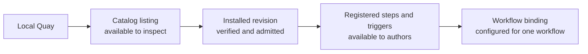

A catalog record is comparable to an item on a store shelf: users can search its verified metadata and inspect its origin, but it cannot execute. Once verified documentation assets are hydrated, they can read the safe rendered documentation from the same immutable snapshot. Installing a plugin creates immutable installed records for the exact verified digest. A workflow then refers to those installed records rather than to a catalog entry that may change during the next reconciliation.

For a GitHub plugin, Syntara first stores the local Quay source and reconciliation results. It creates a catalog listing containing safe documentation and verification information. After approval, it stores the exact plugin revision and its `Create issue` action, `Issue created` trigger, integration and credential types, approved capabilities, and verification evidence. A workflow pins the installed action or trigger revision; catalog updates cannot silently replace it.

The records below preserve five important boundaries:

- **Discovery versus installation:** browsing a plugin does not install, enable, or execute it.
- **Installation versus workflow use:** installation makes definitions available; each workflow still stores its own validated configuration.
- **Definitions versus secrets:** plugin records describe credential types, while credential values remain in Syntara's existing encrypted credential domain.
- **Requested versus approved access:** capability grants record what an administrator actually allowed.
- **New versions versus existing workflows:** immutable revisions let running and published workflows continue using their pinned version until an explicit update.

| Table | Purpose | Important constraints |
|---|---|---|
| `plugin_sources` | Local Quay/catalog configuration, opaque registry-credential and CA references, trust-policy reference, scope, channel, mirror behavior, schedule, and high-water state | Secrets are never returned; source changes are audited; one source cannot silently claim another source's namespace |
| `plugin_source_reconciliations` | Immutable reconciliation attempts and results | Records resolved index digest/generation, predecessor, timestamps, counts, bounded errors, and actor/scheduler identity |
| `catalog_plugin_versions` | Verified discovery projection from accepted catalog indexes | Unique per reconciliation + plugin identity + version; each accepted snapshot retains its exact artifact digest, while catalog rows are not installed definitions and cannot become selectable directly |
| `catalog_plugin_assets` | Verified bounded documentation, icons, and canonical inspection data available before installation | Linked to catalog version and source index digest; text/markup is sanitized; no executable code or secret values |
| `plugin_installations` | Environment-level plugin lifecycle and default revision policy | Tracks default pointer and environment scope, not mutable definition bodies |
| `installed_plugin_revisions` | Immutable verified plugin manifest revision | Unique digest; stores canonical normalized manifest and verification evidence |
| `installed_plugin_assets` | Verified canonical inline documents and bundled schemas, UI declarations, mappings, recipes, documentation, and icons | Unique by plugin revision + logical location; records source kind, normalized asset path or synthetic manifest location, media type, source/canonical digests, bounds, and compiled local references; never stores credential values or executable code |
| `runner_profiles` | Stable server-owned runner selection identity | Maps a versioned driver to one administrator-selected active immutable revision |
| `runner_profile_revisions` | Immutable platform-runner ABI/profile/image bindings | Versioned profile plus exact verified image digest; installed platform-runner actions pin this row |
| `installed_step_revisions` | Immutable step schemas, UI metadata, form bindings, operation, runner/workload binding, capabilities | Identity includes plugin digest and exact runtime-binding revision; no user-controlled image or form-provider route |
| `installed_trigger_revisions` | Immutable declarative trigger schemas, UI metadata, driver selection, event mapping, and integration requirements | Selects only an admitted Syntara trigger driver; contains no publisher listener code or mutable endpoint |
| `workflow_trigger_activations` | Concrete trigger binding for one published workflow revision | Pins trigger, workflow, connection/endpoint, grant, and driver-owned endpoint/schedule/subscription IDs; unique activation and external-event deduplication identities |
| `installed_form_provider_revisions` | Immutable declarative or sandboxed authoring providers shared by steps in one plugin revision | Namespaced provider ID; mode, operations, mappings or exact provider-image digest, ABI, limits, and authoring capabilities; never secret values or mutable image references |
| `installed_integration_type_revisions` | Dynamic integration definitions and validation schema | Namespaced IDs; definitions immutable per plugin revision |
| `integration_endpoint_revisions` | Administrator-approved external deployment endpoints | Immutable normalized API/web origins, endpoint kind, TLS policy, OAuth registration, capability evidence, and egress binding; ordinary authors and workflows cannot create arbitrary origins |
| `installed_credential_type_revisions` | Dynamic credential schema, secret-field metadata, and bounded issuance recipe | Selects only an allowlisted broker mechanism; never contains credential instance values or executable provider code |
| `provider_sandbox_bindings` | Verified executable authoring-provider image and ABI binding | Exact digest, signature/provenance/SBOM/scan evidence, trust tier, provider ABI, resource policy, and dedicated worker-pool binding |
| `plugin_capability_grants` | Administrator-approved intersection of requested and environment-allowed authoring/runtime capabilities | Versioned and auditable; deny by default; authoring reads and runtime effects are shown separately |
| `plugin_verification_records` | Signer, identity, digest, provenance, SBOM, scan, compatibility, and policy evidence | Append-only evidence linked to artifact/image digests |
| `registry_generations` | Complete immutable registry snapshot and publication state | Candidate hash is validated before atomic current-generation pointer flip |
| `registry_outbox` | Durable generation publication/notification work | At-least-once, idempotent, recoverable by polling |
| `plugin_lifecycle_events` | Install/update/disable/uninstall/deny audit trail | Actor, request ID, reason, prior/new state |

Integration instances and credential instances continue in their existing domains but reference a specific installed type revision. Workflows reference installed action/trigger revisions rather than mutable catalog rows.

#### Presentation talking points

- Browsing a plugin does not install or activate it.
- Workflows always use an exact, verified plugin revision.
- Updating a catalog cannot silently change a published or running workflow.
- Credential values stay in Syntara's existing secure credential system, not in plugin records.
- Every installation, permission change, update, disable, and removal is auditable.
- The table list represents explicit safety boundaries inside the Syntara data model, not a requirement to create a separate service for every table.

### 5. Runtime registries

Introduce typed domain services backed by immutable installed revisions:

- `StepTypeRegistry`
- `TriggerTypeRegistry`
- `FormProviderRegistry`
- `IntegrationTypeRegistry`
- `CredentialTypeRegistry`
- `PluginInstallationService`
- `PluginPolicyService`

They expose immutable generation snapshots to request handlers and workflow compilation. They do not execute plugin code. Installation first commits definitions into a non-selectable candidate generation. A publisher builds and validates the complete deterministic snapshot, stores its hash, then atomically flips the environment’s `current_registry_generation_id` and any lifecycle/default-pointer changes in one transaction. Replicas poll or consume the outbox, load and hash-check the new generation, and continue serving the prior complete generation until ready; they never combine generations. Definition responses carry the generation ID, and publish/mutating requests carry an `If-Match` generation so any replica either loads that exact immutable snapshot or returns a refresh conflict. A replica that cannot load the current generation fails authoring/publish readiness instead of serving a partial registry. Notification loss is recovered by polling. Pinned running workflows use direct immutable revision reads and are not coupled to cache refresh. Failed candidate publication never changes the current pointer and can be retried or abandoned without a compensating database rollback.

Existing native step models remain for orchestration primitives. Plugin-contributed external actions use a generic stored action envelope containing the canonical step revision ID plus schema-validated configuration. The first implementation names this typed workflow node `external_action`; it accepts only `step_revision_id`, optional `plugin_connection_id`, and `inputs`. Publication resolves and freezes the image, runtime ABI, runner profile, integration-type revision, and admitting registry generation into a separate `WorkflowActionBinding` record in the same database transaction. It rejects images, commands, policy IDs, grants, credentials, and other execution-route fields from the workflow definition. Plugin-contributed triggers use a separate generic trigger envelope containing the installed trigger revision ID and schema-validated configuration. The two envelopes cannot be substituted for one another: only an action may compile to `Container`, and only a trigger may create a publish-time activation. For a laptop-only proof, two explicit deployment switches may enable the local-PoC bridge: it accepts only an integration-free action with no credential lease, re-resolves the immutable binding in the Temporal activity, and assigns opaque local-only control-plane context. It is not a production default and is forbidden in shared, hosted, OpenShift, and production deployments. All other external-action execution continues to fail closed with `ExternalActionRuntimeUnavailable` until server-owned connection, policy, and credential-lease resolution is implemented. This keeps the generic boundary at the extension seam rather than turning the entire workflow definition into untyped dictionaries.

### 6. API surface

The API surface is the shared contract used by the Syntara UI, CLI, SDK-based developer tools, a future Syntara VS Code extension, and approved hosted tooling. These clients do not import Syntara backend or plugin code; they invoke the same authenticated APIs.

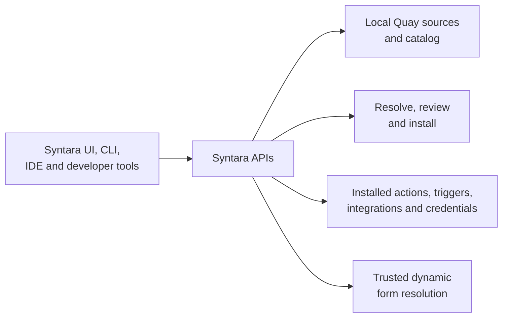

The routes form four user-facing groups:

1. **Source administration:** connect, test, and reconcile a local Quay catalog source and inspect its history.
2. **Discovery and installation:** search the catalog, read documentation, inspect a version, resolve its exact digest, review it, and install or manage it.
3. **Workflow authoring:** list the enabled action, trigger, integration, and credential definitions visible in the current environment.
4. **Dynamic forms:** securely resolve options or a bounded form fragment through an installed provider without exposing credentials to the browser.

Implemented source-administration APIs:

- `GET/POST /api/v1/plugin_sources`
- `GET/PATCH/DELETE /api/v1/plugin_sources/{plugin_source_id}`
- `POST /api/v1/plugin_sources/{plugin_source_id}/enable`
- `POST /api/v1/plugin_sources/{plugin_source_id}/disable`

Planned source-administration APIs, after concrete credential and trust adapters exist:

- `POST /api/v1/plugin_sources/{plugin_source_id}/test`
- `POST /api/v1/plugin_sources/{plugin_source_id}/reconcile`
- `GET /api/v1/plugin_sources/{plugin_source_id}/reconciliations`

Implemented read-only discovery APIs:

- `GET /api/v1/catalog/plugins`
- `GET /api/v1/catalog/plugins/{namespace}/{name}`
- `GET /api/v1/catalog/plugins/{namespace}/{name}/versions/{version}?source_id={source_id}`

Planned discovery and installation APIs:

- `GET /api/v1/catalog/plugins/{namespace}/{name}/versions/{version}/documentation`
- `POST /api/v1/plugin-installations/resolve`
- `POST /api/v1/plugin-installations`
- `GET /api/v1/plugin-installations`
- `GET /api/v1/plugin-installations/{namespace}/{name}`
- `POST /api/v1/plugin-installations/{namespace}/{name}/revisions/{revision}/enable`
- `POST /api/v1/plugin-installations/{namespace}/{name}/revisions/{revision}/make-default`
- `POST /api/v1/plugin-installations/{namespace}/{name}/revisions/{revision}/disable`
- `DELETE /api/v1/plugin-installations/{namespace}/{name}/revisions/{revision}` with dependency checks
- `POST /api/v1/plugin-installations/{namespace}/{name}/disable`
- `DELETE /api/v1/plugin-installations/{namespace}/{name}` for dependency-free whole-plugin uninstall

Authoring/runtime definition APIs:

- `GET /api/v1/step-types?installed=true`
- `GET /api/v1/trigger-types?installed=true`
- `GET /api/v1/integration-types?installed=true`
- `GET /api/v1/credential-types?installed=true`
- `POST /api/v1/step-types/{installed_step_revision_id}/form/resolve`
- Existing integration and credential instance APIs accept dynamic type-revision IDs and validate against the installed schema.

The form-resolution request contains the draft workflow ID, field path, opaque integration connection reference, values for only the field's declared dependencies, search text, and an opaque cursor. Environment and caller identity come from authentication. The server resolves the component/provider/operation from the immutable installed step revision and rejects client-supplied provider IDs, URLs, methods, auth profiles, credential IDs, or undeclared dependency values. The response is either a bounded option page or an allowlisted schema/UI fragment, with a source version, content digest, and optional next cursor.

Catalog list/detail APIs return safe projections and a non-secret source identity; they never return registry credentials, raw signature material that contains secrets, or unsanitized publisher markup. The current implementation supports bounded pagination and filtering by source, namespace, name, version, runtime ownership, and lifecycle flags. It returns the immutable documentation digest and, only through an administrator-only hydration operation, can verify and persist sanitized rendered documentation. The local proof restricts that operation to an explicit loopback source profile; production composition requires configured signed-artifact trust adapters. Neither path exposes raw publisher markup. Later search extends this with publisher, action/trigger capability, compatibility, installed/update state, and local verification. Source test, reconciliation, and documentation hydration are administrator-only, rate-limited, auditable operations. Deleting a source removes its discoverable projections only after dependency checks; it never uninstalls an installed plugin revision.

`resolve` is read-only and accepts an explicit digest reference. When installation starts from the catalog, the backend copies the selected catalog digest into the same request rather than accepting a tag or mutable source location from the browser. `resolve` returns the exact digest, verification evidence, compatibility, requested capabilities, referenced images, and proposed grants. `install` requires that resolved digest plus explicit grants, preventing a source or tag from changing between review and commit. Direct-digest and catalog-driven installations therefore converge before trust evaluation and persistence.

Every route is scoped to an environment ID derived from the authenticated principal, never accepted as an unchecked body field. Definition reads expose only enabled revisions visible to that environment unless the caller has plugin-audit permission.

#### GitHub dynamic-form example

When an author opens a GitHub `Create issue` step, the UI obtains the installed step definition and asks its form-resolution endpoint for repository options. The request includes only the opaque GitHub connection reference, declared dependent values, and search text. Syntara determines the provider and approved endpoint from the installed revision, obtains credentials server-side, calls GitHub, and returns a bounded list of repository choices; no access token is returned to the browser.

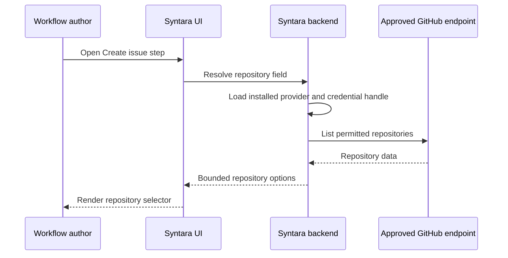

#### Presentation talking points

- The same APIs support the Syntara UI, CLI, IDE extension, SDK tooling, and approved hosted tools.
- `resolve` is a read-only inspection step; `install` commits the exact digest and grants the administrator reviewed.
- Catalog and direct-digest installations converge on the same backend transaction.
- The frontend discovers installed capabilities through data APIs and never imports plugin code.
- Dynamic forms run through the trusted backend, so access tokens do not enter the browser.
- Removing a catalog source removes discovery records only; it does not silently uninstall already installed plugins.
- Authentication determines the environment and permissions; a client cannot select an unchecked environment, provider, endpoint, or credential.

### 7. Install transaction

The install transaction safely turns one exact OCI plugin artifact into capabilities that Syntara may expose to users. Catalog selection and direct-digest installation enter the same transaction; there is no less-trusted marketplace shortcut.

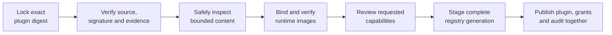

For example, installing a GitHub plugin at version `1.2.0` does not mean trusting the text `1.2.0` or a mutable tag. Syntara pins the resolved artifact digest, verifies who signed it, validates the manifest and every referenced asset, binds exact managed-runner or publisher-workload images, and presents the requested design-time and runtime capabilities for review. Only after the entire candidate registry validates does Syntara make the plugin selectable.

The transaction has three safety properties:

- **No content substitution:** review and commit use the same immutable plugin and image digests.
- **No partial installation:** a failure leaves no action, trigger, form, credential type, or integration type selectable.
- **No installation-time publisher execution:** installation interprets bounded declarations and never runs publisher hooks or frontend code.

1. Accept an explicit plugin artifact digest. SDK tooling may resolve a tag before installation, but the review and install request use only the resulting immutable digest.
2. Pull only the OCI descriptor and signature material.
3. Verify the digest claim and signer identity against the environment's local trust policy **before decoding the plugin manifest**. Verify provenance, SBOM, and scan evidence before decoding when local policy requires that evidence.
4. Fetch the config, root-manifest, and content-bundle descriptors by digest. Enforce exact v1 media-type/cardinality rules and compressed/expanded limits before decoding. Parse the bounded config and root manifest, validate each asset-capable field as an explicit `inline` or `asset` source, then stream the bundle without filesystem extraction while rejecting unsafe archive entries.
5. Verify that the asset index and archive match exactly; reject bare-string or unknown document-source variants; validate every normalized relative reference and asset digest/media type; canonicalize inline and asset-backed documents; compile both forms to immutable installed-asset IDs; and validate canonical IDs, SemVer, compatibility ranges, schemas/UI/mappings, action versus trigger target kinds, admitted trigger drivers and event mappings, form components/provider operations/dependency graphs, credential issuance recipes, self/native-only cross-references, forbidden fields, and manifest uniqueness. Declarative provider routes must be read-only and relative to an approved integration endpoint. Sandboxed provider declarations must contain an exact image digest, supported provider ABI, bounded operation class, and explicit capabilities. Trigger targets must be declarative and may not name a workload/provider image or executable listener. Cyclic dependencies, undeclared inputs, remote schema references, arbitrary URLs, executable UI/backend content, install hooks, and in-process backend modules are rejected.
6. For Kind A, resolve the requested driver family/version range to an administrator-admitted immutable runner-profile revision and bind its exact image digest. For Kind B and sandboxed providers, require exact image digests—never tags—and verify signer/repository authorization, ABI/conformance, and any provenance, SBOM, or scan evidence required by local policy. Record every selected revision and digest before administrator review.
7. Compute the intersection of requested capabilities, environment policy, workload-class ceiling, and administrator grants separately for authoring and runtime. Every capability is declared `required` or belongs to a named optional feature. A denied required capability blocks installation. A denied optional feature is recorded, removed from the effective grant, and disabled in the builder; a configuration that still attempts to use it fails deterministically with `CAPABILITY_NOT_GRANTED`. Granting a read-only authoring provider never implicitly grants the corresponding runtime mutation.
8. Stage normalized immutable revision rows and verification evidence in lifecycle state `STAGED` and create a candidate registry generation.
9. Build/hash-check that complete generation. For first install, the reviewed request may atomically transition the revision to `ENABLED`, set it as default, and publish the generation. For updates, the default is unchanged unless the request explicitly asks to change it.
10. Emit the durable outbox and audit events in the same pointer-flip transaction. Replicas refresh by generation; on any earlier failure, nothing becomes selectable and only safe diagnostic evidence remains.

No `npm install`, Python import, shell hook, plugin migration script, or executable frontend bundle runs during installation.

#### Presentation talking points

- Syntara installs an exact immutable digest, never a moving tag.
- The package is authenticated before Syntara decodes its manifest.
- Installation validates declarations; it does not execute plugin code.
- Managed runners, publisher workloads, and sandboxed providers are all bound to exact verified image revisions.
- Design-time reads and runtime effects are reviewed as separate permission sets.
- A failed installation exposes no partial plugin capabilities.
- Plugin definitions, effective grants, the current registry pointer, and audit events become active together.
- Catalog and direct-digest installation use the same transaction and trust rules.

### 8. Trust and policy model

This model answers two separate questions: whether Syntara can establish where a plugin came from and whether this environment permits the plugin to perform its requested work. A signature is necessary evidence of origin and integrity, but it is not by itself proof that content is safe, compatible, certified, or approved for use.

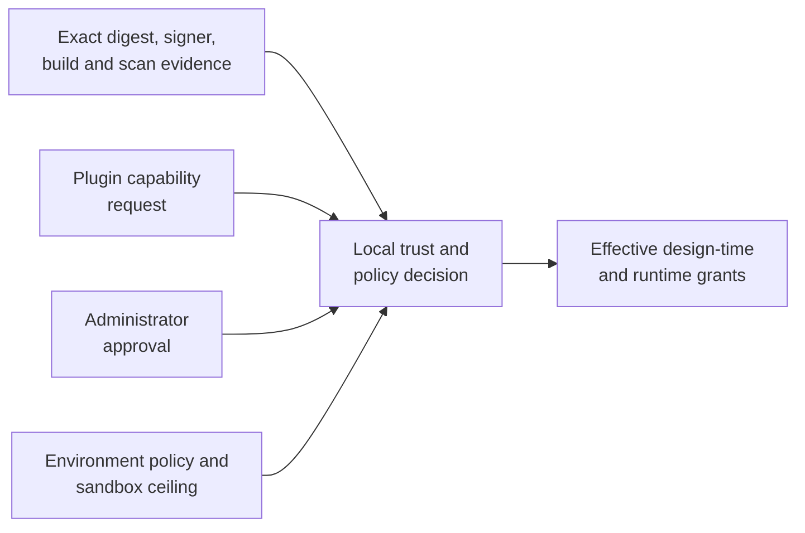

Trust is layered:

- **Integrity:** artifact/image digest.
- **Identity:** trusted signing key or keyless identity policy.
- **Build provenance:** expected repository, workflow, builder, and source revision.
- **Content evidence:** SBOM and vulnerability/malware/license scan policy for executable images.
- **Compatibility:** Syntara, SDK, manifest, runner, and Execution Plane versions.
- **Capabilities:** authoring-time provider mode, operation class, network/broker/credential access plus runtime network destinations, credential types/scopes, filesystem mode, resource bounds, timeout, concurrency, and execution pool.
- **Workload enforcement:** OpenShift security context, dedicated service identities and pools, read-only root filesystem, seccomp, dropped capabilities, namespace/network policy, quotas, and audit for runtime workloads and sandboxed providers.

The effective authoring grant and effective runtime grant are computed independently using the same rule:

`manifest request ∩ administrator grant ∩ environment policy ∩ workload-class ceiling`

The initial platform has no Certified, Validated, or Community tier. The UI reports factual local evidence: artifact digest, verified signer identity, source reference, optional supply-chain evidence, workload ownership, and the policy decision made by this environment. A future marketplace certification attestation may become another policy input, but a valid signature alone never creates a certification badge.

Required and optional capability sets are disjoint and named in the manifest. Optional capabilities belong to named features with schema/UI conditions; an optional feature cannot make a base-schema field required. Install review shows authoring reads separately from runtime effects, granted and denied features, and the exact effective sets are pinned in `plugin_capability_grants`. A runtime grant does not authorize editor-time enumeration, and a form-provider grant does not authorize execution.

For example, a GitHub plugin may request permission to read repositories and labels while an author edits a workflow, use one GitHub credential type, contact an approved GitHub Enterprise endpoint, and create issues during execution. The administrator may allow those operations only for a particular endpoint and credential scope. Syntara records and enforces that smaller approved set; the plugin cannot grant access to itself. Approving repository lookup at design time does not automatically approve issue creation at runtime.

#### Authorization and isolation

V1 uses an explicit environment boundary. Every source, catalog projection, installation, registry generation, integration instance, credential instance, workflow revision, capability grant, invocation, and audit event carries `environment_id`; database queries and cache keys require it. Cross-environment references fail closed.

| Role/permission | Allowed operations |
|---|---|
| Platform security administrator | Manage trust roots, signer/namespace bindings, global runner and provider-sandbox policies, emergency revocation, and break-glass policy |
| Environment plugin administrator | Configure/test/reconcile local catalog sources; browse inspection details; resolve catalog-selected or explicit digests; install, grant, enable, default, disable, and remove plugin revisions |
| Integration owner | Create/update/revoke integration and credential instances they own; delegate use to environment roles/workflows |
| Workflow author | Read enabled definitions, use explicitly authorized integration/credential references, edit drafts, and request publish |
| Workflow publisher | Publish immutable workflow revisions after policy and revision validation |
| Workflow runner | Start permitted published workflows and inspect permitted runs; cannot change routes or grants |
| Auditor | Read manifests, evidence, grants, lifecycle events, and redacted run records; cannot mutate |

The authorization service checks role, environment, resource ownership/delegation, and requested action at the API and again when publishing and dispatching. A reference visible in a builder is not proof of credential-use permission. Negative authorization and cross-environment tests are required for every administrative, credential, publish, run, inspect, cancel, and audit route; denials are audited without leaking resource existence across environments.

#### OAuth and integration resolution

OAuth is an explicit connection flow owned by Syntara, not code supplied by a plugin and not a side effect of opening a form field. The browser visits the authorization page for an administrator-approved endpoint, while the Credential Broker completes and stores the token exchange. The browser and workflow retain only an opaque connection reference.

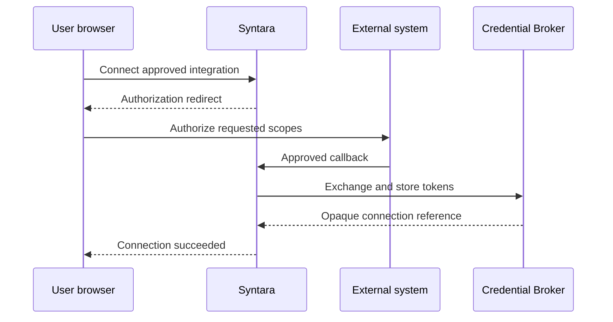

V1 supports managed OAuth, GitHub App-style service identity, and administrator/user-supplied service tokens; it does not force every system into one authentication style or require product-specific authentication code in the workflow engine. Syntara owns a versioned OAuth and Credential Broker with allowlisted mechanisms such as `oauth2-authorization-code.v1`, `static-bearer.v1`, and `jwt-token-exchange.v1`. An installed credential type supplies its schema, secret fields, scope ceiling, and a bounded recipe selecting one of those mechanisms. The selected integration endpoint revision supplies the validated authorization/token/revocation origins, exact registered callback, TLS policy, and egress grant for GitHub.com, a GHE.com tenant, a GitHub Enterprise Server instance, AAP, or another approved deployment. The broker enforces PKCE S256 where supported, state/nonce, redirect validation, scope ceilings, refresh/revocation, response extraction, and short-lived credential minting. A GitHub App recipe references the server-side private-key field and installation identity, but only the broker can read that key, sign the bounded JWT, perform the approved relative token exchange, or retain the returned token. Plugins and workflows cannot supply absolute OAuth/token URLs or widen claims, algorithms, scopes, headers, or destinations beyond the mechanism and endpoint revision.

The integration connection records both an authentication profile and an execution identity mode. `project` is the default for published scheduled/event-driven automation and resolves a project-owned service/app connection. `triggering-user` is explicit and resolves the initiating user's OAuth connection at run time; publish rejects it for triggers that have no user principal. Syntara never silently converts the workflow author's design-time OAuth connection into the runtime identity. A user connection may be used to browse resources while editing only if publish separately proves that the selected runtime connection can use those resources.

OAuth connect/reconnect is explicit UI state, not a side effect of mounting a field. The browser navigates to the external authorization page resolved from the administrator-approved endpoint revision and receives only success/failure plus an opaque connection reference; access tokens, refresh tokens, client secrets, private keys, and PATs never enter form values, browser storage, workflow drafts, provider requests, or form-resolution responses. Adding or changing an external origin requires privileged endpoint registration, TLS/identity validation, SSRF and DNS checks, and a new immutable endpoint revision; plugins and workflow authors cannot create one implicitly.

A step declares one accepted integration type revision family. A workflow node references an authorized integration instance ID, never raw connection data. At publish, Syntara verifies that the instance’s type revision is compatible with the step revision and that the publisher may delegate its use. At run time, the server resolves the exact integration revision: bounded non-secret connection metadata goes into the ABI request, while secrets become invocation-scoped handles. This dynamic resolver replaces plugin paths through the static adapter factory; native engine integrations may retain native adapters behind the same typed resolution interface.

#### Credential-handle contract

At execution time, Syntara does not place stored credentials into the workflow definition or work item. The broker issues a short-lived, one-use handle for the exact invocation. After the trusted Execution Plane redeems it, only the approved fields are written as temporary read-only files for that workload and are removed when the invocation ends.

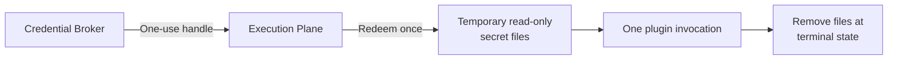

The Syntara Credential Broker is the redemption owner. It mints an opaque, random, single-use handle bound to `environment_id`, integration and credential instance/revision IDs, step revision, invocation ID, capability-grant ID, approved field/scope set, EP audience, and a short expiry no longer than the invocation timeout. The value is persisted only as a hash. EP authenticates to redeem it once; a repeated redemption, binding mismatch, expired invocation, disabled grant, or revoked credential fails closed and is audited. The broker refreshes upstream OAuth tokens before issuing the lease; custom workloads cannot refresh or widen scopes.

After redemption, EP writes only the approved fields to individual mode-0400 files on an invocation tmpfs and passes file paths through the workload ABI. Environment variables and command-line arguments are forbidden for secret values. Direct injection is therefore not a separate fallback: it is this file-based, invocation-scoped delivery path. EP removes the tmpfs at terminal state, cancellation, startup failure, or lease expiry; broker revocation invalidates unredeemed handles immediately. Secret values never enter plugin manifests, workflow definitions, Temporal histories, catalog rows, work-item bodies, result envelopes, or general logs.

#### Syntara-to-Execution-Plane boundary

EP is exposed only as an internal ClusterIP/service route. Calls use mTLS plus a short-lived projected OpenShift service-account token with audience `syntara-execution-plane`; EP validates issuer, audience, expiry, namespace, and an allowlist of Syntara worker service-account subjects. Network policy permits ingress only from the worker namespace and service. TLS provides request integrity, while the durable invocation/request-hash rule below detects replays or mutation. Submit/read/cancel scopes are distinct. No plugin pod, user browser, or general API client can reach the EP control API or redeem a credential handle.

#### First generic-container implementation increment

The first local implementation proves the in-container boundary before it connects the whole product path. The SDK owns `syntara.container/v1alpha1` as a small `ContainerService` contract: Health advertises the immutable step revisions supported by the image, Execute names one selected step revision and carries bounded JSON input plus an optional bounded non-secret runtime context, and Cancel names the invocation. The image itself dispatches that selected action; EP does not use an image entrypoint, a server-generated command, or a one-image-per-action rule.

EP now accepts a `container` work item only after validating the shared `ContainerWorkloadRequest` schema. It launches the pinned image through the existing isolated cold-start Kubernetes Job path, confirms that Health advertises the selected step revision, and calls the SDK client. It forwards runtime context only after checking that it is a bounded JSON object. For `http.v1`, the context contract admits only the resolved operation and output-schema digest; it excludes origin, credentials, headers, image references, asset references, and executable expressions. A single image can therefore implement many actions from one plugin, while the current lifecycle still creates one pod for each workflow-step attempt. That is an intentional cold-start isolation choice, not an image-model limitation or a promise that the process is reused for the workflow run.

The legacy script workload remains a compatibility adapter behind the same Kubernetes transport. The generic container path is additive and does not reinterpret existing published script workflows. The local increment rejects non-empty credential leases: Credential Broker redemption and per-invocation read-only temporary-file mounts must be implemented before credential-bearing generic actions are enabled. This prevents an incomplete path from silently accepting or exposing a token.

Syntara now has the matching static generic Temporal activity and an internal EP client foundation. The activity accepts only a pre-resolved, schema-valid, credentialless request; derives a retry-stable work-item identity from Temporal's workflow/run/activity identity; mints a short-lived project-scoped token with only submit/read/cancel authority; submits the request; polls the durable EP state; and relays cancellation by that stable identity. It accepts only inline object results for now and fails closed for an object reference. The installed-action resolver returns the stored canonical action definition only to trusted backend composition code. A small application composer now takes only a published workflow revision and workflow-step identity plus server-resolved invocation, connection-handle, grant, policy, and timeout state. It resolves the durable binding, re-reads its immutable action revision, checks that the plugin digest/runtime ABI/image/runner-profile route still equals the stored snapshot, and then constructs the runtime context, policy snapshot, and request hash. A first publish-time action-route binding service requires an action to be enabled in the active registry generation, validates static JSON inputs against its installed schema, and persists only the server-selected plugin digest, action revision, runtime ABI, image digest, runner-profile revision, and admitting generation for that workflow revision. It stores no inputs, endpoint, connection, credential, grant, policy, or timeout. A later action disable therefore cannot silently change an already-published route, while a later delete is dependency-protected by the binding. Crucially, the activity is **registered but not exposed as a user-configurable workflow step**. Connection and policy resolution records, expression typing, publication generation preconditions, and workflow-definition integration still must exist before the dynamic workflow can call that composer. Until then, exposing an image-bearing request in a workflow definition would violate the boundary that image routing is server-controlled. The bridge, catalog installation, policy snapshot persistence, runner/publisher pools, broker redemption, and dynamic forms remain required product work, not assumptions hidden in the prototype.

#### Enforceable egress

Workload namespaces deny all direct external egress except cluster DNS and a policy-aware egress proxy. EP supplies the invocation’s immutable egress grant to the proxy. The proxy allows exact FQDN/port tuples by default; wildcards require a separately reviewed capability. It resolves DNS through the cluster resolver, blocks loopback/private/link-local/metadata ranges, validates destination host plus TLS SNI for CONNECT, re-evaluates every redirect, and never permits a raw IP to bypass a hostname grant. TTL/IP changes cause a fresh policy evaluation, and DNS failure, SNI mismatch, unsupported protocol, or proxy unavailability fails closed. OpenShift NetworkPolicy prevents pods from bypassing the proxy; target-cluster conformance tests cover redirects, DNS rebinding, wildcard boundaries, raw IPs, ports, and metadata endpoints.

#### Inert schema and content subset

V1 freezes an allowlisted JSON Schema 2020-12 subset: bounded object/array/string sizes and nesting; types, properties, required, enum/const, numeric/string limits, conditionals from an approved subset, and RE2-compatible patterns with length limits. Inline schemas may use only internal fragment `$ref` values and must be self-contained. Asset-backed schemas may additionally use bounded relative `$ref` values resolved from the containing asset's directory to another indexed schema asset in the same plugin revision. Remote refs, root escapes, custom formats that perform I/O, recursive schemas, unbounded regex engines, and arbitrary annotations are rejected. The UI schema names only shipped PatternFly components and declarative layout/visibility rules. Documentation is sanitized CommonMark without raw HTML, scripts, iframes, remote images, or styles; links are HTTPS-only and rendered with safe external-link attributes. Icons are approved PatternFly names or bounded sanitized bundled SVG. Nothing in schemas, documentation, or assets causes a server-side fetch.

#### Presentation talking points

- A signature proves origin and integrity; it does not by itself prove safety, certification, or local approval.
- Effective access is the intersection of the plugin request, administrator approval, environment policy, and the sandbox's maximum allowance.
- Design-time data lookup and runtime mutation have separate grants.
- Every plugin, workflow, integration, credential reference, grant, and invocation is isolated by environment and checked by role.
- OAuth tokens, private keys, and service tokens remain in the Syntara Credential Broker and never become form or workflow values.
- Execution receives short-lived, one-use credential access scoped to one invocation.
- Only trusted internal workers can submit to the Execution Plane, and plugin workloads cannot bypass the approved egress path.
- Schemas, documentation, icons, and UI declarations remain inert data and cannot introduce executable browser or backend code.

### 9. Dynamic forms and design-time providers

A dynamic form is part of workflow authoring, not workflow execution. It helps a user choose valid configuration while editing a step, but it does not start Temporal, create an Execution Plane work item, or run the step's workflow workload.

Use the least powerful form path that satisfies each field:

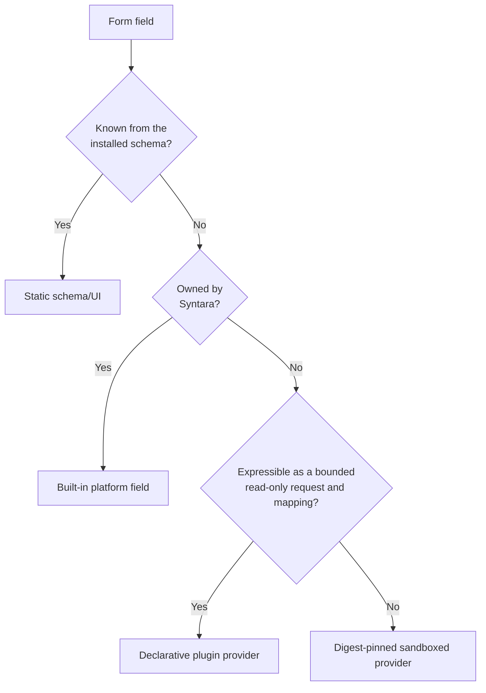

When an author drags a step onto the canvas, the builder first renders its installed input and UI schemas through Syntara-owned components. Static fields need no backend lookup. A remote field sends only its declared dependencies, search text, cursor, and opaque connection reference to the form-resolution API; Syntara selects the installed provider, authorizes the connection, resolves credentials server-side, and returns bounded values or an allowlisted schema fragment. The browser never receives an access token, provider URL, or publisher-supplied executable component.

A step form does not require a form provider. Dragging a step onto the canvas always loads its immutable input/UI schema. Static fields render and validate from that installed content alone; built-in platform fields may use fixed Syntara services. Only a field whose choices or shape depend on remote or computed state invokes a bounded read-only form provider. Form editing is an authoring-plane interaction, not a partial workflow execution: Temporal and the workflow-runtime Execution Plane remain idle, and a sandboxed provider may invoke only the separate Provider Sandbox Service.

For fields with a provider binding, the logical `FormProviderService` lives in the Syntara authoring/control plane and is backed by `FormProviderRegistry`, integration authorization, the OAuth/Credential Broker, an outbound provider gateway, and the Provider Sandbox Service. It resolves each immutable binding to one of two v1 provider modes: a declarative provider interpreted by trusted Syntara code, or a digest-pinned executable provider dispatched through the `syntara.provider/v1alpha1` ABI. The API/backend process never imports plugin modules or starts containers directly. The dispatch interfaces permit either service to be extracted or independently scaled without changing plugin or frontend contracts.

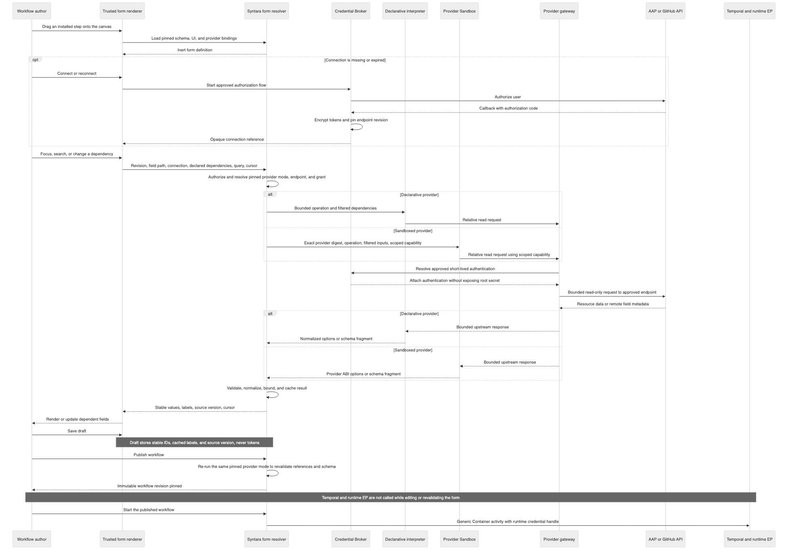

#### Generic form renderer and component registry

The builder uses one platform-owned `StepFormRenderer` inside the selected node's configuration card or side panel. It recursively walks the immutable input/UI schema and resolves every field through a frontend `InputComponentRegistry`. Installing a plugin registers step definitions, UI declarations, and provider bindings; it never installs a React component or other browser code. Registry implementations ship with a versioned Syntara frontend release.

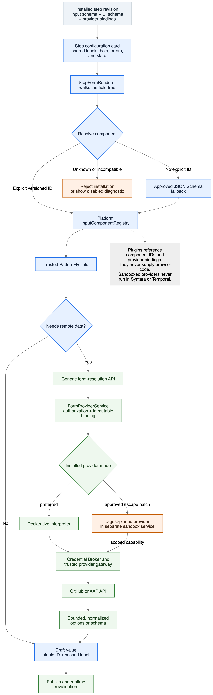

The contract keeps value, presentation, and remote lookup concerns separate:

| Contract | Source | Purpose | Trusted implementation |
|---|---|---|---|
| Value schema | Installed step input schema | Defines stored type, required fields, constraints, and validation | Allowlisted JSON Schema validator |
| Component ID | Installed UI declaration, for example `remote-resource-picker.v1` | Selects the interaction pattern without naming a JavaScript module | Syntara `InputComponentRegistry` |
| Component options | Installed UI declaration | Configures labels, layout, selection mode, visibility, and other component-owned behavior | The selected registry entry validates and interprets its versioned options schema |
| Provider binding | Installed step revision | Declares the read-only operation, connection, dependencies, projection, and invalidation rules for a dynamic field | `FormProviderService` and trusted provider gateway |

Component resolution is deterministic:

1. During installation, validate every explicit component ID against the environment's supported registry versions, the component's accepted value-schema shapes and options schema, and any required provider capability. An unsupported or incompatible component blocks installation.
2. At render time, an explicit versioned component ID wins. Plugin and provider names never select frontend modules.
3. If the UI declaration omits a component, select only an approved fallback from the JSON Schema shape, such as `string` to `text.v1`, `number` or `integer` to `number.v1`, `boolean` to `boolean.v1`, and a bounded string `enum` to `static-select.v1`. Any presentation beyond that default requires an explicit component ID.
4. Render the selected control inside the shared field/card shell. The shell owns title, description, required state, help, validation messages, loading, empty, stale, permission, and provider-error states; the component owns its specific input interaction.
5. If corrupt or stale installed state reaches a frontend that lacks the component despite installation checks, render a disabled unsupported-field diagnostic and block save/publish. Never silently coerce it to a text input or discard its value.

A dynamic component receives only its value/change contract, field path, declared dependencies, opaque connection reference, query, cursor, and a platform form-resolution client. It does not receive a provider URL, provider-selected module name, OAuth token, service credential, or arbitrary callback. A returned `schema` fragment re-enters the same renderer recursively after server and client validation against the installed component allowlist.

This is a deliberate combination of two proven patterns. Backstage separates JSON Schema from presentation with [`ui:field` and `ui:options`](https://backstage.io/docs/features/software-templates/ui-options-examples/) and collects registered fields into a generic form renderer, but its [custom field extensions](https://backstage.io/docs/features/software-templates/writing-custom-field-extensions/) are executable React code installed into the trusted frontend. Syntara adopts the schema/presentation split but keeps marketplace browser code out of v1. n8n resolves a parameter type through a [component registry](https://github.com/n8n-io/n8n/blob/46645c6d736692d0745ab2eed52268815c8dcdf7/packages/frontend/%40n8n/frontend-module-sdk/src/registries/parameterInputRegistry.ts#L21-L40) and its [generic parameter renderer](https://github.com/n8n-io/n8n/blob/46645c6d736692d0745ab2eed52268815c8dcdf7/packages/frontend/editor-ui/src/features/ndv/parameters/components/ParameterInput.vue#L1563-L1608) reloads remote options when dependencies change. Syntara adopts that dispatch and refresh behavior, not executable module-contributed UI.

#### Choosing whether a form provider is required

`formProviders` is optional plugin metadata, not a requirement for every step. Use the least powerful form path that satisfies the field:

| Form path | Plugin declares `formProviders` | Source of values | Backend activity while editing | Example |
|---|---:|---|---|---|
| Static schema/UI | No | Input schema, static enums, defaults, and user input | Normal draft save/validation only; no form-resolution call | Title, description, severity enum, timeout |
| Built-in platform field | No | Syntara-owned state or workflow context | Fixed Syntara API; no plugin provider and no publisher code | Integration connection, secret reference, workflow expression |
| Plugin declarative provider | Yes | Approved external endpoint through a connection | `FormProviderService` interprets the installed read-only operation | GitHub repositories/labels, AAP organizations/templates |
| Plugin sandboxed provider | Yes | Digest-pinned provider computation through brokered capabilities | Provider Sandbox Service executes the declared image | Bounded normalization that cannot be expressed declaratively |

The architecture does not call generic platform fields “built-in form providers.” They are versioned frontend component and fixed Syntara-service contracts. Product-specific GitHub or AAP discovery remains a provider declared by the corresponding installed plugin, even when Syntara publishes that plugin as first-party content. This keeps product API knowledge out of Syntara core and lets the plugin evolve independently.

Static fields need only an input schema. The generic renderer infers ordinary controls or consumes an inert UI declaration:

```yaml
inputSchema:
  kind: inline
  value:
    type: object
    additionalProperties: false
    required: [title, severity]
    properties:
      title:
        type: string
        minLength: 1
        maxLength: 256
      severity:
        type: string
        enum: [low, medium, high]
ui:
  kind: inline
  value:
    apiVersion: syntara.io/form/v1alpha1
    fields:
      title:
        component: text.v1
      severity:
        component: static-select.v1
```

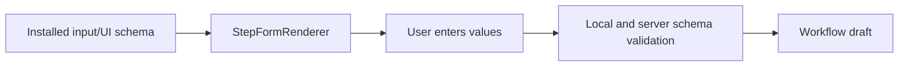

This path does not call `FormProviderService`, the Provider Sandbox Service, Temporal, the runtime Execution Plane, or an external system.

A built-in platform field also does not require `formProviders`. For example, a GitHub step may let the author choose an authorized connection but enter the repository name manually:

```yaml
ui:
  kind: inline
  value:
    apiVersion: syntara.io/form/v1alpha1
    bindings:
      connection:
        component: integration-connection.v1
        integrationType: syntara.github.connection
        authProfiles: [github-oauth.v1, github-app.v1, github-service-token.v1]
    fields:
      repository:
        component: text.v1
      title:
        component: text.v1
```

`integration-connection.v1` calls a fixed Syntara API to list connection records the current author may use and may start the platform-owned connect/OAuth flow. It stores only an opaque connection reference. It does not call GitHub to discover repositories and does not execute a plugin-declared provider. The repository string is validated structurally while editing and revalidated by the step operation before its external side effect.

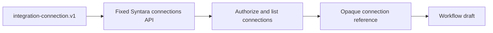

Built-in fields are shipped and versioned with Syntara. A plugin references their component contract but does not redefine them under `formProviders`. If a field must query product-specific remote data—such as repositories, inventories, or job-template surveys—the plugin declares a provider operation so the endpoint, connection, dependencies, mapping, permissions, and revalidation behavior are explicit and install-time validated.

#### Built-in and step-declared input types

| Input class | Owner | Examples | V1 rule |
|---|---|---|---|
| Built-in scalar/layout | Syntara | `text.v1`, `textarea.v1`, `number.v1`, `boolean.v1`, `static-select.v1`, `json-editor.v1`, groups, help, visibility | Fully described by inert schema/UI metadata |
| Built-in platform binding | Syntara | `integration-connection.v1`, `secret-reference.v1`, `expression.v1` | Enforces authorization, secret handling, workflow typing, and connect/reconnect UX |
| Step-declared dynamic input | Installed step/plugin revision | `remote-resource-picker.v1`, `remote-resource-multi-picker.v1`, `remote-schema-form.v1` plus a provider/operation binding | The step owns the declaration, dependencies, projection, and labels; trusted Syntara components render it and trusted providers resolve it |
| Sandboxed provider | Plugin author | Digest-pinned provider image implementing `syntara.provider/v1alpha1` | Optional v1 escape hatch for logic that cannot be declarative; runs only in the dedicated Provider Sandbox Service under an explicit executable-authoring grant |
| Step-supplied executable widget | Plugin author | React bundle, Web Component, arbitrary browser JavaScript | Out of scope for v1 and separate from backend-provider execution; requires an opaque-origin UI sandbox and scoped message ABI |

“Custom input type” in v1 means a namespaced reusable field definition composed from the shipped component vocabulary. Its provider binding may be declarative or may reference a separately reviewed sandboxed provider image, but it never installs browser code or imports backend code. This rule is independent of runtime Kind: a Kind B workflow workload does not automatically gain permission to run code during authoring, and a sandboxed authoring provider does not become a workflow workload.

The initial dynamic vocabulary has two resolver result kinds:

- **`options`:** a searchable/cursor-paginated page of normalized `{value, label, description?, disabled?, metadata?}` choices for one or many selection. `value` is a bounded JSON scalar or object with a provider-defined stable identity; `label` and `metadata` are cached presentation data, never authority.
- **`schema`:** a bounded JSON Schema/UI-schema fragment using only installed v1 components. It supports remote systems whose selected resource determines later fields, such as an AAP job template's prompt-on-launch settings and survey. It cannot add remote `$ref`, code, HTML, arbitrary URLs, new provider bindings, or a component outside the installed allowlist.

Any dynamically introduced secret/password field is normalized to `secret-reference.v1`. Its plaintext is written through Syntara's secret/credential service and the draft stores only an opaque reference; provider responses, workflow definitions, browser storage, and Temporal history never contain that value.

#### Form-resolution API and lifecycle

The browser calls only:

`POST /api/v1/step-types/{installed_step_revision_id}/form/resolve`

Example request:

```json
{
  "draftWorkflowId": "uuid",
  "fieldPath": "/inputs/labels",
  "connectionRef": "opaque-uuid",
  "dependencies": {
    "/inputs/repository": {
      "id": 123,
      "owner": "syntara-orchestration",
      "name": "syntara"
    }
  },
  "query": "bug",
  "cursor": "opaque-provider-cursor"
}
```

Example option response:

```json
{
  "kind": "options",
  "items": [
    {
      "value": {"id": 456, "name": "bug"},
      "label": "bug",
      "metadata": {"color": "d73a4a"}
    }
  ],
  "nextCursor": null,
  "sourceVersion": "etag-or-provider-version",
  "contentDigest": "sha256:..."
}
```

A `schema` response replaces `items` with the bounded schema/UI fragment and its digest. The client does not send `providerId`, operation, URL, method, auth profile, credential ID, response mapping, or capability. The server derives all of them from `installed_step_revision_id + fieldPath`, rejects undeclared dependency keys, and validates the supplied connection against the required integration type and form-provider grant.

Resolution follows these rules:

1. Authorize draft edit, installed step visibility, integration use, connection ownership/delegation, and the provider's authoring capability on every request.
2. Resolve provider mode, operation, declarative mapping or sandbox image digest, endpoint revision, and grant from one immutable registry generation; never trust browser routing data.
3. For a declarative provider, interpret the bounded operation in `FormProviderService`. For a sandboxed provider, submit a short-deadline request to the dedicated Provider Sandbox Service using the exact installed provider revision and image digest. Neither path invokes Temporal or the workflow-runtime EP API.
4. Resolve OAuth/service-token material only inside the Credential Broker and provider gateway. The browser and sandbox receive opaque connection/capability references and normalized non-secret results, never raw long-lived credentials or private keys.
5. Permit only side-effect-free provider operations. Creating or mutating a remote resource from a form requires a separate, explicitly authorized and audited authoring-action contract and is not in v1.
6. Apply the same endpoint-owned destination allowlist, TLS, redirect, DNS-rebinding, private/link-local/metadata-address, and canonicalization defenses used by the runtime egress boundary. Form lookup never accepts a browser-, workflow-, or provider-image-supplied absolute URL. Also apply versioned limits for deadline, response bytes, item/field count, schema depth, pagination, redirects, retries, and concurrent lookups. Use cancellation, input debouncing, rate limiting, bounded short-TTL caches, and opaque cursors.
7. For sandboxed providers, additionally require verified image evidence, no service-account token, arbitrary non-root UID, read-only root filesystem, dropped capabilities, seccomp/SELinux, default-deny network policy, no Syntara/database/Kubernetes API access, bounded CPU/memory/processes, and gateway-only egress. Terminate or quarantine the invocation on deadline, protocol violation, malformed output, revocation, or grant mismatch.
8. Key caches by environment, installed revision, provider operation, authorized connection/principal, declared dependency values, query, and cursor. Never cache or log tokens; avoid logging raw search/dependency values.
9. When an upstream dependency changes, cancel in-flight requests and clear every downstream value declared with `clearOnChange`. Hidden or stale values are not submitted.

#### Draft, publish, and run semantics

- A draft stores the stable provider value, cached label, provider/source version, and dynamic schema digest. Use an upstream ETag/revision when available; otherwise derive `sourceVersion` from the canonical normalized response while retaining `contentDigest` as the integrity comparison. Cached labels are UX only and do not prove existence or permission.
- Publish reruns the provider using the selected **runtime** connection, revalidates every literal external reference, fetches the current dynamic schema, validates values against it, and pins the normalized schema digest/source version in the immutable workflow revision.
- A value supplied by a workflow expression can be type-checked at publish but cannot be remotely resolved then. The builder marks it “resolved at run time”; execution performs the remote existence/permission check before the side effect.
- If a remote schema changes incompatibly between draft and publish, publish fails with `FORM_SCHEMA_CHANGED` and returns the affected fields. If it changes incompatibly after publish, execution fails closed with `FORM_BINDING_STALE`; it never silently remaps answers.
- Runtime rechecks integration/credential authorization, resource existence, source compatibility, and provider-specific constraints. Authoring discovery is never an authorization grant.

#### GitHub example: `Create issue`

The GitHub step mixes built-in fields with connection-aware dynamic fields:

| Field | Component | Dynamic behavior |
|---|---|---|
| Connection/execution identity | `integration-connection.v1` | Choose a project GitHub App/service connection or explicitly connect a user with OAuth; scheduled workflows default to project identity |
| Repository | `remote-resource-picker.v1` | Search repositories visible to the selected connection; save stable repository identity plus cached `owner/name` label |
| Title | `text.v1` | Required built-in string/expression |
| Body | `textarea.v1` | Built-in Markdown/string/expression |
| Labels | `remote-resource-multi-picker.v1` | Load labels for the selected repository; clear when repository changes |
| Assignees | `remote-resource-multi-picker.v1` | Load assignable users for the selected repository and connection |
| Milestone | `remote-resource-picker.v1` | Load open milestones for the selected repository |

The step-owned UI declaration can express that without GitHub-specific React:

```yaml
apiVersion: syntara.io/form/v1alpha1
bindings:
  connection:
    component: integration-connection.v1
    integrationType: syntara.github.connection
    authProfiles: [github-oauth.v1, github-app.v1, github-service-token.v1]
    executionIdentity: [project, triggering-user]
fields:
  repository:
    component: remote-resource-picker.v1
    provider: syntara.github.resources
    operation: repositories.list
    connection: $binding.connection
    searchable: true
    clearOnChange: [$binding.connection]
  title:
    component: text.v1
  body:
    component: textarea.v1
  labels:
    component: remote-resource-multi-picker.v1
    provider: syntara.github.resources
    operation: labels.list
    connection: $binding.connection
    dependencies:
      owner: $.repository.owner
      repo: $.repository.name
    clearOnChange: [$.repository]
```

At publish, Syntara verifies that the runtime connection can still access the repository and has the profile-approved permission needed to create issues. At execution, the Kind A GitHub HTTP runner receives the pinned declarative create-issue operation and an invocation-bound runtime credential handle; form-provider credentials or tokens are never copied from the draft.

#### AAP example: `Launch job template`

The AAP form has a cascade plus a remote schema:

| Field | Component | Dynamic behavior |
|---|---|---|
| Connection/execution identity | `integration-connection.v1` | Select an AAP integration and project service token or explicit user OAuth connection |
| Template type | `static-select.v1` | Choose job template or workflow job template |
| Organization | `remote-resource-picker.v1` | Load organizations visible to the selected AAP connection |
| Job template | `remote-resource-picker.v1` | Load templates filtered by connection, type, and organization; clear on any upstream change |
| Launch parameters | `remote-schema-form.v1` | Fetch normalized prompt-on-launch flags and survey; materialize only fields the selected template accepts |
| Inventory/credentials/execution environment/instance groups/labels | Remote single/multi pickers inside the schema fragment | Load choices with organization/template filters only when their prompt-on-launch flag permits them |
| Limit/tags/skip tags/job type/verbosity/forks/timeout/diff/extra vars | Built-in scalar/select/JSON components inside the schema fragment | Required/default/visibility rules come from normalized template metadata |
| Survey answers | Built-in scalar/select/multi-select or `secret-reference.v1` | Survey questions are normalized to the safe component subset; password answers become secret references |

```yaml
apiVersion: syntara.io/form/v1alpha1
bindings:
  connection:
    component: integration-connection.v1
    integrationType: syntara.aap.connection
    authProfiles: [aap-oauth.v1, aap-service-token.v1]
    executionIdentity: [project, triggering-user]
fields:
  templateType:
    component: static-select.v1
    options: [job, workflow]
  organization:
    component: remote-resource-picker.v1
    provider: syntara.aap.resources
    operation: organizations.list
    connection: $binding.connection
    clearOnChange: [$binding.connection]
  jobTemplate:
    component: remote-resource-picker.v1
    provider: syntara.aap.resources
    operation: templates.list
    connection: $binding.connection
    dependencies:
      organizationId: $.organization.id
      templateType: $.templateType
    clearOnChange: [$.organization, $.templateType]
  launchParameters:
    component: remote-schema-form.v1
    provider: syntara.aap.launch-form
    operation: job-template.resolve
    connection: $binding.connection
    dependencies:
      organizationId: $.organization.id
      jobTemplateId: $.jobTemplate.id
      templateType: $.templateType
    allowedComponents:
      - text.v1
      - textarea.v1
      - number.v1
      - boolean.v1
      - static-select.v1
      - json-editor.v1
      - secret-reference.v1
      - remote-resource-picker.v1
      - remote-resource-multi-picker.v1
```

`syntara.aap.launch-form` is a first-party installed provider operation because assembling launch fields can require template detail, survey, and related-resource calls plus AAP-specific normalization. It should use the declarative multi-operation contract when that contract remains bounded; if executable normalization is truly necessary, the same operation may be implemented by a digest-pinned first-party sandboxed provider without adding AAP code to Syntara core. The step still owns when and where the normalized result is used. The existing [AAP job-template form](../../frontend/packages/syntara-ui/src/routes/builder/node-forms/AAPJobTemplateForm.tsx), [AAP browser hook](../../frontend/packages/syntara-ui/src/hooks/useAAPBrowser.ts), and [server-side AAP proxy](../../backend/src/syntara/aap/services/aap_proxy_service.py) are implementation seeds; the marketplace work replaces their hard-coded node coupling with the generic contracts above.

#### Precedents and intentional differences

- The proposed v1 boundary prefers declarative providers but includes a separately deployed sandbox for digest-pinned executable providers. Publisher code never runs in the Syntara API, worker, browser, or workflow-runtime pool.

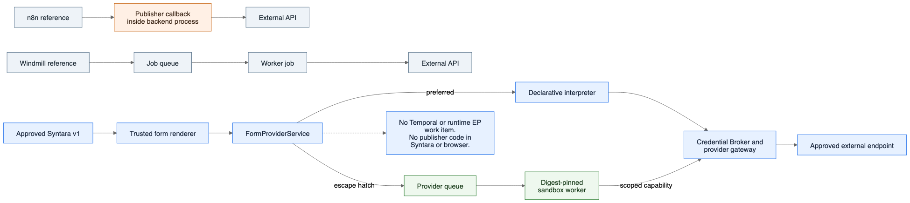

| System | Form UI | Where provider logic runs | Syntara lesson |
|---|---|---|---|
| Backstage | React JSON Schema Form (RJSF) plus trusted `ui:field` React extensions | A frontend extension may call trusted frontend APIs or a backend autocomplete provider | Reuse the schema/UI split and field registry, but do not distribute marketplace React code or browser-held provider tokens in v1 |
| n8n | Platform-owned Vue components | An installed node's `loadOptions`/`listSearch` method is called inside the n8n backend process | Reuse the editor UX and normalized result contracts, not the in-process publisher-code boundary |
| Windmill | Platform-owned Svelte select/multi-select components | The API authorizes and enqueues dynamic-select code as a normal worker job | Reuse the queue-to-worker separation for executable providers, but make isolation and brokered egress mandatory rather than deployment-optional |
| Syntara v1 declarative | Trusted PatternFly components | `FormProviderService` interprets an installed declarative operation and a trusted gateway performs the read | Lowest-cost and lowest-risk default for GitHub, AAP, and other ordinary API lookups |
| Syntara v1 sandboxed | Trusted PatternFly components | A dedicated provider queue dispatches a digest-pinned image to the Provider Sandbox Service | Adds custom provider computation without importing publisher code, exposing long-lived keys, or starting a Temporal workflow |

- Backstage templates demonstrate the safe ownership split: YAML names `ui:field: AAPResourcePicker`, while trusted frontend/backend plugins implement it. The [generic seed example](https://github.com/ansible/ansible-rhdh-templates/blob/main/generic-seed/template.yaml#L50-L57) does not carry executable field code. Syntara keeps that split but does not send a raw AAP token through the browser or persist an entire remote resource object.
- n8n demonstrates that `loadOptions`, resource locators, dependency reload, pagination, and OAuth can run while editing without executing a workflow. Its [dynamic-parameter service](https://github.com/n8n-io/n8n/blob/46645c6d736692d0745ab2eed52268815c8dcdf7/packages/cli/src/services/dynamic-node-parameters.service.ts#L299-L320) directly invokes the installed node's `listSearch` method in the backend process; its expression isolate protects expression evaluation, not the provider method itself. Syntara adopts the UX but not that process trust model. The [n8n dynamic-parameter credential advisory](https://github.com/n8n-io/n8n/security/advisories/GHSA-r4v6-9fqc-w5jr) and [routing/SSRF advisory](https://github.com/n8n-io/n8n/security/advisories/GHSA-9w78-79q7-r4fp) reinforce the rule that credentials and routing are re-authorized and resolved from immutable server state on every request.
- Windmill demonstrates the selected executable-provider topology. Its [dynamic-select endpoint](https://github.com/windmill-labs/windmill/blob/651a6b01f53d511974e69857fbbbace9b40bbf9b/backend/windmill-api/src/jobs.rs#L9768-L9989) validates the request and pushes provider code through the normal job queue instead of importing it into the API process. Syntara reuses that separation in v1, but not Windmill's deployment defaults: its [security-isolation documentation](https://github.com/windmill-labs/windmilldocs-public/blob/54041151247d2972bf867e4757aa1b9d06e0533a/docs/advanced/27_security_isolation/index.mdx#L29-L33) says job isolation is optional and disabled by default, whereas marketplace provider isolation is mandatory.

#### Proposed v1 Provider Sandbox boundary

V1 has two dynamic-provider modes. `kind: declarative` remains the default: `FormProviderService` resolves the immutable integration endpoint and operation from installed state and invokes the trusted provider gateway. `kind: sandboxed-provider` is an explicit escape hatch: `FormProviderService` resolves the exact provider revision, image digest, ABI, operation class, and capability grant and dispatches a bounded request to the Provider Sandbox Service. No publisher function, package, module, or container is loaded into the Syntara backend.

The sandboxed mode is not implied by Kind A or Kind B runtime execution and does not turn form resolution into a workflow step. Its boundary is:

1. The browser still submits only the installed step revision, field path, opaque connection reference, declared dependency values, query, and cursor.
2. The control plane authenticates and authorizes the caller, derives the exact provider revision and digest from installed state, validates the executable-authoring grant, and enqueues a short-lived provider invocation without using Temporal.
3. A dedicated provider worker pool runs the digest-pinned provider with read-only root filesystem, no Kubernetes API or service-account token, arbitrary non-root UID, seccomp/SELinux, dropped capabilities, fixed CPU/memory/process/time/output limits, cancellation, and no ambient credentials.
4. The provider can reach external systems only through the policy-aware provider gateway using an invocation-scoped capability. The gateway resolves the administrator-approved endpoint revision and may attach a short-lived access token or perform a brokered signing/token-exchange operation. Raw long-lived tokens, refresh tokens, client secrets, and private keys are not exposed to publisher code. A protocol that cannot work through this boundary remains unsupported until a separate privileged-secret trust contract is reviewed.
5. The control plane validates and normalizes the returned `options` or `schema` envelope, enforces size/depth/count limits, caches it under the authorized principal/connection/dependency key, and returns only non-secret data to the browser.

The Provider Sandbox Service may reuse code and Kubernetes isolation primitives from the Execution Plane repository, but it is deployed as a separate service identity, API audience, namespace, latency-oriented queue, and worker pool. It does not call Temporal, create a workflow run, accept runtime work items, share runtime capability grants, or reuse long-running retry semantics. Provider errors are editor interactions with short deadlines and cancellation, not durable workflow failures. A warm pool or scale-to-zero strategy may reduce form latency, but workers remain isolated by environment and provider revision and never retain credentials between calls.

Sandboxing reduces blast radius but does not make publisher code harmless. A provider can misuse any non-secret input, broker operation, upstream API operation, or destination it is granted. Install review must therefore show executable-provider ownership, exact image digest, operation classes, data exposed to the provider, broker capabilities, destinations, resource limits, local verification evidence, and residual publisher trust separately from workflow-runtime capabilities. Future certification labels may provide additional evidence but can never replace technical enforcement.

Executable browser widgets remain a separate future decision. If ever supported, they require an opaque-origin iframe, no Syntara session cookie, no direct credential or network access, and a versioned message/capability bridge. Publisher labels such as certified or validated may influence admission and review requirements, but never replace either the backend sandbox or the browser isolation boundary.

#### Presentation talking points

- Editing a dynamic form does not start or partially execute a workflow.
- Most fields use static schemas or built-in Syntara controls and require no provider.
- Syntara owns every browser component; plugins supply inert schema, presentation, and provider declarations.
- Product-specific lookup knowledge remains in the GitHub, AAP, or other integration plugin rather than Syntara core.
- Declarative providers cover ordinary read-only API lookups; sandboxed provider code is the exception for bounded computation that cannot be expressed declaratively.
- OAuth tokens and service credentials remain server-side and never become form or workflow values.
- AAP prompt-on-launch fields and GitHub repositories or labels use the same generic renderer and form-resolution contract.
- Draft selections are revalidated at publish time against the runtime identity and again when required at execution.
- Installing a plugin never installs executable React or JavaScript into the Syntara frontend.

### 10. Unified execution contract

Every external plugin action uses one generic Temporal activity and one versioned Execution Plane contract. Managed-runtime actions and publisher-workload actions differ in image ownership and implementation, but not in orchestration, credential delivery, isolation, cancellation, result, or failure handling.

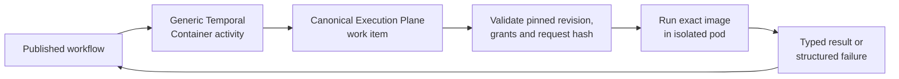

A managed GitHub action resolves to a Syntara-approved HTTP runner image that interprets the plugin's operation declaration. A custom change-risk action resolves to the publisher's exact signed workload image. In both cases, server-side installed state supplies every routing and security value; workflow authors cannot substitute an image, grant, credential handle, execution pool, or runtime contract.

At workflow publish time, compile each external plugin **action** node to an immutable installed step revision. Declarative trigger nodes instead compile to the immutable activations described above. At action execution time:

1. The workflow worker loads that revision and evaluates only schema-declared input expressions.
2. Server-side code resolves the exact integration revision, runner/custom image digest, capability grant, invocation-bound credential handles, execution pool, timeout, and resources.
3. One generic Temporal `Container` activity submits a canonical, hash-bound Execution Plane work item.
4. Execution Plane validates the envelope against its policy snapshot, runs the pinned image in an isolated pod, streams bounded progress, and records result metadata.
5. The activity returns a typed success/failure envelope to the workflow. Large outputs use object storage references rather than Temporal payloads.
6. Cancellation, heartbeat, retry, and timeout map to Execution Plane operations using durable invocation semantics.

The work item needs at least:

```json
{
  "apiVersion": "syntara.io/v1alpha1",
  "kind": "ContainerStepWorkItem",
  "invocationId": "uuid",
  "workflowRunId": "uuid",
  "stepRevisionId": "uuid",
  "pluginDigest": "sha256:...",
  "runtimeAbi": "syntara.container/v1alpha1",
  "imageDigest": "registry/repo@sha256:...",
  "integrationHandle": "opaque-invocation-bound-reference",
  "inputs": {},
  "runtimeContext": {
    "driver": "http.v1",
    "operation": {"method": "POST", "path": "/repos/{input.owner}/{input.repository}/issues"},
    "outputSchemaDigest": "sha256:..."
  },
  "credentialHandles": [],
  "capabilityGrantId": "uuid",
  "executionPolicyId": "uuid",
  "timeoutSeconds": 300,
  "requestHash": "sha256:..."
}
```

Every routing field and runtime context is generated from trusted installed state. Unknown or inconsistent IDs/digests are denied. The current control-plane builder derives the `http.v1` context from the immutable installed action, verifies that it matches the selected runner profile and validates it against the shared context schema before it can cross the container ABI. A second pure builder validates the action's structured input then creates the complete credentialless, hash-bound work-item request from server-owned invocation, connection, and policy references. The SDK defines the hash as SHA-256 of strict canonical JSON with only the two mirrored `requestHash` fields omitted; EP independently recomputes it before accepting a request. A runtime context is not integration transport: it must not contain endpoints or any credential material. The published-workflow adapter that obtains those trusted references remains a separate increment. EP PR 1 therefore needs to generalize `workload_type: "script"` into a versioned container-step contract rather than merely accepting arbitrary payload fields.

#### Durable idempotency

Before creating a pod, EP atomically reserves the unique invocation ID with the canonical request hash, policy/runtime revision IDs, and state. A duplicate with the same hash returns the existing operation or durable terminal result; a duplicate with a different hash returns `INVOCATION_CONFLICT`. A fencing token and unique pod UID prevent concurrent launches after worker failover. Terminal result/error metadata is stored before acknowledgement, so a lost response is recovered by read/poll rather than re-execution. Records remain at least as long as workflow-history retention plus the maximum retry window. The ABI passes the invocation ID as a downstream idempotency token; Kind A runners use target API idempotency support where available and declare `at-least-once` behavior visibly where an external API cannot deduplicate side effects.

#### Container workload ABI

Both platform runners and custom Kind B images implement `syntara.container/v1alpha1`. The author-facing target omits this value when it is the only compatible default. The runner profile or SDK compiler selects it, and the canonical descriptor plus installed runtime binding pin it explicitly:

- EP launches the image’s declared entrypoint with non-secret environment variables pointing to `/var/run/syntara/request.json`, `/var/run/syntara/result.json`, `/var/run/syntara/secrets/`, and a localhost sidecar endpoint/token file. The canonical plugin descriptor or admitted runner profile declares the selected ABI; image metadata and conformance evidence prove support. Installation verifies compatibility and pins one exact ABI in the installed runtime revision.
- `request.json` is read-only and contains invocation metadata, typed inputs, bounded non-secret integration metadata, effective capability feature names, output limits, and secret file descriptors/paths—not secret values. EP verifies its canonical hash before launch.
- Credential files are mode 0400 on an invocation-only tmpfs. The workload user cannot list credentials outside its approved set, reach the credential broker, or access the Kubernetes API.
- Progress and heartbeat are bounded structured events sent to the localhost sidecar over a per-invocation token. The sidecar owns EP communication, rate limiting, event size, and redaction. Missing heartbeats trigger the pinned timeout policy.
- Success writes a temporary result envelope and atomically renames it to `result.json`; the envelope names the step output-schema revision and contains either bounded inline data or an approved object reference. Structured failure uses the step error schema plus a stable platform/workload error code, retryability flag, and redacted message.
- EP sends `SIGTERM` on cancellation or timeout, marks cancellation at the sidecar, waits the policy grace period, then sends `SIGKILL`. A result written after cancellation fencing is ignored. Pod termination, OOM, image pull, ABI violation, and missing/invalid result each map to stable platform errors.
- Inline request, result, error, and progress sizes are fixed by the ABI; object references are minted for the invocation and validated for environment, audience, expiry, content type, and size. Workload stdout/stderr are bounded, redacted, and never treated as a result channel.

The shared cross-repository fixture includes the ABI JSON Schemas, a minimal conformance image, malformed images, cancellation/heartbeat/idempotency scenarios, and SDK helpers. A Kind B image is installable only after its canonical materialized ABI and conformance evidence satisfy environment policy.

#### Structured failure taxonomy and redaction

The shared ABI and SDK define provider-neutral failure categories rather than exposing step-specific exception classes or treating every HTTP 4xx response as local validation. At minimum, the stable envelope distinguishes invalid local input, authentication failure, authorization failure, remote rejection, not found, conflict, rate limit, transient upstream failure, timeout, cancellation, policy denial, ABI violation, and outcome unknown. A runner may add a bounded namespaced provider subcode, but workflows branch on the stable platform category rather than raw status text.

The envelope carries a stable code, safe message, retryability, outcome certainty, optional sanitized provider status/category, and correlation ID. It never carries a raw provider body, raw request URL, authorization header, credential value, chained exception representation, or arbitrary plugin traceback. Non-JSON and malformed error bodies reduce to a bounded generic message. Logs record codes and safe structured metadata rather than exception text.

Redaction is defense in depth at both source and sink: runners normalize and redact before writing `result.json`; the sidecar/EP revalidates the error envelope; the generic Temporal activity creates only sanitized application errors; and Syntara scrubs secret-marked values again before workflow-history or failed-node persistence. Known credential values, bearer/header patterns, query strings, sensitive schema fields, and provider-specific secret locations are covered by shared SDK helpers and adversarial fixtures. Regex replacement alone is not the security boundary; structured allowlisting and omission remain primary.

Retryability is derived from operation semantics, provider guarantees, and idempotency—not only an HTTP status. Reads may retry bounded rate-limit or transient failures. A mutation retries only when an immutable idempotency key or provider guarantee proves repetition safe. Otherwise a lost or ambiguous response becomes `OUTCOME_UNKNOWN` and requires reconciliation or human review rather than automatic replay.

#### Presentation talking points

- Every external plugin action uses one Temporal activity and one Execution Plane work-item contract.
- Managed runners and publisher workloads differ by image ownership, not by execution plumbing or security controls.
- Every routing field comes from trusted installed state rather than workflow-authored payload data.
- The container ABI standardizes request input, temporary secret files, progress, heartbeat, cancellation, results, and failures.
- Durable invocation IDs and request hashes prevent infrastructure retries from launching duplicate pods.
- When an external mutation cannot be proved safe to repeat, Syntara reports `OUTCOME_UNKNOWN` instead of retrying blindly.
- Workflows branch on stable platform failure categories rather than provider-specific exception text.
- Structured allowlisting and repeated redaction keep credentials, raw provider responses, and plugin tracebacks out of Temporal history.
- Declarative triggers keep their separate publish-time activation path because they start workflows rather than execute as action nodes.

### 11. Temporal migration and removal criteria

Temporal workflow history records the activity names and decisions used by a workflow. Replacing an existing named activity with the generic `Container` activity does not make the old name immediately disposable: retained histories and published workflow revisions may still need it for deterministic replay.

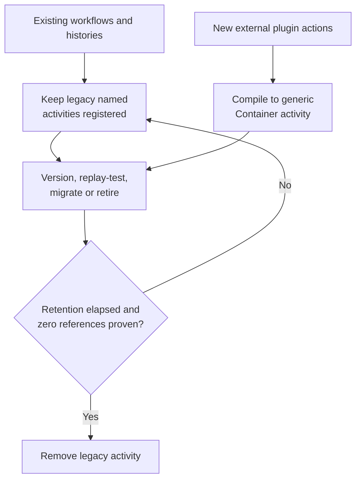

For example, an existing workflow may contain `RunAAPJobTemplateActivity`, while a newly published AAP plugin step compiles to `ContainerActivity`. Syntara keeps the old activity available for existing histories and stops creating new workflow revisions that reference it. A temporary compatibility activity may translate the old trusted input into a server-generated generic work item, but it may not accept a user-provided image, route, credential, or grant.

- New external plugin action steps compile to the generic activity from the first supported plugin manifest version.
- Existing named activities remain registered while any retained history or published workflow revision can reference them.
- Use Temporal workflow versioning/patch markers where replay behavior changes; add replay tests against representative historical event histories before each migration.
- A compatibility activity may translate its legacy typed input into the server-generated generic work item, but it must not trust a user-provided route.
- Stop creating new legacy workflow revisions after a declared cutoff.
- Remove an old activity only after retention has elapsed, all published revisions have migrated or been retired, and replay tests plus production inventory prove zero references.
- Do not migrate native orchestration primitives to EP merely to achieve uniformity.

#### Presentation talking points

- Temporal replay makes activity removal a compatibility decision rather than ordinary code cleanup.
- New external plugin actions use the generic activity from the first supported plugin manifest version.
- Existing workflows continue using their historical named activity while their revisions or retained histories require it.
- Temporal version markers and representative history replay tests protect deterministic behavior during migration.
- A compatibility activity may translate legacy typed input, but all routing and security values must still come from trusted server state.
- Syntara stops producing new legacy references before attempting removal.
- Retention expiry, migration or retirement, replay tests, and production inventory must all prove zero remaining references.
- Native orchestration primitives remain in Syntara; the migration applies to external plugin action execution.

### 12. Versioning, updates, disable, and uninstall

Plugin lifecycle operations preserve immutable revisions. Installing an update creates a new side-by-side revision; it never edits the image, schema, grant, or runtime binding behind an existing identity, and it never silently rewrites a published workflow.

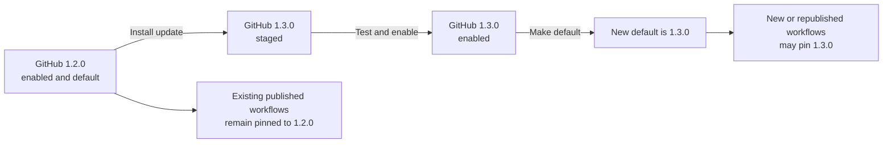

Contract names and content versions solve different problems. Add `.v1` or a versioned group/path only when independently deployed callers and implementations must negotiate a contract. Keep stable business identities such as `syntara.github.connection` and `create_issue` unversioned; the immutable installed revision and digest already identify their exact implementation.

#### Identifier and contract versioning

Do not add `.v1` to every name. A version belongs in an identifier only when that identifier selects an independently evolving contract that a caller, compiler, runner, broker, renderer, or transport must negotiate. Stable domain identities remain unversioned and resolve through the immutable plugin, installed-definition, and workflow revision that already pins their exact implementation and schema.

| Identifier category | Version form | Example | Rule |
|---|---|---|---|
| Manifest or form contract | Group path | `syntara.io/v1alpha1`, `syntara.io/form/v1alpha1` | Required because `apiVersion` selects a schema and semantic contract |
| Workload or provider ABI | Group path | `syntara.container/v1alpha1`, `syntara.provider/v1alpha1` | Required because independently deployed producers and consumers negotiate the wire and lifecycle contract |
| Runner driver or declarative protocol | Major suffix | `http.v1` | Required because the operation language and runner support evolve independently |
| Credential issuance mechanism | Major suffix | `oauth2-authorization-code.v1` | Required because the Credential Broker interprets a versioned recipe contract |
| Form component contract | Major suffix | `remote-resource-picker.v1` | Required because the renderer and declaration schema must agree |
| SDK/RPC service contract | Major suffix | `syntara.sdk.authoring.v1` | Required because generated clients negotiate an independently deployed service API |
| REST API or OCI media format | Path/media version | `/api/v1`, `application/vnd.syntara.plugin.v1` | Required because the transport or serialized format has its own compatibility boundary |
| Integration, credential, or provider identity | None | `syntara.github.connection`, `syntara.github.oauth`, `syntara.github.resources` | Stable business identity; the installed type revision pins its schema and implementation |
| Step, operation, or logical image identity | None | `create_issue`, `repositories.list`, `plugin-workload` | Stable plugin-local or qualified identity; the plugin revision and digest provide versioning |
| Discriminator or field name | None | `platform-runner`, `declarative`, `asset`, `runtime` | Vocabulary within a versioned containing contract, not an independently negotiated contract |

Use `.vN` only for a stable major contract; use `/vNalphaM` or `/vNbetaM` while an ABI or schema contract is explicitly prerelease. Minor compatible changes do not create names such as `.v1.1`; they evolve additively under the same major contract and are constrained by capability negotiation and compatibility tests.

An incompatible change to a driver, mechanism, component, service, ABI, media format, or API creates a new major identifier and may coexist with the old major during migration. An integration or credential identity does not receive `.v1` preemptively. If two semantically incompatible business types must coexist rather than being represented as installed revisions, introduce a deliberately new identity and document its migration instead of mechanically suffixing every existing name.

#### Lifecycle state machine

Install by immutable digest; display SemVer and mutable tags only as metadata. Each installed revision has exactly one state:

- `STAGED`: verified and persisted but not selectable by drafts, publish, or execution.
- `ENABLED`: selectable, publishable, and runnable subject to grants; zero or one enabled revision is the installation’s default.
- `DISABLED`: retained and inspectable but not selectable for new nodes/publishes/starts.
- `REVOKED`: security-denied; retained for evidence/replay inspection and subject to the emergency matrix below.

First install may atomically publish a generation with the revision `ENABLED` and default after the administrator’s resolve review. Side-by-side update defaults to `STAGED`; explicit enable makes it selectable, and explicit make-default changes the pointer in a new registry generation. Rollback changes the default pointer to a prior enabled revision; it never mutates definitions. Disabling the current default requires choosing another enabled default or leaving no default, in which case adding default-tracking draft nodes is blocked.

Draft action/trigger nodes may either select an exact enabled revision or track `environment-default`. Default-tracking drafts re-resolve and revalidate on every open/publish after a default change; incompatibilities are shown and block publish. Publishing always creates an immutable workflow revision with exact action/trigger, integration-type, credential-type, capability-grant, driver/activation, and runtime-binding revision IDs as applicable. Republishing a changed/default-tracking draft creates a new workflow revision and idempotently replaces its active trigger bindings; it never rewrites an earlier published revision.

#### Runner and type updates

A Kind A installed step identity includes the plugin digest, step-definition digest, exact runner-profile revision, negotiated ABI, and verified image digest. Promoting a runner security update creates a new runner-profile revision and new derived installed step revision; existing workflows retain their old binding, new publishes may select the new one, and emergency revocation can deny the old binding. No image changes behind an existing identity.

A Kind B image update requires a new signed plugin artifact/revision containing the new exact digest. Installation creates a new installed plugin and step revision; it never edits the image binding of an existing revision. The environment administrator can stage and test it, explicitly enable or make it the default, and migrate or republish workflows deliberately. Emergency revocation may deny the old image without silently substituting the new one.

Integration and credential type revisions declare a compatibility key and schema version. Reuse by a newer step revision is automatic only when the auth profile is identical and the new schema is proven backward-compatible under a conservative server rule: existing required fields and secret semantics are unchanged, and additions are optional. Otherwise update review reports the incompatibility and offers a server-owned clone flow: copy allowed non-secret values, require the owner to re-enter/re-authorize secrets, validate into a new instance pinned to the new type revision, and leave the old instance for rollback. Plugins cannot run migration hooks.

#### Disable and revocation enforcement

| Operation | Normal `DISABLED` | Security `REVOKED` |
|---|---|---|
| Inspect existing workflow/history | Allowed, visibly disabled | Allowed, visibly revoked |
| Add to draft / publish | Denied | Denied |
| Start a new workflow/invocation | Denied | Denied |
| Already queued but not launched | Denied/cancelled before launch | Denied/cancelled before launch |
| Already running workload | Allowed to finish under its pinned grant | Best-effort immediate cancellation; result quarantined |
| Retry same reserved invocation | Allowed for an in-flight run under the same request hash | Denied unless a platform-security break-glass grant explicitly allows recovery |
| Resume history that schedules new work | Replay computation is allowed; new submission denied | Replay computation is allowed; new submission denied |
| Operator override | Environment admin may re-enable through normal generation flow | Platform-security break-glass only, time-limited and fully audited |

Temporal replay itself never calls EP, so inspection/replay remains possible. Any newly emitted activity command is gated at dispatch. User-visible failures carry stable disable/revocation reason codes and remediation ownership.

#### Removal and retention

- Version-specific removal targets `/revisions/{revision}` and requires the revision to be non-default, disabled/staged, and free of integration, credential, draft, published workflow, trigger activation, retained run, or runner-binding references.
- Whole-plugin uninstall disables/removes all selectable revisions and the installation/default record only after the same dependency report is empty. There is no force operation in v1.
- Removal hides installed-plugin UI entries but tombstones immutable definitions and keeps verification/lifecycle evidence through the maximum workflow, run, security, and audit retention period. Registry/object-layer garbage collection occurs only after that horizon and a second reference scan.
- A local administrator can disable a revision normally or revoke a signer, artifact, runner, or image for security reasons. A future hosted withdrawal feed may automate this input, but it is not part of the initial architecture.

#### Presentation talking points

- Use `.v1` for independently negotiated contracts, not every identifier or business name.
- Updates create new immutable revisions and never change the content behind an existing revision.
- Installing an update does not make it the default or alter an earlier published workflow.
- Administrators can stage, test, enable, promote, roll back, and migrate revisions deliberately.
- Managed-runner updates and publisher-image updates both create new exact bindings rather than changing an image in place.
- Existing integration or credential instances are reused only when compatibility is conservatively proven; incompatible changes require a server-owned clone and reauthorization flow.
- Normal disablement is reversible lifecycle management; security revocation denies new work and attempts to stop active risk.
- Temporal histories remain inspectable after disablement or revocation, while any newly scheduled external work is denied.
- Uninstall is dependency-aware, retains audit evidence, and has no force-delete path in v1.

### 13. Installed-plugin library and builder UX

The first iteration provides one continuous on-premises experience from connecting local Quay to using an installed capability in a workflow. The available catalog and installed library are separate views: the catalog contains content that may be installed, while the installed library contains the immutable revisions and grants available in this environment.

#### First end-to-end demonstration scope

The first end-to-end demonstration proves the author-to-execution path without introducing a new form framework. A workflow author selects an installed action and supplies a simple structured JSON value that is validated against the action input schema. An existing generic primitive-schema renderer may be reused if it is already available, but it is not a demo acceptance criterion and no plugin-specific frontend work is required.

The demonstration includes authoring, validation, artifact and workload-image publication, local Quay catalog discovery, documentation inspection, administrator approval and installation, action selection, schema validation, and execution through the approved runtime route. It uses actions that need no credential or an already configured, non-interactive connection.

The following are deliberately deferred: custom UI layouts or widgets, publisher-provided browser code, dynamic option lookups, remote resource pickers, declarative or executable form providers, provider sandbox deployment, OAuth and other interactive connection flows from the builder, and asynchronous form-state handling. The browser continues to receive only platform-owned UI and inert metadata; it never loads plugin code or handles external-system credentials.

Input, output, and error schemas remain part of every action contract from the start. Workflows store structured values rather than UI state. This preserves the future extension point: a later implementation may add optional UI declarations and declarative or sandboxed providers without changing the installed action identity, workflow value shape, artifact trust model, or Execution Plane request.

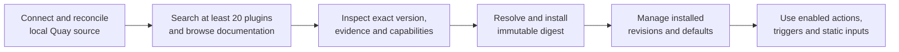

The proposed initial UX covers four states:

1. **Catalog sources:** an administrator adds, tests, updates, reconciles, disables, and removes a local Quay catalog source using opaque credential/CA references and sees safe connection, signature, generation, freshness, and error status.
2. **Available catalog:** search and filter at least 20 reconciled plugins, browse sanitized documentation, compare versions, and open the Plugin Inspector before installation.
3. **Resolve and install:** select a catalog version or enter an immutable OCI digest, then review verified identity, available provenance/SBOM evidence, runner/image ownership, credentials, egress, capabilities, sandbox, and resource policy before the same installation transaction.
4. **Installed library, configure, and run:** search and filter installed revisions by identity, compatibility, lifecycle/update state, runtime ownership, and action/trigger count; use dynamically installed action/trigger workflow steps and static schema-validated inputs in the builder; configure built-in sub-workflow selection and mapping; and show the pinned plugin revision and visible locked execution or trigger-activation route. Dynamic connection, provider, and form states are introduced with the deferred dynamic-form capability.

The existing marketplace and Backstage catalog/Inspect Entity implementations are research inputs for the local discovery experience; they are not runtime dependencies or approval to copy their general entity model.

| Available catalog | Installed library |
|---|---|
| Shows content that the configured sources advertise | Shows revisions that this environment has verified and installed |
| Supports discovery, documentation, comparison, and inspection | Supports enable/default/disable/update/removal and dependency review |
| Cannot supply workflow definitions directly | Supplies enabled actions and triggers to the first-demo builder; integrations, credentials, and forms follow their separately approved capabilities |
| May disappear when a source is removed or stops advertising an entry | Remains until an administrator performs a dependency-safe lifecycle operation |

Use PatternFly components and tokens, preserve keyboard navigation and accessible names, and run axe coverage. The frontend receives schema metadata only in the first demonstration. The fuller architecture adds inert UI/provider-binding metadata and normalized provider results, but never imports plugin JavaScript or receives OAuth/service credentials.

#### Presentation talking points

- The first iteration provides the complete local journey: connect, discover, inspect, install, manage, configure, and use.
- The available catalog is the store shelf; the installed library is the environment's approved toolbox.
- The Plugin Inspector exposes exact versions, signatures, evidence, dependencies, runtime ownership, and requested capabilities before installation.
- At least 20 genuine plugins validate search, documentation, installation, and lifecycle management rather than only an empty framework.
- Enabled actions and triggers appear dynamically in the workflow builder without rebuilding Syntara.
- The first demonstration uses static, schema-validated inputs; dynamic fields, custom UI, and interactive connection flows are a later capability.
- The builder shows the pinned plugin revision and whether execution or trigger activation is managed by the platform.
- Backstage informs the browse-and-inspect experience but is not a Syntara runtime dependency.
- PatternFly, keyboard operation, and automated accessibility checks are acceptance requirements for the first demonstration. Focus preservation and announced asynchronous updates become requirements when dynamic fields are implemented.
- The browser receives platform-owned rendering data only, never plugin JavaScript or external-system credentials.

### 14. SDK responsibilities

The `syntara-plugin-sdk` is the plugin author's toolchain. It turns concise, reviewable source into a validated, deterministic, signed plugin artifact and signed catalog entry. It is not the Syntara control plane, marketplace backend, workflow runtime, or Execution Plane.

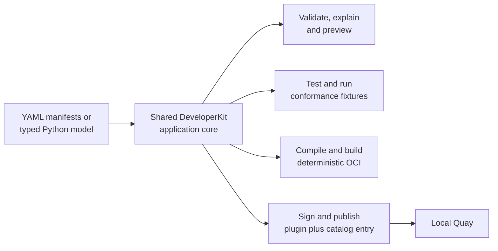

The design follows three rules:

1. **One authoring model:** YAML, Python, CLI, IDE, RPC, agent, and hosted adapters construct the same versioned root-and-target model.
2. **One implementation core:** every adapter calls the same validator, compiler, artifact planner, and publication services rather than reimplementing rules.
3. **Simple source, complete output:** authors may omit only contract-defined defaults and generated details; the compiler materializes every security-, compatibility-, image-, and execution-relevant value before signing.

Extend the SDK root plugin manifest work to provide:

- extension—not replacement—of the existing `plugin.yaml` schema, explicit target discovery, path-containment checks, canonical identity derivation, and compiler services merged in Plugin SDK PR 6;
- strict `v1alpha1` schema and canonical IDs;
- a scaffolded YAML-first authoring experience plus typed Python builders for action and trigger targets, input/configuration/output/error schemas, admitted trigger-driver declarations and event mappings, integrations, credential types, OAuth profile references, runtime bindings, required/optional authoring/runtime capabilities, and declarative operations/mappings; optional UI metadata, dynamic input definitions, and form-provider bindings remain a later extension;
- versioned generic templates for HTTP request/response, remote job, webhook/schedule/event-source triggers, OAuth authorization code, static token, JWT token exchange, custom workload, declarative form provider, and sandboxed provider patterns;
- generation of canonical schemas, UI declarations, mappings, credential recipes, manifest references, asset indexes, and OCI layers from the authoring model;
- allowlisted JSON/UI/form-provider/mapping validation, dependency-cycle and projection checks, option/schema fixtures, ABI conformance, and compatibility checks;
- deterministic OCI assembly with manifest/assets as layers;
- explicit build-time resolution of logical publisher-image IDs to digest-pinned canonical references, install-time resolution of platform-runner selectors to approved immutable runner-profile bindings, and digest-pinned workload/provider validation; one Kind B plugin workload is inherited by all of its custom-workload targets, while provider images remain separate;
- local build and inspect commands;
- push to Quay/OCI registries;
- Cosign signing and verification wrappers using a pinned CLI version;
- provenance/SBOM attachment and registry compatibility fallback;
- signature and optional provenance/SBOM generation under explicit local or CI identity configuration;
- integration tests against local Quay and Syntara’s direct resolve/install APIs.
- deterministic signed catalog-index generation and publication, monotonic generation/predecessor validation, and catalog fixtures for at least 20 plugins.

Signed catalog-entry/index generation is part of the initial SDK publication workflow. Hosted publication promotion and certification attestations are deferred adapters over the same immutable artifact and local catalog contracts; they must not alter compiler, signing, reconciliation, or installation semantics when introduced.

`oras-py` is appropriate for registry operations; use the maintained Cosign CLI as a pinned subprocess until its Python verification surface meets the same policy and bundle requirements. The SDK must use realistic network timeouts and retries rather than the current sub-second default.

#### Plugin authoring experience and compiler boundary

The default workspace extends the upstream SDK layout: one versioned root `plugin.yaml` plus one explicitly targeted `manifest.yaml` per action or trigger. The root owns plugin-wide identity, version, attribution, compatibility, integrations, credential types, providers, and the ordered target list. An action target owns action metadata, input/output/error schemas, UI, runtime operation, and capabilities. A trigger target owns trigger metadata, configuration/output schemas, UI, a Syntara-owned driver declaration, event mapping, and capabilities. Tooling never discovers targets by scanning directories.

Plugin authors may keep schemas, UI declarations, mappings, and credential recipes inline in the relevant root or target document. External JSON or YAML assets are an advanced option for large, shared, or independently tested documents—not a prerequisite for creating a plugin. Programmatic authors may construct the same root-and-target model through the Python API and optionally emit the equivalent YAML source tree.

If accepted, the published `syntara.io/v1alpha1` root manifest, targeted action/trigger manifests, and canonical compiled descriptor become the portable contract. The SDK does not introduce a second incompatible plugin DSL. YAML authoring, typed Python builders, CLI scaffolding, the language server, and the VS Code extension all construct the same versioned model and call the existing path-contained discovery/compiler services. Templates generate reviewable source content rather than hidden runtime semantics. Authors may omit only defaults, inferred UI, a workload/provider ABI when the selected runtime kind has one compatible default, target-level inherited workload bindings, and generated canonical inventory explicitly defined by the contract; compilation combines author source with explicit build inputs and materializes those values into the complete canonical manifest before signing or publication.

A normal source workspace is intentionally small:

```text
my-plugin/
├── plugin.yaml               # required root manifest and explicit targets
├── steps/
│   └── format_title/
│       └── manifest.yaml     # targeted action contract
├── triggers/
│   └── pull_request_opened/
│       └── manifest.yaml     # targeted declarative-trigger contract
├── README.md                 # optional documentation
├── icon.svg                  # optional icon
├── schemas/                  # optional advanced external schemas
├── mappings/                 # optional advanced request/response mappings
├── credentials/              # optional advanced credential recipes
├── ui/                       # optional advanced UI declarations
└── tests/                    # generated fixtures and author tests
```

Generated canonical manifests, JSON documents, bundle indexes, OCI layouts, signatures, and SBOM/provenance files go to an ignored build directory or directly to the configured artifact sink. They are inspectable and reproducible but read-only from the author's perspective. Editing generated output fails validation with a clear instruction to edit the source manifest or an explicit source asset instead.

The SDK reduces authoring work through these rules:

| Author intent | Default SDK behavior | Advanced override |
|---|---|---|
| Define inputs and outputs | Accept inline YAML types/constraints or typed Python models and compile canonical JSON Schema | Supply an explicit JSON/YAML Schema asset |
| Render ordinary fields | Infer approved PatternFly components from schema shape | Add an explicit UI declaration for layout, dynamic fields, or non-default components |
| Map an HTTP request/response | Generate bounded Syntara Mapping v1 from typed field/path selections | Supply an explicit validated mapping document |
| Add authentication | Scaffold a generic OAuth, static-token, or JWT-exchange credential pattern and its safe defaults | Supply an explicit bounded credential schema/recipe |
| Add dynamic choices | Scaffold a declarative provider binding with dependencies, pagination, and fixtures | Supply an explicit provider declaration or separately approved sandbox provider |
| Add a trigger | Scaffold a declarative `TriggerType` over an admitted driver with configuration/output schemas, event mapping, and fixtures | Select a different admitted driver; publisher listener code is not a v1 authoring option |
| Reference executable images | Declare one logical plugin workload at the root for all Kind B action targets; declare separate logical provider IDs only when needed; declarative trigger targets name no image; resolve all IDs from an explicit, recorded build request | Inspect the generated canonical `repository@digest` inventory or supply an approved repository/tag mapping; never repeat pull paths across action targets |
| Select a runtime ABI | Omit `abi` from target manifests; infer the single compatible workload/provider ABI and materialize it in canonical output | If multiple ABI majors become valid, select one once at the root workload/provider binding or in the explicit build request |
| Request capabilities | Derive the minimum candidate set, explain why each capability is needed, and require explicit author confirmation | Add a reviewed capability only when the operation cannot be expressed with the derived set |
| Test the plugin | Generate valid, invalid, mock-provider, and conformance fixtures | Add integration and end-to-end tests |

The compact root names its target and keeps plugin-level identity in one place:

```yaml
# plugin.yaml
apiVersion: syntara.io/v1alpha1
kind: Plugin
metadata:
  namespace: acme
  name: issue-tools
  displayName: Issue tools
  version: 0.1.0
  description: Small issue-processing utilities.
  authors:
    - name: Acme Automation
spec:
  workload:
    image: plugin-workload
  targets:
    - ./steps/format_title/manifest.yaml
```

The targeted step can keep its value schemas inline and omit UI metadata when safe inference is sufficient:

```yaml
# steps/format_title/manifest.yaml
apiVersion: syntara.io/v1alpha1
kind: StepType
metadata:
  name: format_title
  displayName: Format title
  description: Normalize an issue title.
spec:
  inputSchema:
    kind: inline
    value:
      type: object
      additionalProperties: false
      required: [title]
      properties:
        title:
          type: string
          minLength: 1
          maxLength: 256
  outputSchema:
    kind: inline
    value:
      type: object
      additionalProperties: false
      required: [title]
      properties:
        title:
          type: string
  runtime:
    kind: custom-workload
```

This source requires no hand-written JSON or UI file, declares the logical workload exactly once, and does not repeat the inferred ABI in each target. A build adapter supplies an explicit mapping such as `plugin-workload=quay.io/acme/issue-tools:0.1.0`; the SDK application service resolves it to a digest, records the resolution and inferred ABI in the build report, and materializes the full reference plus exact ABI in the canonical signed inventory. The compiler discovers only the declared target, derives its qualified identity and plugin version from the root, and makes the compiled target refer to `plugin-workload`. The current upstream SDK's source-authored `spec.images` list and target-level image reference are compatibility inputs during migration, not the long-term authoring requirement; when present, they must normalize to the same binding.

The equivalent CLI is intentionally thin over the same build request:

```console
syntara-sdk build plugin.yaml \
  --image plugin-workload=quay.io/acme/issue-tools:0.1.0
```

Python, RPC, IDE, CI, and hosted adapters submit the same typed image-binding map. Registry and repository defaults may reduce typing, but they are resolved into that request and shown in preview; a machine's hidden configuration cannot change canonical output without appearing in the build report.

The earlier GitHub root and target manifests are the full form: an author may use explicit assets when definitions are large or reused, while the SDK still validates and packages them through the same compiler.

Scaffolding is additive and idempotent. Creating a plugin, adding a step/credential/provider, or upgrading the source schema must preserve comments and unrelated author edits or present a reviewable patch; it must never overwrite a workspace silently. Templates are versioned, their expansion is recorded in the build report, and a template upgrade cannot change a signed artifact without an explicit source change and new artifact digest.

Diagnostics identify the source file, YAML path, stable code, explanation, and concrete remediation. Validation, generated-artifact preview, form preview, mock-provider tests, and conformance tests work locally without Syntara, OpenShift, a registry, or real credentials. Publishing and live integration tests remain explicit networked operations.

The target first-run experience is:

1. Scaffold a plugin from a generic runner/workload template.
2. Answer a small set of questions or edit `plugin.yaml` and its targeted action/trigger manifests with completion and inline documentation.
3. Add a step, credential, or dynamic field through CLI/IDE code actions that produce a reviewable source patch.
4. Validate and preview the canonical manifest, generated forms, mappings, capabilities, and artifact contents locally.
5. Run generated unit/conformance fixtures.
6. Build and inspect the deterministic OCI artifact.
7. Sign and publish only through a separate explicit command.

The quickstart acceptance gate is that a developer unfamiliar with SDK internals can scaffold, validate, preview, test, and build a simple platform-runner plugin without hand-writing JSON, selecting a container ABI, understanding OCI layer mechanics, starting Syntara, or copying credential/runtime boilerplate. Manual developer-experience testing measures time to first successful build, task completion, diagnostic recovery, and documentation gaps.

#### Developer-tool architecture

The SDK is **library-first, adapter-neutral, and headless**. The source of truth is a reusable application layer with versioned, serializable request, result, event, diagnostic, and error models. Domain/application code must not parse command-line arguments, print output, choose process exit codes, start a web server, read an implicit global working directory, or depend directly on FastAPI, gRPC, an IDE, or terminal rendering. Those concerns belong to adapters.

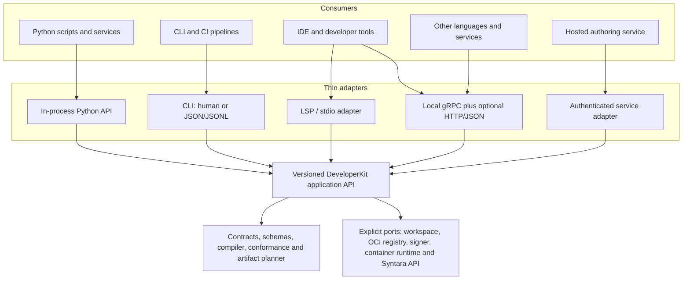

This is one logical SDK product and repository with three focused Python distributions and explicit dependency boundaries:

1. **`syntara-plugin-contracts`:** language-neutral JSON Schema 2020-12 documents, OpenAPI documents, canonical fixtures, stable diagnostics, and compatibility rules. If accepted, JSON Schema and JSON/OpenAPI are the normative plugin-platform and runtime contracts.
2. **`syntara-plugin-runtime`:** the minimal workflow-workload and provider-sandbox ABIs, runner/provider interfaces, cancellation/deadline handling, progress/result bounds, redaction helpers, and container-side runtime needed inside platform-runner, Kind B, and sandboxed-provider images. It must not pull in OCI clients, signing tools, servers, database packages, or developer UI dependencies.
3. **`syntara-plugin-sdk`:** workspace discovery, scaffold, validate, compile, inspect, conformance, deterministic build planning, signing, publication, catalog generation, the public Python facade, and thin adapters. It depends on ports for filesystem, registry, signer, container engine, clock, and Syntara API access so callers can embed or replace integrations.

The CLI, optional local gRPC server, LSP adapter, and hosted-service wrapper remain thin invocation surfaces over `syntara-plugin-sdk`; they are not separate rule engines. JSON Schema and JSON/OpenAPI remain the normative durable artifact and work-item contracts. The SDK also owns one canonical protobuf source for the **in-container** `ContainerService` ABI: it carries a selected immutable step revision, bounded JSON input, mounted credential-file paths, progress, cancellation, and one terminal result/failure. It never carries an image route, command, or plaintext credential. This workload ABI is distinct from the later local SDK authoring gRPC adapter; neither replaces the other. Phase 0 delivers the contracts, fixtures, canonicalization, diagnostics, minimal runtime interfaces, and conformance harness. Full build, signing, publication, authoring RPC, LSP, and IDE tooling follow in later approved phases.

The current SDK is a useful implementation seed but not yet this boundary. The reusable `init`, `build`, `push`, and registration behavior currently lives in the [CLI module](../../../syntara-plugin-sdk/tools/syntara_tools/cli.py), while the [step base classes](../../../syntara-plugin-sdk/sdk-python/syntara_sdk/step.py) and [local runner](../../../syntara-plugin-sdk/sdk-python/syntara_sdk/runner.py) form a separate runtime package. Move reusable behavior behind public authoring services; keep argument parsing, stdout/stderr, prompts, and exit-code mapping in the CLI adapter. Preserve the small runtime dependency set rather than merging the authoring toolchain into every workload image.

#### Contract bundle: one grammar for IDEs and agents

The SDK distributes one immutable **Syntara Contract Bundle** for each supported manifest contract version. This bundle is the only source of truth for plugin grammar. IDE extensions, language servers, CLI commands, Python callers, hosted services, and agent adapters must consume this bundle and the same SDK validator; none may maintain a separate interpretation of the manifest.

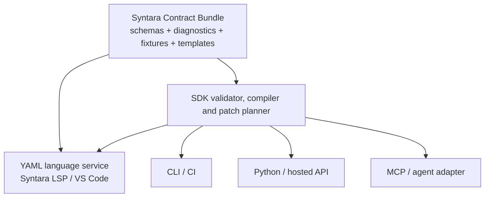

The `syntara-plugin-contracts` distribution contains a self-contained layout similar to:

```text
contracts/
└── v1alpha1/
    ├── contract.json
    ├── plugin-source.schema.json
    ├── plugin-canonical.schema.json
    ├── step-source.schema.json
    ├── step-canonical.schema.json
    ├── integration-type.schema.json
    ├── credential-type.schema.json
    ├── dynamic-field.schema.json
    ├── common.schema.json
    ├── diagnostics.json
    ├── examples/
    ├── invalid-examples/
    └── templates/
```

The root and targeted-step source schemas permit only contract-defined omissions that the compiler can deterministically materialize, such as qualified step identity, inherited plugin version, inherited logical workload binding, generated canonical image inventory, and the single compatible workload/provider ABI. Their canonical counterparts require every security-, compatibility-, and execution-relevant value explicitly. Image repository/tag resolution is not an implicit default: it is an explicit compiler input whose resolved digest is captured in the canonical output and build report. These are authoring and publication validation profiles over the same root-and-target model, not separate plugin languages. `contract.json` records the manifest contract version, canonical schema IDs, bundle digest, compatible SDK range, and included resources. Every schema has an immutable canonical `$id`, such as `https://schemas.syntara.io/contracts/v1alpha1/plugin-source.schema.json`. References resolve within the downloaded bundle, so validation never depends on a live network request. Mutable aliases such as `latest` are not valid inputs to signing, publication, installation, or compatibility negotiation; a non-floating tag may appear only as a build-resolution input and is replaced by its digest before canonical validation.

The identical bundle bytes are:

- packaged in the SDK distribution for offline CLI and Python use;
- packaged in the Syntara VS Code extension for offline completion and validation;
- published at stable HTTPS schema IDs for editors that do not have the extension;
- available as a signed, content-addressed release artifact for hosted services, air-gapped mirrors, and provenance verification.

The manifest's `apiVersion` selects the contract. The SDK records the selected bundle digest in validation, compilation, and build reports. A caller that requests an unsupported version or supplies a mismatched digest fails closed with a stable diagnostic rather than silently using the nearest installed schema.

JSON Schema 2020-12 defines structural grammar: properties, types, required fields, enums, patterns, defaults, examples, descriptions, and deprecations. The shared SDK validator defines semantic grammar that JSON Schema cannot reliably express, including cross-file references, identifier uniqueness, dependency cycles, mapping compatibility, credential/provider bindings, capability constraints, and runtime compatibility. Semantic rules never live only in the VS Code extension or agent server.

##### IDE delivery

The VS Code extension registers the appropriate bundled root or targeted-step source schema with the [YAML Language Server](https://github.com/redhat-developer/yaml-language-server/blob/main/README.md) by detected `apiVersion` and `kind`. This provides completion, hover documentation, structural validation, examples, defaults, and deprecation guidance without starting Syntara, the local SDK service, or a network connection. Other YAML editors can associate the published schema by URL; a generated root manifest may include this portable fallback without making it part of the signed plugin model:

```yaml
# yaml-language-server: $schema=https://schemas.syntara.io/contracts/v1alpha1/plugin-source.schema.json
apiVersion: syntara.io/v1alpha1
kind: Plugin
```

The Syntara language-server adapter adds semantic diagnostics, document links, form preview, workspace-wide references, and code actions by calling the shared SDK application API. A code action or scaffold operation returns a reviewable workspace edit and preserves comments and unrelated content. The editor must not duplicate compiler rules or rewrite a manifest silently.

##### Agent delivery

Agents should not learn the grammar from a copied prompt, a hand-maintained `AGENTS.md`, or the model's training data. They receive the contract and examples as bounded resources and call the shared SDK for validation and transformations. A thin optional adapter uses the [MCP resource and tool primitives](https://modelcontextprotocol.io/specification/draft/server/index) to expose read-only resources such as:

```text
syntara://contracts/v1alpha1
syntara://diagnostics/v1
syntara://examples/github/create-issue
syntara://examples/aap/launch-job
syntara://templates
```

It also exposes schema-described tools such as:

```text
syntara_validate_manifest
syntara_compile_manifest
syntara_explain_diagnostic
syntara_scaffold_patch
syntara_preview_form
```

The MCP adapter is another invocation surface, not another compiler. Agents that cannot use MCP call the machine-readable CLI, local gRPC service, or Python API. Read-only inspection is the default; authoring tools return a proposed patch or workspace edit unless the caller has explicitly authorized mutation. Signing, publication, credential use, and other networked operations remain separate explicit capabilities.

Every machine-facing result includes the contract version and bundle digest. Diagnostics use a versioned structured envelope rather than prose alone:

```json
{
  "contractVersion": "syntara.io/v1alpha1",
  "schemaSetDigest": "sha256:0123456789abcdef0123456789abcdef0123456789abcdef0123456789abcdef",
  "valid": false,
  "diagnostics": [
    {
      "code": "SYN-STEP-0012",
      "severity": "error",
      "file": "steps/create_issue/manifest.yaml",
      "path": "/spec/runtime",
      "message": "runtime.driver is required for a platform-runner step",
      "suggestedPatch": {
        "op": "add",
        "path": "/spec/runtime/driver",
        "value": "http.v1"
      }
    }
  ]
}
```

Compact grammar references, examples, and repository agent instructions are generated from schema annotations, the diagnostic catalog, and tested fixtures. Generated guidance tells an agent which validation tools to call; it is never normative and CI rejects stale generated guidance.

##### Contract reliability gates

A contract bundle is releasable only when:

- every schema validates against its declared meta-schema and every `$ref` resolves locally;
- valid, invalid, and malicious fixtures produce their declared results and stable diagnostic codes;
- SDK, CLI, LSP, gRPC, MCP, and hosted adapters return semantically identical diagnostics for shared fixtures;
- the VS Code extension validates and completes manifests while offline using the exact bundled digest;
- compatibility checks identify additive, breaking, and deprecated contract changes before release;
- generated documentation, editor metadata, templates, and agent guidance are current;
- schema IDs, bundle contents, version metadata, and digests agree across the Python package, editor extension, HTTPS publication, and signed release artifact.

This design makes the author experience friendly without making the IDE or an AI agent a trusted parser. Both propose content; the versioned SDK contract validates and compiles it.

#### One operation, multiple invocation surfaces

The exact names below are illustrative, but all surfaces must consume the same request models and return the same canonical results:

| Capability | In-process API | CLI | RPC/service |
|---|---|---|---|
| Discover and inspect | `kit.plugins.inspect(request)` | `syntara-sdk plugin inspect --format json` | `PluginAuthoringService.Inspect` |
| Retrieve a contract bundle | `kit.contracts.get(request)` | `syntara-sdk schema get --contract v1alpha1` | `ContractService.GetBundle` |
| Explain a diagnostic | `kit.diagnostics.explain(request)` | `syntara-sdk diagnostics explain SYN-STEP-0012 --format json` | `ContractService.ExplainDiagnostic` |
| Validate | `kit.plugins.validate(request)` | `syntara-sdk plugin validate --format json` | `PluginAuthoringService.Validate` |
| Scaffold a reviewable patch | `kit.plugins.scaffold(request)` | `syntara-sdk plugin add step --dry-run --format json` | `PluginAuthoringService.Scaffold` |
| Run conformance tests | `kit.plugins.test(request)` | `syntara-sdk plugin test --format jsonl` | `PluginAuthoringService.Test` streaming events |
| Build deterministic artifact | `kit.plugins.build(request)` | `syntara-sdk plugin build --format jsonl` | `PluginAuthoringService.Build` streaming events |
| Publish, sign, and emit catalog entry | `kit.plugins.publish(request)` | `syntara-sdk plugin publish --format jsonl` | `PluginAuthoringService.Publish` streaming events |
| Negotiate compatibility | `kit.capabilities()` | `syntara-sdk capabilities --format json` | `SdkService.GetCapabilities` |

For example, an embedded Python caller should need no subprocess:

```python
from syntara_sdk import DeveloperKit, ValidatePluginRequest

with DeveloperKit.open(workspace=".") as kit:
    report = kit.plugins.validate(ValidatePluginRequest(manifest="plugin.yaml"))
    if not report.ok:
        for diagnostic in report.diagnostics:
            print(f"{diagnostic.code}: {diagnostic.message}")
```

The CLI remains the default human experience and the easiest CI entry point, but it is not the programmatic API. In machine mode, stdout contains only the versioned result envelope or JSONL event stream, progress goes to stderr, prompts and color are disabled, and stable exit codes distinguish invalid input, policy/conformance failure, unavailable dependency, authentication failure, and internal failure. Other tools must never parse the human-oriented renderer.

Short operations such as inspect and validate are unary. Build, conformance, and publish support progress events, cancellation, deadlines, correlation IDs, and one terminal result. The in-process, CLI, and RPC adapters must produce the same diagnostic codes, resolved digests, artifact bytes, and terminal status for the same explicit inputs.

#### Local service, IDE, and hosted integration

An optional `syntara-sdk serve` process may expose a versioned `syntara.sdk.authoring.v1` gRPC service over a Unix-domain socket or Windows named pipe by default, with loopback TCP as an explicit fallback. gRPC is appropriate for typed calls, streaming progress, cancellation, and generated clients; it is not itself the IDE protocol. IDE diagnostics, completion, hover, links, and code actions should use a thin Language Server Protocol adapter over the same application API. An optional HTTP/JSON gateway may serve environments where gRPC is impractical.

The optional MCP server follows the same local-process and security model. It exposes contract/example resources and schema-described SDK tools for agents, but delegates all validation, compilation, patch generation, and form preview to the application API. MCP, LSP, and gRPC can share process lifecycle and caches without sharing transport-specific models with the domain layer.

The local service is a developer convenience, not a new marketplace control plane and not the Execution Plane. It binds locally by default, authenticates peers or uses an ephemeral launch token, confines paths to an explicitly opened workspace, limits request and output sizes, redacts secrets, and disables mutating/networked operations such as publish or sign unless the caller explicitly enables them. Registry, signing, and Syntara credentials come from pluggable credential providers or opaque references; they are not persisted in request histories or returned in events.

A hosted authoring service may import the same application core directly or place its own service adapter in front of it, but must add tenant authentication, authorization, quotas, audit, isolated workspaces, secret storage, and sandboxed build/test execution. It must not expose the local daemon unchanged to a network. Local-path requests become workspace-relative URIs or content-addressed uploaded workspaces, and operations that execute author-controlled code run in a disposable sandbox rather than the service API process.

#### Compatibility and evolution

- Manifest/workload contracts (`syntara.io/v1alpha1`), the SDK package SemVer, CLI output-envelope version, and RPC package version evolve independently and are reported by `GetCapabilities`.
- Requests use explicit workspace, configuration, platform target, timeouts, and dependency settings. Environment variables and config files are adapter conveniences that resolve into an explicit request before application logic runs.
- Protobuf evolution is additive within a major version: never reuse field numbers; reserve removed fields; use typed one-of envelopes and stable diagnostic/error codes rather than transport strings.
- Generated clients may be published for other languages, but the wire contract and fixtures—not generated client behavior—are normative.
- A capability handshake advertises operations, protocol versions, manifest/ABI versions, optional features, and limits so an IDE or hosted tool can degrade gracefully.
- Every adapter runs the same conformance fixture suite. Cross-adapter golden tests prove that class API, CLI JSON/JSONL, and gRPC produce byte-identical deterministic artifacts and semantically identical diagnostics.

#### Alternatives rejected

- **CLI as the core API:** simple initially, but forces subprocess overhead, text scraping, weak cancellation, lossy errors, and duplicated state management in IDEs and services.
- **Always-on daemon as the only API:** convenient for polyglot clients, but makes simple scripts, unit tests, and hosted embedding depend on process lifecycle and transport availability.
- **Independent CLI, library, and server implementations:** maximizes drift precisely where signing, digest calculation, policy checks, and reproducibility must remain identical.

The recommended library-first architecture permits all three consumption styles without making any one of them the privileged implementation.

#### Presentation talking points

- The SDK is a plugin developer toolchain, not a new marketplace control plane or workflow runtime.
- A simple plugin starts with one root `plugin.yaml` and one targeted manifest per action or trigger; ordinary schemas and UI declarations can stay inline.
- Authors do not hand-write generated JSON, repeat an image on every step, select an ABI when only one is valid, or understand OCI layer mechanics.
- YAML and typed Python are two authoring surfaces over one portable plugin model, not competing plugin languages.
- The SDK is library-first; the CLI, LSP, VS Code extension, local gRPC/HTTP service, MCP adapter, CI, and hosted service are thin adapters.
- One signed contract bundle supplies schemas, diagnostics, examples, templates, and compatibility rules to humans, IDEs, services, and agents, including offline use.
- The minimal runtime package stays separate from the authoring toolchain so plugin and provider images do not inherit registry, signing, server, or IDE dependencies.
- Logical image names keep source concise, while explicit build inputs and the build report make repository/tag resolution visible before the SDK materializes immutable digests.
- Local validation, form preview, fixtures, and conformance testing work without Syntara, OpenShift, Quay, or real credentials; signing and publication remain separate explicit operations.
- Publishing produces the deterministic OCI plugin, signatures and evidence, and the signed local catalog entry/index needed by the first-iteration on-premises marketplace.
- Cross-adapter conformance tests require identical diagnostics and deterministic artifact bytes for identical explicit inputs.

### 15. Initial 20-plugin acceptance catalog

The initial local Quay acceptance catalog contains at least 20 real Syntara plugins. Rank and refine the list using internal workflow requests, n8n template/node usage, credential reuse, enterprise relevance, runner reuse, implementation cost, and OpenShift fit. Platform primitives such as If, Merge, Wait, Webhook, Schedule, generic HTTP, and Script remain native/runner capabilities rather than marketplace plugins.

1. GitHub
2. Ansible Automation Platform
3. Jira
4. ServiceNow
5. Slack
6. Microsoft Teams
7. Email / SMTP
8. PagerDuty
9. Kubernetes / OpenShift
10. Amazon Web Services
11. Microsoft Azure
12. Google Cloud
13. PostgreSQL
14. MySQL
15. Amazon S3 / S3-compatible storage
16. HashiCorp Vault
17. Terraform Cloud / Enterprise
18. Salesforce
19. Google Sheets
20. OpenAI-compatible LLM APIs

Each catalog plugin must be signed, documented, installable, removable when dependency-free, and backed by at least one genuine action or declarative trigger; placeholder cards do not count. Every plugin passes manifest, documentation, signature, install/lifecycle, mocked provider, and applicable runner conformance tests. GitHub and AAP establish the reusable OAuth, service-token, HTTP-runner, AAP-runner, pagination, polling, webhook, and long-running-job patterns and receive the deepest live and end-to-end coverage; the remaining plugins are implemented in reusable tranches and receive representative live tests where approved credentials and non-production systems are available.

### Post-foundation showcase: Tesla through Teslemetry

After the GitHub/AAP vertical slice and local OpenShift acceptance achieve the platform goals, build an optional Tesla/Teslemetry plugin as a developer-excitement showcase. Its purpose is to demonstrate that a community author can use the completed SDK, dynamic forms, credentials, capability review, generic runner, signing, catalog, and canvas without changing Syntara core.

Use the local [n8n Teslemetry integration](../../../typescript-teslemetry/packages/n8n-nodes-teslemetry/) as behavioral reference, not as a runtime dependency. It demonstrates three useful plugin surfaces:

- a token-backed Teslemetry integration;
- dynamic vehicle and energy-site selectors;
- vehicle/energy request-response operations plus Server-Sent Events (SSE) triggers.

The Syntara plugin is initially a platform-runner plugin: declarative Teslemetry operations execute through the approved HTTP runner, while a future platform-owned streaming trigger profile may handle SSE. The current n8n implementation places access tokens in request query parameters, so the Syntara runner, proxy, diagnostics, and audit path must redact complete query strings and must never record raw request URLs. Current Teslemetry authentication, licensing, branding, and service terms must be reverified from authoritative sources before implementation.

The first showcase release is deliberately narrower than the reference node:

1. Start with a simulator or mocked Teslemetry service and read-only vehicle data.
2. Add a small allowlist of observable commands such as flash lights, start/stop climate, and start/stop charging.
3. Require a user-owned connection, an interactive manual run, an explicit real-world-side-effect confirmation, a specific vehicle selection, and a fresh parked/stationary safety check for every live command.
4. Disable scheduled, trigger-driven, service-account, and unattended live vehicle commands in the initial showcase.
5. Exclude unlock, remote start, trunk/frunk, windows/sunroof, Homelink, software-update, navigation, and other security- or safety-sensitive commands until a separate threat model, policy, and approval exists. Do not expose vehicle-motion or autonomous-driving controls.
6. Mask VINs and precise location data in ordinary UI, logs, screenshots, fixtures, and shared demo output; expose them only to explicitly authorized users.

Every operation receives its own capability and risk classification rather than inheriting blanket “vehicle control” access. The installation screen displays the requested commands, data categories, destinations, and residual physical-world risk. Runtime checks do not replace the vehicle owner's responsibility to keep the vehicle stationary, nearby, unoccupied where appropriate, and in a safe environment during a demonstration.

### 16. Repository ownership and PR reference map

The existing EP and step-container PRs predate this plugin-platform proposal. They are reference material, not branch bases and not units that should be merged or cherry-picked wholesale. New implementation branches start from each repository's current canonical `devel`; individual contracts, tests, and implementation fragments are ported only after they satisfy immutable installed-revision resolution, one generic `Container` activity, server-owned routing, digest-pinned images, and the versioned EP/workload ABI.

#### Repository ownership

| Repository | Owns | Must not own |
|---|---|---|
| `syntara` | Plugin source/install/catalog services, immutable installed revisions, dynamic action/trigger/backend/frontend registries, trigger activation and ingress drivers, trusted form renderer, `FormProviderService`, provider-sandbox dispatch client, OAuth/connect UX, Credential Broker, integration/endpoint authorization, policy-aware provider gateway, publish-time form revalidation, built-in `Execute Sub-workflow` and `Sub-workflow Trigger` nodes, the generic Temporal `Container` activity, durable Syntara-to-EP bridge, and replay shims | Plugin workload/provider implementations, publisher trigger-listener programs, plugin build/publish logic, plugin-supplied UI or in-process backend code, direct pod transport, or raw private-key delivery to provider images |
| `syntara-plugin-sdk` | Language-neutral action/trigger manifest and driver contracts, minimal workflow/provider runtimes, the `syntara.container/v1alpha1` and `syntara.provider/v1alpha1` ABIs, the reusable authoring application API, manifest/form/credential-recipe validators, option/schema and conformance fixtures, deterministic plugin OCI build, signing, SBOM/provenance, catalog generation, publish tooling, the CLI, and optional local RPC/LSP adapters | Product-side installation/activation state, hosted-service tenancy, OAuth token storage, workflow orchestration, trigger listeners, sandbox scheduling, or business rules implemented independently in an adapter |
| `syntara-step-types` | First-party external action and declarative trigger definitions, GitHub/AAP declarative form definitions, credential recipes, Kind A operations, Kind B workload implementations, reusable first-party runner implementations, one minimal sandboxed-provider reference image, tests, examples, and image build inputs | A copied ABI/runtime, plugin installation/trigger activation persistence, built-in sub-workflow or other Temporal control-flow nodes, executable trigger listeners, executable frontend extensions, Temporal orchestration, or execution/sandbox infrastructure |
| `syntara-execution-plane` | Runtime work-item persistence and isolated workload lifecycle plus a separately deployed Provider Sandbox Service that reuses generic image-verification, placement, isolation, cancellation, and result-envelope primitives under distinct APIs, identities, namespaces, queues, pools, grants, and SLAs | Form semantics, credential storage, step-specific behavior, plugin catalog resolution, workflow semantics, or treating provider invocations as runtime work items |
| `automation-orchestrator-operator` | Deployment and upgrade of Syntara, runtime EP, Provider Sandbox Service/pools, identities, namespaces, network policies, trust roots, quotas, and observability | Plugin authoring semantics, credential-broker business rules, or duplicate policy engines |

All externally installable action and declarative trigger types, their input/UI schemas, credential recipes, declarative form-provider bindings, and any first-party sandboxed-provider images are authored and tested in `syntara-step-types` and built, validated, and published through `syntara-plugin-sdk`. This does not put every supporting component in that repository: shipped PatternFly components, `FormProviderService`, trigger drivers/activation, the Credential Broker/provider gateway, and publish validation belong in Syntara; shared contracts, ABIs, and runtime code belong in the SDK; runtime and provider-sandbox scheduling/isolation belong in separately deployed services from the Execution Plane repository. Native orchestration primitives such as branching, loops, approvals, merge, wait, `Execute Sub-workflow`, and `Sub-workflow Trigger` remain in Syntara. Plugins may declare webhook, schedule, event-source, or polling triggers over Syntara-owned drivers, but they may not install listener code into Syntara or the Execution Plane. Generic HTTP and Script are platform runner capabilities rather than separately installable plugins.

The initial `syntara-step-types` layout keeps concrete first-party implementations together while preventing shared runtime duplication:

```text
syntara-step-types/
├── runners/
│   ├── http/
│   ├── aap/
│   └── script/
├── plugins/
│   ├── github/
│   │   ├── plugin.yaml
│   │   ├── steps/
│   │   │   └── create_issue/
│   │   │       └── manifest.yaml
│   │   ├── triggers/
│   │   │   └── pull_request_opened/
│   │   │       └── manifest.yaml
│   │   ├── README.md
│   │   ├── icon.svg
│   │   ├── schemas/           # optional advanced source assets
│   │   ├── mappings/
│   │   ├── credentials/
│   │   ├── ui/
│   │   └── tests/
│   └── aap/
│       ├── plugin.yaml
│       ├── steps/
│       │   └── launch_job_template/
│       │       └── manifest.yaml
│       ├── README.md
│       ├── icon.svg
│       ├── schemas/           # optional advanced source assets
│       ├── mappings/
│       ├── credentials/
│       ├── ui/
│       └── tests/
├── examples/
│   ├── custom-workload/
│   └── sandboxed-provider/
└── tests/
    ├── contract/
    ├── integration/
    ├── images/
    └── e2e/
```

The `runners/` directory contains concrete independently built platform-runner images. Each `plugins/` entry contains a root `plugin.yaml`, its explicitly targeted action manifests under `steps/`, optional declarative trigger manifests under `triggers/`, optional advanced source assets, and tests; logical image IDs are source, while resolved repository/digest inventory and OCI content are build output rather than hand-maintained step data. In v1, every Kind B action target in one plugin shares its single plugin workload image; independently versioned workloads are separate plugins, and declarative triggers have no workload image. `examples/custom-workload/` contains a minimal Kind B conformance example, and `examples/sandboxed-provider/` contains the v1 executable-provider conformance fixture; neither is a production product. Common runtime, interfaces, schemas, validation, diagnostics, generation, and conformance logic remain exclusively in `syntara-plugin-sdk` and are imported as versioned dependencies.

#### Selective adoption decisions

| Reference | Take | Replace or reject |
|---|---|---|
| [Syntara PR 728](https://github.com/syntara-orchestration/syntara/pull/728) | Port persist-before-submit, stable request IDs, encrypted task-token binding, callback inbox/deduplication, reconciliation, and cancellation outbox | Replace script-only payloads, broad fixed scopes, optional transport security, AO `Project` coupling, and EP fields attached to generic integrations; expose one generic `Container` activity |
| [Syntara PR 724](https://github.com/syntara-orchestration/syntara/pull/724) | Use `StepInvocation`/transport separation, mapping and result validation, sanitized transport failures, timeout tests, and unsupported-semantics tests as design and test seeds | Reject per-step Temporal activities, filesystem deployment manifests, raw credentials, and image/entrypoint authority from a step-supplied manifest |
| [Syntara PR 749](https://github.com/syntara-orchestration/syntara/pull/749) | Port the Kind CI shape, Temporal-to-workload E2E flow, narrow namespace RBAC, arbitrary-UID checks, and read-only workload assertions | Replace in-process EP imports, disabled TLS verification, long-lived test bearer setup, mutable personal image tags, and script-only cases |
| [Syntara PR 748](https://github.com/syntara-orchestration/syntara/pull/748) | Reuse the in-cluster HTTP test-service correction where the new E2E suite needs it | Do not treat it as part of the runtime architecture |
| [Syntara PR 747](https://github.com/syntara-orchestration/syntara/pull/747) | Reuse cluster image-pull mechanics, pre-pull validation, Kind/Podman runbook patterns, and its container-execution E2E shape | Reject mutable `migration-test` tags, personal Quay references, and configuration-owned `node_type` to image routing. Resolve installed step revision to approved runner-profile revision to immutable image digest instead |
| [Syntara PR 745](https://github.com/syntara-orchestration/syntara/pull/745) | Port the authentication/authorization/remote-rejection distinction, stable error-code tests, read-versus-mutation retry cases, known-secret and bearer/header redaction, non-JSON-body omission, sanitized Temporal failure conversion, sink-side workflow-history scrubbing, and structured code/status logging | Generalize the behavior into the SDK/runtime failure envelope and generic activity. Do not port TFE-specific enums, clients, static node registrations, or per-step activities; do not rely on regex or post-hoc scrubbing as the primary secret boundary; do not cherry-pick from its TFE feature-branch base |
| [Syntara PR 701](https://github.com/syntara-orchestration/syntara/pull/701) | Salvage result/error parity, cancellation/limit/redaction cases, pod hardening, cleanup cases, and HTTP/Script/AAP behavior tests | Reject the direct AO-to-pod transport, `_container_route`, hard-coded node/image map, workflow-history image routing, mutable tags, and duplicated executors; those executors already appear in the step-types stack |
| [Syntara PR 709](https://github.com/syntara-orchestration/syntara/pull/709) and [PR 724](https://github.com/syntara-orchestration/syntara/pull/724) | Mine the TFE work for adapter boundaries, mapping compatibility, and migration-test cases | Do not make the TFE branch or its per-step registration model a marketplace foundation |
| [Syntara PR 648](https://github.com/syntara-orchestration/syntara/pull/648) | Historical PoC evidence only | Superseded by the standalone EP and generic marketplace route |
| [Plugin SDK PR 6](https://github.com/syntara-orchestration/syntara-plugin-sdk/pull/6) | Adopt the `plugin.yaml` root, explicit ordered targets, plugin-level namespace/version/authorship, canonical step identity/content digest, path-contained discovery, digest-pinned image validation/inventory, plugin metadata layer, authenticated registry handling, and traversal/duplicate/identity/schema/OCI tests as the implementation baseline | Extend the existing compiler and metadata artifact rather than fork them: migrate repeated target/root image references to one logical plugin workload plus separate provider IDs; resolve explicit build inputs into one canonical digest inventory; add marketplace definitions and inert assets, deterministic content bundle, signing/provenance, digest-first install/catalog, structured diagnostics, and production runtime/provider ABIs. Replace the prototype push-then-register flow and local-runner production assumptions |
| [Step-types PR 2](https://github.com/syntara-orchestration/syntara-step-types/pull/2) | Use its invocation/protocol semantics, one-shot admission, secret separation/redaction, cancellation, bounds, mTLS, and conformance cases | Move the shared protocol and runtime implementation into the SDK instead of copying it into step packages; carry its two later secret-redaction/timeout fixes into any adapted stack |
| [Step-types PR 3](https://github.com/syntara-orchestration/syntara-step-types/pull/3) | Port bounded HTTP/Script behavior, cancellation, response-limit, arbitrary-UID, read-only image, and process-cleanup tests | Convert per-step mutable images/manifests to SDK plugin definitions and immutable runner bindings; enforce DNS/egress in EP. Script remains a platform runner capability |
| [Step-types PR 7](https://github.com/syntara-orchestration/syntara-step-types/pull/7) | Port AAP launch, poll, cancellation, failure mapping, and integration-derived connection behavior into a Kind A AAP runner | Remove optional TLS verification, environment-proxy trust, debug bodies, mutable image authority, and duplicated shared runtime |
| [Step-types PR 6](https://github.com/syntara-orchestration/syntara-step-types/pull/6) | Reuse pinned Actions, least-privilege permissions, multi-architecture matrix, same-snapshot validation intent, and Konflux onboarding shape | Treat it as CI scaffolding only: builds are not yet hermetic and signing, SBOM, admission, and promotion are absent |
| [Step-types PR 4](https://github.com/syntara-orchestration/syntara-step-types/pull/4) | Retain only failure requirements for uncertain submission, cancellation, and callback recovery | Reject the bespoke Agent POST/OBO/callback implementation; it creates a second asynchronous completion and identity model outside the generic EP contract |
| [Execution Plane PR 1](https://github.com/syntara-orchestration/syntara-execution-plane/pull/1) | Port the service boundary, API/auth foundation, durable store, scoped idempotency, claim/recovery state machine, result outbox, placement basis, cancellation, and hardened Kubernetes job context | Replace `workload_type="script"`, the global runner image, fixed Python command, log-based results, raw payload credentials, AO project/integration terminology, conflict-without-verification handling, and CIDR-only egress assumptions |

SDK PRs [1](https://github.com/syntara-orchestration/syntara-plugin-sdk/pull/1), [2](https://github.com/syntara-orchestration/syntara-plugin-sdk/pull/2), [4](https://github.com/syntara-orchestration/syntara-plugin-sdk/pull/4), [5](https://github.com/syntara-orchestration/syntara-plugin-sdk/pull/5), and [6](https://github.com/syntara-orchestration/syntara-plugin-sdk/pull/6) are already represented in `devel` and need no separate port; closed [PR 3](https://github.com/syntara-orchestration/syntara-plugin-sdk/pull/3) is documentation history only. Step-types [PR 1](https://github.com/syntara-orchestration/syntara-step-types/pull/1) and [PR 5](https://github.com/syntara-orchestration/syntara-step-types/pull/5) are superseded and should not be taken independently.

The complete Syntara EP feature-chain inventory is retained as reference so useful work is not lost:

- durable queue/store/target/worker mechanics to inspect selectively: [#561](https://github.com/syntara-orchestration/syntara/pull/561), [#607](https://github.com/syntara-orchestration/syntara/pull/607), [#646](https://github.com/syntara-orchestration/syntara/pull/646), [#691](https://github.com/syntara-orchestration/syntara/pull/691), [#697](https://github.com/syntara-orchestration/syntara/pull/697), [#723](https://github.com/syntara-orchestration/syntara/pull/723), and [#725](https://github.com/syntara-orchestration/syntara/pull/725);
- design and operational reference: [#593](https://github.com/syntara-orchestration/syntara/pull/593), [#606](https://github.com/syntara-orchestration/syntara/pull/606), [#609](https://github.com/syntara-orchestration/syntara/pull/609), [#620](https://github.com/syntara-orchestration/syntara/pull/620), [#621](https://github.com/syntara-orchestration/syntara/pull/621), [#631](https://github.com/syntara-orchestration/syntara/pull/631), [#632](https://github.com/syntara-orchestration/syntara/pull/632), [#634](https://github.com/syntara-orchestration/syntara/pull/634), [#673](https://github.com/syntara-orchestration/syntara/pull/673), and [#727](https://github.com/syntara-orchestration/syntara/pull/727);
- local-cluster, build, and test infrastructure to reuse only where it fits the new contracts: [#582](https://github.com/syntara-orchestration/syntara/pull/582), [#583](https://github.com/syntara-orchestration/syntara/pull/583), [#584](https://github.com/syntara-orchestration/syntara/pull/584), [#585](https://github.com/syntara-orchestration/syntara/pull/585), [#667](https://github.com/syntara-orchestration/syntara/pull/667), [#668](https://github.com/syntara-orchestration/syntara/pull/668), [#693](https://github.com/syntara-orchestration/syntara/pull/693), [#699](https://github.com/syntara-orchestration/syntara/pull/699), [#710](https://github.com/syntara-orchestration/syntara/pull/710), [#747](https://github.com/syntara-orchestration/syntara/pull/747), [#748](https://github.com/syntara-orchestration/syntara/pull/748), and [#749](https://github.com/syntara-orchestration/syntara/pull/749);
- narrow correctness cases worth preserving as regression tests: [#594](https://github.com/syntara-orchestration/syntara/pull/594) and [#596](https://github.com/syntara-orchestration/syntara/pull/596);
- integration/bootstrap work whose AO-specific data model must not define the marketplace contract: [#669](https://github.com/syntara-orchestration/syntara/pull/669), [#704](https://github.com/syntara-orchestration/syntara/pull/704), and [#707](https://github.com/syntara-orchestration/syntara/pull/707); and
- closed, superseded, or explicitly ignored branches: [#598](https://github.com/syntara-orchestration/syntara/pull/598), [#622](https://github.com/syntara-orchestration/syntara/pull/622), [#648](https://github.com/syntara-orchestration/syntara/pull/648), [#718](https://github.com/syntara-orchestration/syntara/pull/718), and [#741](https://github.com/syntara-orchestration/syntara/pull/741).

#### Clean-branch and extraction plan

Use `feature/plugin-platform-sdk-marketplace` locally from the current canonical `devel` in Syntara, Plugin SDK, step-types, and Execution Plane. Before approved SDK implementation begins, fast-forward or recreate its existing local feature branch from current `devel` so merged PR 6 is the ancestor; do not implement from the older feature-branch tip. Do not base any branch on a PR head. Do not push any branch or commit without explicit approval. Port work in this dependency order:

1. Freeze the plugin artifact, action/trigger target schemas, trigger-driver declarations, work-item, workload ABI, and shared conformance fixture in the SDK.
2. Generalize EP PR 1's durable substrate against that contract.
3. Implement the installed action/trigger revision registries, trigger activation/ingress, built-in sub-workflow pair, and port PR 728's durable bridge patterns into one generic Syntara action activity, preserving legacy activity names as replay shims.
4. Adapt step-types PRs 2, 3, and 7 to consume the SDK and produce plugin-level artifacts; use PR 6 only for the corrected build/release scaffolding.
5. Port PR 749's E2E shape and require the same versioned fixture in all four repositories so schema drift fails CI.

## Failure Model and Observability

- Catalog and installation errors use stable reason codes: source connection/authentication, index resolution, descriptor/signature/identity/source binding, rollback, broken predecessor, generation conflict, expiry, repository/namespace ownership, plugin digest resolution, manifest media/size/schema/content subset, compatibility, image policy, capability, conflict, generation publication, and persistence.
- Authoring failures distinguish connection required/expired, provider disabled/revoked, image admission or pull failure, sandbox unavailable/crashed/timed out, ABI or output violation, authorization, dependency invalidation, rate limit, upstream unavailable, malformed/oversized response, schema change, stale selection, and publish revalidation. Responses remain non-enumerating across environment/connection boundaries.
- Trigger failures distinguish inactive/unpublished activation, authentication failure, unsupported event, invalid or oversized payload, mapping failure, duplicate delivery, rate limit, disabled/revoked definition, unavailable driver, and Temporal start failure. Sub-workflow failures separately identify not-callable, permission denied, no published child, incompatible input/output map, cycle detected, child start/run/cancel failure, and missing pinned revision.
- Runtime denials distinguish caller identity, environment boundary, invalid installed state, policy mismatch, integration/credential authorization, credential redemption, egress, idempotency conflict, ABI violation, resource quota, image pull, heartbeat, timeout, cancellation, and workload failure.
- Provider failures use the shared provider-neutral categories and never collapse authentication, authorization, remote rejection, local validation, or uncertain mutation outcomes into one generic error. Workflow conditions consume stable codes rather than provider message text.
- Every install and invocation carries a correlation ID across API, Temporal where applicable, runtime EP or Provider Sandbox Service, pod labels, gateway, broker, and audit records.
- Initial metrics include source connection tests, reconciliation duration/outcome/freshness, accepted/rejected index generations and plugin counts, catalog query latency, documentation/inspection failures, digest resolution and verification outcomes, installation states, registry refresh time, active versions, trigger activation/deactivation/start/authentication/deduplication/failure outcomes, sub-workflow start/result/cancel/failure outcomes, declarative versus sandboxed form-provider resolution latency/errors/cache hits/rate limits, provider queue/cold-start/run/crash/timeout/denial outcomes, OAuth connect/refresh outcomes, publish revalidation failures, EP queue/start/run latency, denials by policy, retries, and terminal results.
- Logs redact secret material and schema fields marked sensitive. Form logs record provider/operation IDs and result counts, not tokens, raw dependency/search values, option labels, or complete upstream payloads. Large/plugin-controlled strings are bounded.
- Operator-facing health exposes stale or failed catalog sources, expiring indexes/trust roots, revoked identities, vulnerable installed images, incompatible updates, and orphaned references.

## Testing Strategy

- **Schema/property tests:** canonical IDs, SemVer, compatibility ranges, required/optional authoring/runtime capabilities, source-to-canonical materialization including inferred workload/provider ABIs, rejection of per-target ABI repetition/override and unsupported explicit root/build selections, local-ref-only input/output/error/UI/mapping limits, declarative and sandboxed provider/component/operation/dependency/projection rules, credential issuance recipes, self/native cross-references, deterministic build output, and malicious YAML/JSON/regex/markup cases.
- **Catalog/verifier tests:** source credential and CA isolation; valid reconciliation; unsigned, expired, replayed, lower-generation, broken-predecessor, wrong-source, wrong identity/namespace/repository binding, tampered plugin/runner/workload/provider digest, missing policy-required provenance, invalid attachment, untrusted root, mirror/referrers fallback, documentation sanitization/bounds, source deletion, and workload-class policy boundaries.
- **Database tests:** candidate-generation publication and pointer flip, notification-loss polling, concurrent installs, lifecycle transitions, side-by-side versions, default rollback, revision/whole-plugin dependency protection, tombstone retention, and instance compatibility/clone behavior.
- **Contract tests:** the same manifest, declarative mapping, credential recipe, form-provider request/option/schema envelopes, GitHub/AAP form fixtures, credential-handle, work-item, workflow-workload ABI, provider-sandbox ABI, runner/provider-image bindings, and stable diagnostics in SDK, Syntara, step-types, and the runtime/sandbox services where applicable.
- **Failure-contract tests:** authentication, authorization, provider rejection, local validation, not found, conflict, rate limit, transient failure, timeout, cancellation, policy denial, ABI violation, and outcome-unknown mappings; read/mutation idempotency; malformed and non-JSON bodies; known and unknown credential shapes; bearer/header/query-string redaction; exception chaining; and proof that plaintext never enters result files, logs, Temporal history, or failed-node persistence.
- **Temporal replay tests:** representative histories for each legacy external activity and patched migration path.
- **Trigger tests:** install-versus-publish activation, driver admission, immutable revision/connection/grant pinning, webhook authentication, event mapping, payload/rate bounds, deduplication, deactivate/republish races, disable/revoke, side-by-side updates, dependency-protected uninstall, and proof that no plugin listener code runs in Syntara, Temporal workers, or runtime EP.
- **Sub-workflow tests:** parent/child input-output typing, callable and permission checks, latest-published resolution at call start followed by exact revision pinning, retry/replay stability, cycle rejection, synchronous result/error/cancellation propagation, reference-versus-embed behavior, dependency/deletion protection, and parent execution-view visibility.
- **Execution security tests:** Syntara/EP workload identity, API replay/mutation, route override, proxy bypass/DNS rebinding/redirect/raw-IP egress, unauthorized or replayed credential handle, secret leakage, cross-environment reference, excessive output, idempotency conflict/fencing, heartbeat, timeout, cancellation, ABI violation, resource limit, image mismatch, and service-account isolation.
- **Provider-sandbox security tests:** forged dispatch, cross-environment/provider invocation, mutable or mismatched image, missing/revoked executable-authoring grant, service-account/Kubernetes/API/database/secret-store access, direct egress and DNS exfiltration, gateway bypass, raw credential/private-key exposure, capability replay, filesystem/process/resource escape, malformed or oversized output, crash/timeout/cancellation, worker reuse leakage, and revocation during an invocation.
- **OAuth tests:** state/nonce/PKCE, exact callback, scope ceiling, refresh/revocation, token secrecy, disallowed endpoints/redirects, and SSRF targets.
- **Authorization tests:** every admin/author/owner/publisher/runner/auditor permission plus ownership, delegation, environment isolation, and non-enumerating denials.
- **Dynamic-form tests:** server-owned route resolution, credential reauthorization, connection/project/environment isolation, dependency clearing, cancellation/debounce, cursor pagination, cache-key isolation, provider limits, token/log secrecy, bounded schema normalization, sensitive-to-secret-reference conversion, literal/expression behavior, draft-to-publish drift, and runtime stale-binding failure.
- **Contract-bundle tests:** validate every schema against its declared meta-schema; reject unresolved or remote-only references; verify canonical IDs and bundle digests; run valid, invalid, and malicious fixtures; classify compatibility changes; verify generated documentation/agent guidance freshness; and prove that the Python package, VS Code extension, HTTPS publication, and signed release artifact contain identical contract bytes.
- **SDK adapter tests:** run common contract retrieval, diagnostic explanation, scaffold, inspect, validate, conformance, build, and publish fixtures through the in-process API, CLI JSON/JSONL, LSP, local gRPC, MCP, and hosted adapters where applicable; assert identical diagnostic codes, source paths, suggested patches, event ordering constraints, terminal status, resolved references, schema-set digest, and deterministic artifact digests. Cover offline IDE validation/completion, capability negotiation, protocol compatibility, cancellation/deadlines, daemon authentication, workspace traversal, request/output limits, concurrent callers, credential redaction, and crash recovery.
- **UI tests:** Quay source add/test/reconcile/edit/disable/remove, catalog search/filter/pagination, documentation and Plugin Inspector, catalog-to-install review, installed-library search/filter, local verification details, direct-digest recovery, rejection states, dynamic node rendering, connect/reconnect, loading/empty/error/stale states, dependency cascades, async announcements/focus retention, schema validation, version pin display, update flow, responsive layout, and axe.
- **End-to-end tests:** publish at least 20 signed/documented plugins plus a signed index to local Quay → configure/test/reconcile the source from Syntara UI → discover/search/browse documentation/inspect → select catalog digest → resolve/review/install through the shared transaction → configure connection → resolve GitHub/AAP resources declaratively → resolve one reference field through the Provider Sandbox Service without Temporal/runtime EP → publish revalidation → activate a declarative GitHub trigger → authenticated/deduplicated event starts the pinned workflow → GitHub/AAP action execution → audit → publish/reconcile/inspect/install a side-by-side update; plus a parent `Execute Sub-workflow` call into a child `Sub-workflow Trigger` with typed result return.
- **Performance tests:** reconciliation and search with the required 20-plugin set plus a generated larger fixture, concurrent catalog reads/direct installs, registry snapshot rebuild, builder load, concurrent declarative and sandboxed form resolution/cache behavior, provider cold/warm latency and saturation, and runtime EP dispatch throughput. Internet-scale catalog targets remain deferred.

## Success Criteria

### Vertical-slice acceptance

- At least 20 signed, documented, genuine plugins—including GitHub and AAP—are published with a signed catalog index to local Quay. An administrator configures and tests the source from the Syntara UI, reconciles all valid entries, searches/filters them, browses documentation and inspection details, and installs a selected version through the shared digest-verified transaction without rebuilding Syntara.
- The GitHub `Create issue` form selects an authorized connection, searches repositories, and loads repository-dependent labels/assignees/milestones. The AAP `Launch job template` form cascades connection → organization → template and renders prompt-on-launch/survey fields from a bounded remote schema. Neither flow schedules Temporal or EP work while editing.
- Changing a connection/repository/template clears dependent values; drafts retain only stable references/cached labels/schema digests; publish revalidates literal resources with the runtime identity; an incompatible upstream form change fails closed with a stable reason code.
- A newly authored Kind A GitHub operation installs and runs using only the declarative `http.v1` driver, relative operation, mapping, and selected GitHub connection; no Syntara or runner image rebuild is required. A minimal independent Kind B image passes the workload-ABI conformance suite.
- A declarative GitHub `Pull request opened` trigger installs without listener code, remains inactive while a workflow is only a draft, creates a revision-pinned activation at publish, authenticates and deduplicates an event, and starts the exact published workflow through a Syntara-owned trigger driver.
- A parent workflow calls the latest published callable child through `Execute Sub-workflow`; the child begins at `Sub-workflow Trigger`, receives typed inputs, returns a typed result, and remains pinned to the resolved child revision across retries and replay. Permission denial and recursive/cyclic calls fail closed.
- A minimal independent sandboxed-provider image installs by digest, passes `syntara.provider/v1alpha1` conformance, resolves and revalidates a bounded form value without importing code into Syntara or starting Temporal/runtime EP work, and is denied when it requests an ungranted broker, destination, secret, identity, or resource capability.
- The installer proves verification-before-parse with an automated test that observes no manifest decode or persistence after signature failure.
- Unsigned/locally untrusted/tampered artifacts, namespace/repository-policy conflicts, disallowed images, workflow-supplied routes, forbidden egress, unauthorized/replayed credentials, cross-environment access, and forged EP submissions are denied with stable reason codes and audit records.
- GitHub and AAP credentials complete through plugin-declared credential types and platform-owned broker mechanisms with PKCE/state where applicable, approved endpoint revisions, scopes, refresh/revocation, exact redirects, and no workflow/provider-controlled absolute endpoint fetch; project/service-token connections remain available for unattended automation.
- Existing published workflows remain pinned and runnable after a side-by-side plugin update; new workflows can select the approved new revision.
- A runner security update creates a new immutable runtime binding; generation publication is consistent across replicas, and losing a notification does not expose a partial registry.
- Representative legacy Temporal histories replay successfully through the compatibility plan.
- No plugin-provided executable code runs in the Syntara API, worker, or browser. V1 executable authoring-provider code runs only in the dedicated Provider Sandbox Service under an immutable image binding and separately approved authoring grant.
- Unit, integration, contract, replay, security, UI accessibility, and end-to-end suites are green in CI.
- The same reference plugin validates and builds through the SDK class API, machine-readable CLI, and local gRPC adapter with identical diagnostics and artifact digest; an IDE client can negotiate capabilities and receive structured validation diagnostics without parsing CLI text.
- The same pinned contract bundle drives offline IDE completion, CLI/Python validation, LSP semantics, and agent validation through MCP or another machine adapter; all surfaces report the same contract version, schema-set digest, stable diagnostic code, source path, and remediation for shared invalid fixtures.
- A developer unfamiliar with SDK internals can scaffold, edit, validate, preview, test, and build a simple plugin from `plugin.yaml` and its explicit action/trigger targets without hand-writing generated JSON, maintaining image inventory, repeating registry paths across action targets, or selecting an ABI while the runtime kind has one compatible default; an explicit image mapping is required only when the plugin supplies workload/provider code. The workflow does not require starting Syntara/OpenShift, using real service credentials, or understanding OCI layer mechanics, and the YAML, Python, CLI, and IDE paths produce the same canonical artifact.

### Initial platform completion

- The initial 20-plugin set is implemented using shared runners and credential/integration patterns, with generated conformance tests and documentation; each entry is signed, installable, lifecycle-tested, and contains at least one genuine action or declarative trigger.
- A mirrored/air-gapped Quay deployment can reconcile the local signed catalog, browse cached verified documentation, resolve mirrored digests, verify, install, update, disable, and audit plugins without public registry access.
- Operator dashboards expose verification, installed-version, policy-denial, and execution health.
- Plugin authors can embed the SDK in Python, automate it through stable CLI envelopes, or use versioned RPC/generated clients. A future hosted implementation must reuse the same application core and conformance suite.

## Distribution Plan

- The SDK ships a Python authoring API and thin CLI as the required interfaces, plus optional local RPC/LSP/MCP adapters. All adapters submit the same typed logical-image binding request, consume the same self-contained Syntara Contract Bundle, and build the same deterministic plugin OCI artifacts. Registry/repository/tag inputs are explicit and recorded; canonical metadata contains full repository-plus-digest references once. The adapters push to Quay or another compliant registry, sign artifact and image digests, and optionally attach provenance/SBOMs through the shared application API.
- Each contract release publishes identical bytes in the SDK package, VS Code extension, stable HTTPS schema location, and signed content-addressed artifact. Air-gapped installations mirror the signed bundle; IDE and local validation remain functional without a registry, Syntara, or network access.
- Plugin repositories use GitHub Actions with pinned actions/tools, workload identity where available, protected release environments, and immutable release artifacts. Air-gapped releases can use offline keys and mirrored verification bundles governed by the environment trust policy.
- Local catalog indexes are deterministic signed OCI artifacts produced by the SDK publication workflow. Future hosted promotion and certification must reference the existing immutable artifacts, catalog entries, and installation contracts; neither may mutate an installed revision or create a second reconciliation or installation path.
- Syntara’s existing deployment pipeline delivers the control-plane/UI changes. Runtime Execution Plane, Provider Sandbox Service/pools, platform-runner images, and provider reference images are built and promoted independently. Every promoted runner profile or installed provider image creates an immutable signed revision; installed bindings opt into that revision rather than changing in place.

## Delivery Sequence

The detailed work packages, repository changes, tests, manual verification, and approval gates are maintained in the [implementation plan](plugin-platform-marketplace-implementation-plan.md). The recommended dependency order is:

1. **Phase 0 — shared contract core:** create the three SDK distributions and the self-contained Syntara Contract Bundle; freeze the action/trigger manifests, trigger-driver declarations, credential-recipe, workflow-workload, and provider-sandbox `v1alpha1` JSON Schema/OpenAPI contracts; add immutable schema IDs, local references, bundle metadata/digest, canonicalization, stable structured diagnostics, valid/invalid/malicious fixtures, compatibility classification, and shared conformance tests.
2. **Phase 1 — Execution Plane foundation:** generalize the durable EP substrate for the generic work item and workload ABI; implement separate platform-runner and publisher-workload pools from the first release.
3. **Phase 2A — direct-digest installation:** implement Syntara's immutable installed action/trigger definition foundation and complete the one atomic digest-verification/install transaction before adding catalog reconciliation.
4. **Phase 3 — authoring MVP and secure artifact production:** extend the upstream `plugin.yaml` plus explicit-target workflow with the first friendly YAML/Python scaffold, plugin-level logical workload binding, explicit cross-adapter image resolution, canonical digest inventory, contract retrieval/diagnostic explanation, validate/preview/test/build/inspect workflow, generated-JSON boundary, deterministic SDK build/sign capability, documentation packaging, and signed catalog-index generation/publication.
5. **Phase 3B — local Quay catalog backend:** implement source configuration, safe registry-credential/CA references, signed-index reconciliation and rollback protection, verified catalog/documentation projections, search/detail/inspection APIs, and catalog-to-digest-install handoff.
6. **Phase 4 — workflow, trigger, and execution bridge:** add separate generic external-action and declarative-trigger envelopes, trigger publication/activation, the built-in `Execute Sub-workflow`/`Sub-workflow Trigger` flow, publish-time pinning, one generic Temporal `Container` activity for actions, the durable Syntara-to-EP bridge, and replay-safe legacy shims.
7. **Phase 5A — integrations and declarative dynamic forms:** add approved endpoint revisions, plugin-declared credential recipes over platform broker mechanisms, GitHub and AAP OAuth plus project/service identities, `FormProviderService`, declarative providers, caching/rate limits, and publish/runtime revalidation.
8. **Phase 5B — Provider Sandbox:** deploy the separate Provider Sandbox Service/pools; implement `syntara.provider/v1alpha1`, digest-pinned dispatch, brokered gateway capabilities, mandatory isolation, observability, conformance, and one minimal reference provider without making GitHub/AAP depend on it.
9. **Phase 6 — first-party runners and foundation plugins:** build HTTP, AAP, and script runner images; GitHub and AAP action definitions; a declarative GitHub `Pull request opened` trigger; a minimal Kind B conformance example; and the sandboxed-provider reference fixture in `syntara-step-types`, importing all common functionality from the SDK.
10. **Phase 7 — local catalog, installed-plugin, and builder UX:** add Quay source management, reconciliation status, catalog search/docs/Plugin Inspector, catalog and direct-digest install review, lifecycle actions, dynamic action/trigger nodes and forms, sub-workflow selection/mapping UX, version/update UX, and accessible generic rendering.
11. **Phase 8 — complete the SDK developer experience:** harden the Phase 3 authoring workflow for community stability; finish the public authoring API, comment-preserving patch/upgrade operations, CLI, provider scaffold/local harness, optional local gRPC/LSP/MCP adapters, offline VS Code schema integration, generated agent guidance, signing/catalog-publication ergonomics, and cross-adapter parity tests.
12. **Phase 8B — initial 20-plugin catalog:** implement and publish the evidence-ranked plugins 3–20 in reusable tranches; require signed artifacts, documentation, at least one genuine action/trigger, lifecycle and mocked-provider tests, and applicable runner conformance for every catalog entry.
13. **Phase 9 — deployment and end-to-end hardening:** verify the 20-plugin catalog plus runtime EP and Provider Sandbox Service first on local OpenShift with local Quay, then on the hosted OpenShift environment after separate approval; add operator integration, observability, recovery, air-gap, load, and security tests.
14. **Optional showcase — Tesla through Teslemetry:** after Phase 9 acceptance, use the public SDK to build a simulator-first, capability-limited, interactively confirmed Tesla demo without Syntara core changes.
15. **Phase 10 — ecosystem expansion:** expand beyond the initial 20 only after the local catalog and foundation plugin set pass their acceptance gates.

No phase starts without explicit implementation approval. Each phase ends with automated test evidence, a code-quality and security review, and any required user-run manual verification before the next phase is proposed.

## Dependencies and Open Decisions

- **Owner sign-off:** Syntara, Plugin SDK, step-types, Execution Plane/Provider Sandbox, product-security, and operator owners must approve the shared `v1alpha1` contracts before implementation freezes them.
- **Offline trust operations:** document trust-root creation, rotation, recovery, and revocation for disconnected environments. The architecture already supports local test keys, connected-production keyless identities, and offline organization trust roots; development identity never satisfies production policy.
- **Hosted test authority:** local OpenShift and local Quay are the first acceptance environment. Hosted OpenShift credentials and tests require separate approval after local acceptance passes.
- **PR landing ownership:** assign an owner per repository and final merge order after the shared contracts and cross-repository fixtures pass.
- **Top-20 evidence:** obtain internal request/telemetry input and a reproducible n8n usage/template comparison before freezing ranks 3–20.

## The Assignment

Get explicit Syntara, Plugin SDK, Execution Plane/Provider Sandbox, operator, and product-security owner sign-off on a one-page shared contract containing exactly these decisions: one generic Container Temporal activity for external actions; Kind A declarative platform runners versus Kind B custom images; declarative plugin triggers over Syntara-owned drivers with install-time registration and publish-time activation; no publisher listener code in the initial architecture; built-in `Execute Sub-workflow` and `Sub-workflow Trigger` nodes with call-start child-revision pinning; one logical plugin workload inherited by all Kind B targets in v1; explicit SDK image-binding build inputs and one canonical repository/digest entry; immutable runtime bindings and digest-preserving mirror resolution; version suffixes only for independently negotiated contracts while domain identities remain stable; the runtime EP work-item and container ABI; declarative providers plus the optional digest-pinned Provider Sandbox and its separate image/ABI/pool; dynamic integration endpoints and broker-interpreted credential recipes; credential-handle delivery; separate authoring/runtime authorization and capability grants; caller/environment authorization; gateway/proxy-enforced egress policy; generation-based activation; publish-time resource/schema validation and workflow pinning; and replay-safe legacy-activity removal criteria. Record every objection and freeze `v1alpha1` only after all owners agree. This prevents each open PR from independently hard-coding a different extension boundary.

## What I Noticed About How You Think

- You did not treat the supplied Kind A/Kind B comment as editorial noise. You asked to “also check this comment” against the source analysis, and that exposed the most consequential architecture correction in the session.
- You identified the project as “Pre-product” while bringing concrete repositories, PRs, a proof of concept, local infrastructure, and a detailed acceptance surface. The useful posture is therefore a narrow production-shaped wedge, not a disposable demo or a broad marketplace build.
- When the visual tooling dependency was missing, you said “you can install Aside or ask me to,” then “installed now.” That willingness to remove friction quickly is exactly what the multi-repository contract work will need.
- You consistently favored the native platform and unified EP runtime during review, even though both force a harder migration conversation. The proposal records that direction but still requires explicit architecture approval.

<!-- gstack:office-hours:concerns:start -->
## Reviewer Concerns

Disposition: CONCERNS_RECORDED

Stop: CONVERGENCE

### R2-1 — completeness

**Problem**

> The integration-resolution section says bounded non-secret connection metadata goes into the ABI request, but the canonical Syntara-to-EP work item carries only an opaque integrationHandle and no integration broker, redemption operation, or embedded metadata envelope is defined. Syntara resolves the instance while EP materializes request.json, so the specified contract still does not show how the exact type revision and non-secret metadata cross that boundary.

**Remedy**

> Choose one transport and freeze it in the work-item contract: either include schema-validated non-secret integration metadata plus its immutable type-revision ID and integrity binding, or define an authenticated, invocation-bound integration-handle redemption service with audience, expiry, replay, revocation, and cleanup semantics. Add the path to the shared contract fixture and conformance tests.

### R2-2 — feasibility

**Problem**

> The egress design explicitly permits every workload pod to reach cluster DNS while only external connections traverse the policy-aware proxy. A custom workload can encode a credential or other secret in an arbitrary DNS query to an attacker-controlled authoritative domain; NetworkPolicy sees only allowed pod-to-cluster-DNS traffic and the egress proxy never evaluates the query. The promised forbidden-egress guarantee therefore remains bypassable.

**Remedy**

> Prevent workloads from issuing arbitrary DNS queries: have the proxy resolve destinations on their behalf or route pods through a grant-aware DNS stub that permits only normalized names needed by the immutable egress grant, with query-size/rate limits, audit, and fail-closed behavior. Add an explicit DNS-exfiltration conformance test.

### R2-3 — feasibility

**Problem**

> Credential handles are single-use and expire no later than the invocation timeout, but the execution design permits queueing, EP failover, fenced pod relaunch, and retry of the same reserved invocation. If EP redeems a handle and then fails before a usable result, the replacement attempt cannot redeem it; minting a new random handle can also change the work item or request hash, while a Temporal retry may replay an expired handle. No recovery path preserves both one-time secrecy and durable invocation semantics.

**Remedy**

> Define an attempt-scoped lease or broker reissue protocol authorized by the same invocation, credential revision, grant, and fencing token. Mint or redeem just in time, bind the semantic request hash to the underlying credential revision and scope rather than an ephemeral bearer value, forbid concurrent leases, and specify queue-expiry, failover, revocation, and terminal-cleanup behavior in retry tests.

### R2-4 — consistency

**Problem**

> Step fields marked x-syntara-sensitive are said to be redacted from workflow history, yet workflow expression typing is derived from the output schema and the Container activity returns the typed output for later nodes. Temporal records activity results in history: removing the sensitive value makes downstream consumption impossible, while retaining it contradicts the stated redaction guarantee. The same ambiguity applies when a schema permits a sensitive input that is not a credential reference.

**Remedy**

> Choose executable confidential-value semantics. Either forbid sensitive data in ordinary step inputs/outputs, or replace each value with an opaque encrypted/secret-object reference in workflow state and define authorized downstream resolution, expression restrictions, expiry, revocation, logging, and cleanup. Test that histories remain usable without containing plaintext.

### R2-5 — completeness

**Problem**

> EP is required to validate the work item against a policy snapshot and supply concrete egress, secret, resource, timeout, and execution-pool grants, but the work item contains only capabilityGrantId and executionPolicyId. The design defines neither a trusted snapshot payload nor an authenticated lookup/synchronization protocol, cache-freshness rule, or revocation propagation path between Syntara and EP. EP therefore cannot independently turn those IDs into the immutable policy it is supposed to enforce or reliably reject a stale/revoked grant.

**Remedy**

> Define the cross-repository policy-snapshot contract: normalized grant contents, environment and invocation bindings, revision/hash/signature, authenticated transfer or lookup, expiry/high-water behavior, cache and outage rules, and emergency revocation propagation. Bind its digest into the request hash and require EP and proxy to fail closed when the exact snapshot is unavailable.

### R2-6 — clarity

**Problem**

> The unified execution sequence places revision loading, integration resolution, route/policy resolution, and credential-handle minting before the generic Container activity without saying whether those operations run in deterministic Temporal workflow code or inside the activity. Database reads and random/expiring handle creation in workflow code would violate replay determinism and place volatile bearer references in history; moving them into the activity changes its input and retry contract.

**Remedy**

> Draw the exact Temporal boundary. Keep workflow code limited to pinned identifiers and deterministic expression evaluation recorded in history, and perform mutable-state checks, policy lookup, handle minting, and EP submission inside a retry-safe activity using a stable invocation ID. Specify which arguments/results enter history and add replay tests covering policy changes and expired handles.

### R2-7 — feasibility

**Problem**

> Syntara Mapping v1 allows typed interpolation into an HTTP relative path but does not define context-specific escaping and canonicalization. Runtime values containing slashes, dot segments, percent encodings, query delimiters, or fragments can change the endpoint reached on an otherwise allowed origin, and install-time static validation cannot prove those values safe. This can let a declarative operation misuse the attached credential outside its intended resource path.

**Remedy**

> Define typed template contexts with deterministic canonicalization: interpolate path variables as percent-encoded single segments by default, separately type query values, reject encoded separators/dot-segment ambiguity and origin-changing forms, normalize before policy comparison, and require explicit profile-defined exceptions. Add adversarial runtime interpolation tests.

### R2-8 — clarity

**Problem**

> The security narrative does not state the residual trust boundary created when a Kind B image receives raw credential fields. Once granted a token and access to an approved hostname, custom code can use any operation allowed by that token or copy the token into content sent through the approved API; sandboxing, signatures, and hostname egress controls cannot distinguish the intended plugin action from that abuse. Install review may therefore imply stronger containment than the architecture provides.

**Remedy**

> State explicitly that direct credential delivery makes the workload publisher trusted for all granted secret fields, scopes, resources, and allowed destinations. Define local admission rules for when Kind B may receive credentials, prefer platform runners or mediated operation-specific brokers when publisher trust is insufficient, require resource-scoped/short-lived tokens where available, and surface this residual risk in grant review.

### Prior finding evidence

**R1-3 → R2-1 (unverified)**

> The step now declares an integration type and publish/runtime authorization and compatibility checks are described, but the work item exposes only integrationHandle while the ABI request is supposed to contain resolved non-secret metadata; no transport or redemption contract connects those two decisions.

**R1-9 → R2-2 (persisting)**

> Enforceable egress adds a policy-aware proxy for FQDN connections but explicitly permits direct cluster-DNS access from workload pods. Arbitrary attacker-domain DNS queries can carry data without traversing the proxy, so the original obligation to enforce forbidden egress including DNS behavior is still unmet.
<!-- gstack:office-hours:concerns:end -->
